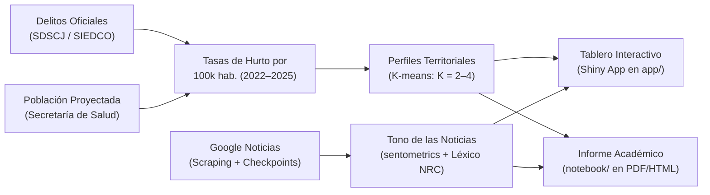

# Hurtos y Sentimiento Mediático en Bogotá (2022–2025)

**Trabajo Final — Taller de Programación en R (2026-02)**  
*Maestría en Economía Aplicada (MECA) — Universidad de los Andes*  

---

## Integrantes del Grupo

| Nombre Completo | Código Estudiantil |
| :--- | :---: |
| **Gabriel Arturo Echeverry Castaño** | `201016705` |
| **Olga Lucía Ramírez Contreras** | `202624900` |
| **Sergio Alejandro López Valderrama** | `202111932` |
| **Juan Esteban Carvajal Cruz** | `202614312` |
| **Miguelangel Palma** | `202621481` |
| **Juan José Echeverry** | `202616233` |

---

## 1. ¿De qué se trata este proyecto?

Queremos responder una pregunta concreta: **¿en las localidades de Bogotá donde más se registran hurtos, las noticias sobre inseguridad son más frecuentes y negativas?**

Para investigarlo, cruzamos los registros oficiales de delitos de la Secretaría de Seguridad (hurtos a personas, residencias y motos) con las noticias publicadas en prensa entre 2022 y 2025. Analizamos el tono de las noticias con procesamiento de lenguaje natural (`sentometrics`) y agrupamos las localidades con perfiles similares usando $K$-means.

El objetivo no es probar causalidad ni asumir que las noticias reflejan la opinión de la ciudadanía, sino comparar los datos de las denuncias oficiales con la historia que cuentan los medios de comunicación.



---

## 2. Dónde encontrar cada cosa

Si necesitas revisar los detalles de alguna parte del proyecto, aquí tienes los accesos directos:

| Si buscas información sobre... | Consulta este archivo | Qué contiene |
| :--- | :--- | :--- |
| **Propuesta y metodología** | [**`docs/propuesta_proyecto.md`**](file:///Users/juanjoseecheverry/Library/Mobile%20Documents/com~apple~CloudDocs/Universidad/Maestria%20%28MECA%29/Primer%20semestre/Taller%20R/Repo_Entrega_Final_Taller_R/docs/propuesta_proyecto.md) | Pregunta, hipótesis, fuentes, variables, sentometrics y plan de trabajo. |
| **Enunciados y rúbricas del curso** | [**`docs/README.md`**](file:///Users/juanjoseecheverry/Library/Mobile%20Documents/com~apple~CloudDocs/Universidad/Maestria%20%28MECA%29/Primer%20semestre/Taller%20R/Repo_Entrega_Final_Taller_R/docs/README.md) | Reglas oficiales y criterios de calificación de la [Semana 11](file:///Users/juanjoseecheverry/Library/Mobile%20Documents/com~apple~CloudDocs/Universidad/Maestria%20%28MECA%29/Primer%20semestre/Taller%20R/Repo_Entrega_Final_Taller_R/docs/enunciado_primera_entrega.md) y la [Semana 16](file:///Users/juanjoseecheverry/Library/Mobile%20Documents/com~apple~CloudDocs/Universidad/Maestria%20%28MECA%29/Primer%20semestre/Taller%20R/Repo_Entrega_Final_Taller_R/docs/enunciado_entrega_final_y_presentacion.md). |
| **Reglas de código del grupo** | [**`docs/estandares_programacion.md`**](file:///Users/juanjoseecheverry/Library/Mobile%20Documents/com~apple~CloudDocs/Universidad/Maestria%20%28MECA%29/Primer%20semestre/Taller%20R/Repo_Entrega_Final_Taller_R/docs/estandares_programacion.md) | Guía de estilo MECA: Outline `----`, rutas con `{here}`, paquetes y control de errores. |
| **Pipeline y scripts de R** | [**`scripts/README.md`**](file:///Users/juanjoseecheverry/Library/Mobile%20Documents/com~apple~CloudDocs/Universidad/Maestria%20%28MECA%29/Primer%20semestre/Taller%20R/Repo_Entrega_Final_Taller_R/scripts/README.md) | Orden en que corren los scripts y cómo funciona el orquestador `master.R`. |
| **Tablas de datos abiertos** | [**`scripts/01_ingesta/01_datos_abiertos/README.md`**](file:///Users/juanjoseecheverry/Library/Mobile%20Documents/com~apple~CloudDocs/Universidad/Maestria%20%28MECA%29/Primer%20semestre/Taller%20R/Repo_Entrega_Final_Taller_R/scripts/01_ingesta/01_datos_abiertos/README.md) | **Enlaces directos a las páginas web de los datos oficiales** y consultas con SQL. |
| **Cómo extraemos las noticias** | [**`scripts/01_ingesta/02_scraping_noticias/README.md`**](file:///Users/juanjoseecheverry/Library/Mobile%20Documents/com~apple~CloudDocs/Universidad/Maestria%20%28MECA%29/Primer%20semestre/Taller%20R/Repo_Entrega_Final_Taller_R/scripts/01_ingesta/02_scraping_noticias/README.md) | **Explicación paso a paso del scraping**: búsquedas con `+`, búsqueda mes a mes y cómo evitamos bloqueos. |
| **Estructura de las bases de datos** | [**`data/README.md`**](file:///Users/juanjoseecheverry/Library/Mobile%20Documents/com~apple~CloudDocs/Universidad/Maestria%20%28MECA%29/Primer%20semestre/Taller%20R/Repo_Entrega_Final_Taller_R/data/README.md) | Qué hay en `data/raw/` y en `data/processed/`, y por qué usamos formato Parquet. |
| **Informe Quarto en PDF** | [**`notebook/README.md`**](file:///Users/juanjoseecheverry/Library/Mobile%20Documents/com~apple~CloudDocs/Universidad/Maestria%20%28MECA%29/Primer%20semestre/Taller%20R/Repo_Entrega_Final_Taller_R/notebook/README.md) | Cómo compilar el documento de 3 páginas de la primera entrega. |
| **Aplicación interactiva Shiny** | [**`app/README.md`**](file:///Users/juanjoseecheverry/Library/Mobile%20Documents/com~apple~CloudDocs/Universidad/Maestria%20%28MECA%29/Primer%20semestre/Taller%20R/Repo_Entrega_Final_Taller_R/app/README.md) | Cómo correr el tablero interactivo en tu computador. |

---

## 3. Estructura de las carpetas

```text
Repo_Entrega_Final_Taller_R/
├── Repo_Entrega_Final_Taller_R.Rproj         # Proyecto de RStudio
├── README.md                                 # Esta guía principal
├── .gitignore                                # Archivos que Git no debe subir (temporales y datos pesados)
│
├── docs/                                     # Documentos del proyecto
│   ├── README.md                             # Índice de documentación
│   ├── propuesta_proyecto.md                 # Propuesta metodológica completa
│   ├── estandares_programacion.md            # Guía de estilo de código del equipo
│   ├── enunciado_primera_entrega.md          # Instrucciones y rúbrica de la Semana 11
│   └── enunciado_entrega_final_y_presentacion.md # Instrucciones de la presentación y entrega final
│
├── data/                                     # Bases de datos
│   ├── README.md                             # Explicación de los datos y formatos
│   ├── raw/                                  # Datos tal como bajan de las fuentes oficiales
│   │   ├── noticias/                         # Noticias guardadas mes a mes (.parquet)
│   │   ├── delitos_alto_impacto_raw.parquet  # Denuncias de hurtos (SDSCJ)
│   │   ├── poblacion_localidades_raw.parquet # Habitantes por localidad (SDS)
│   │   └── localidades_bogota_raw.geojson    # Mapas de las localidades (SDP)
│   └── processed/                            # Bases limpias listas para analizar (.parquet / .rds)
│
├── output/                                   # Resultados generados
│   ├── tables/                               # Tablas resumen (.csv, .tex)
│   └── figures/                              # Gráficos e imágenes (.png, .pdf)
│
├── scripts/                                  # Código en R
│   ├── README.md                             # Explicación del pipeline
│   ├── master.R                              # Script que corre todo el proyecto en orden
│   ├── 01_descarga_datos.R                   # Orquestador de descargas
│   ├── 01_ingesta/                           # Módulos de descarga
│   │   ├── 01_datos_abiertos/                # Consultas a la API de la Alcaldía
│   │   │   ├── README.md                     # Enlaces web a las tablas y explicación
│   │   │   └── datos_abiertos_bogota.R       # Descarga de delitos, población y mapas
│   │   └── 02_scraping_noticias/             # Extracción de noticias
│   │       ├── README.md                     # Metodología detallada de scraping
│   │       └── scraping_google_news.R        # Script con Selenium y guardado por lotes
│   ├── 02_limpieza_indicadores.R             # Cálculo de tasas de hurto por habitante
│   ├── 03_analisis_sentometrics.R            # Análisis de tono de las noticias
│   ├── 04_clustering_kmeans.R                # Agrupamiento de localidades por nivel de hurto
│   └── 05_export_insumos_shiny.R             # Prepara los datos que consume la app Shiny
│
├── notebook/                                 # Documentos Quarto
│   ├── README.md                             # Instrucciones para compilar
│   └── 01_entrega_1_propuesta_eda.qmd        # Primera Entrega (propuesta y EDA, máx. 3 páginas)
│
└── app/                                      # Aplicación Shiny
    ├── README.md                             # Cómo funciona el tablero
    ├── app.R                                 # Código de la aplicación (interfaz y servidor)
    └── www/                                  # Estilos visuales e imágenes
```

---

## 4. Entregas del curso (40% de la nota)

| Cuándo | Qué se entrega | Peso | Requisitos clave |
| :--- | :--- | :---: | :--- |
| **Semana 11** | **Primera Entrega: Propuesta y EDA** | **10%** | Documento Quarto (PDF de máximo 3 páginas) con pregunta, motivación, descripción de datos, plan de análisis y estadísticas con al menos 2 gráficos reales. |
| **Por definir** | **Presentación del avance** | **15%** | Exposición de 20 minutos en clase con diapositiva de resumen, descriptivos y metodología. Se envían las diapositivas 24 horas antes. |
| **Semana 16** | **Entrega Final: Informe + Script + Shiny** | **15%** | Documento académico (máx. 5 páginas + anexo), script reproducible de principio a fin y tablero interactivo en Shiny. |

---

## 5. Cómo correr el proyecto en tu computador (< 5 minutos)

### Paso 1: Abrir el proyecto
Abre el archivo [`Repo_Entrega_Final_Taller_R.Rproj`](file:///Users/juanjoseecheverry/Library/Mobile%20Documents/com~apple~CloudDocs/Universidad/Maestria%20%28MECA%29/Primer%20semestre/Taller%20R/Repo_Entrega_Final_Taller_R/Repo_Entrega_Final_Taller_R.Rproj) en RStudio. Así R sabrá automáticamente dónde está la raíz del proyecto sin necesidad de usar `setwd()`.

### Paso 2: Instalar paquetes necesarios
```r
paquetes <- c(
  "here", "conflicted", "arrow", "readr", "dplyr", "tidyr", "stringr",
  "ggplot2", "sentometrics", "sf", "shiny", "bslib", "DT", "leaflet",
  "httr", "jsonlite", "rvest", "RSelenium", "netstat", "glue", "lubridate"
)
install.packages(setdiff(paquetes, rownames(installed.packages())))
```

### Paso 3: Correr el pipeline de datos
```r
source(here::here("scripts", "master.R"))
```

### Paso 4: Compilar el informe en PDF (Entrega 1)
```bash
quarto render notebook/01_entrega_1_propuesta_eda.qmd --to pdf
```

### Paso 5: Abrir el tablero interactivo de Shiny
```r
shiny::runApp(here::here("app"))
```
