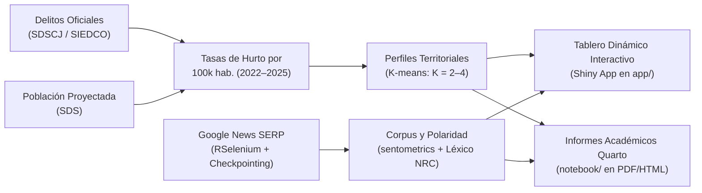

# Hurtos y Sentimiento Mediático en Bogotá (2022–2025)

**Trabajo Final — Taller de Programación en R (2026-02)**  
*Maestría en Economía Aplicada (MECA) — Facultad de Economía, Universidad de los Andes*  

---

## Integrantes del Grupo de Investigación

| Nombre Completo | Código Estudiantil | Correo Institucional |
| :--- | :---: | :---: |
| **Gabriel Arturo Echeverry Castaño** | `201016705` | `ga.echeverryc@uniandes.edu.co` |
| **Olga Lucía Ramírez Contreras** | `202624900` | `ol.ramirezc@uniandes.edu.co` |
| **Sergio Alejandro López Valderrama** | `202111932` | `sa.lopezv1@uniandes.edu.co` |
| **Juan Esteban Carvajal Cruz** | `202614312` | `je.carvajalc@uniandes.edu.co` |
| **Miguelangel Palma** | `202621481` | `m.palma@uniandes.edu.co` |
| **Juan José Echeverry** | `202616233` | `jj.echeverry@uniandes.edu.co` |

---

## 1. Resumen y Pregunta de Investigación

¿Cómo se relacionan los niveles de hurtos registrados y el tono de las noticias sobre inseguridad en las 19 localidades urbanas de Bogotá durante el periodo 2022–2025?  

Los delitos contra el patrimonio impactan directamente la calidad de vida, la inversión comercial y la movilidad ciudadana. No obstante, la intensidad y el tono del cubrimiento mediático no siempre reflejan fielmente la criminalidad real denunciada ante las autoridades. Este proyecto contrasta de manera empírica y reproducible los registros oficiales distritales con el sentimiento de la prensa digital:



* **Hipótesis exploratoria:** Las localidades con mayores tasas registradas de hurto enfrentan una cobertura noticiosa significativamente más recurrente y desfavorable (polaridad negativa).
* **Alcance:** Estudio descriptivo y analítico; no atribuye causalidad ni confunde cobertura periodística con percepción de la ciudadanía.

---

## 2. Mapa de Navegación: ¿A qué Documentación Dirigirse?

Para facilitar la auditoría y consulta en detalle, cada componente cuenta con su documentación especializada:

| Si necesitas consultar... | Documento / README a consultar | Descripción clave |
| :--- | :--- | :--- |
| **Propuesta académica y marco teórico** | [**`docs/propuesta_proyecto.md`**](file:///Users/juanjoseecheverry/Library/Mobile%20Documents/com~apple~CloudDocs/Universidad/Maestria%20%28MECA%29/Primer%20semestre/Taller%20R/Repo_Entrega_Final_Taller_R/docs/propuesta_proyecto.md) | Justificación, bases de datos, llaves de enlace, método `sentometrics`, clustering y cronograma. |
| **Enunciados y rúbricas del curso** | [**`docs/README.md`**](file:///Users/juanjoseecheverry/Library/Mobile%20Documents/com~apple~CloudDocs/Universidad/Maestria%20%28MECA%29/Primer%20semestre/Taller%20R/Repo_Entrega_Final_Taller_R/docs/README.md) | Índice con [Semana 11](file:///Users/juanjoseecheverry/Library/Mobile%20Documents/com~apple~CloudDocs/Universidad/Maestria%20%28MECA%29/Primer%20semestre/Taller%20R/Repo_Entrega_Final_Taller_R/docs/enunciado_primera_entrega.md) (límites de palabras y páginas) y [Semana 16](file:///Users/juanjoseecheverry/Library/Mobile%20Documents/com~apple~CloudDocs/Universidad/Maestria%20%28MECA%29/Primer%20semestre/Taller%20R/Repo_Entrega_Final_Taller_R/docs/enunciado_entrega_final_y_presentacion.md) (presentación e informe final). |
| **Estándares de código y buenas prácticas** | [**`docs/estandares_programacion.md`**](file:///Users/juanjoseecheverry/Library/Mobile%20Documents/com~apple~CloudDocs/Universidad/Maestria%20%28MECA%29/Primer%20semestre/Taller%20R/Repo_Entrega_Final_Taller_R/docs/estandares_programacion.md) | Reglas MECA: Document Outline (`----`), `{conflicted}`, `{here}`, pipe `|>`, tres capas de comentarios y `stopifnot`. |
| **Pipeline de scripts y ejecución** | [**`scripts/README.md`**](file:///Users/juanjoseecheverry/Library/Mobile%20Documents/com~apple~CloudDocs/Universidad/Maestria%20%28MECA%29/Primer%20semestre/Taller%20R/Repo_Entrega_Final_Taller_R/scripts/README.md) | Diagrama de flujo del pipeline, orquestador `master.R` y subcarpeta `scripts/01_ingesta/`. |
| **Detalle de microdatos y fuentes** | [**`data/README.md`**](file:///Users/juanjoseecheverry/Library/Mobile%20Documents/com~apple~CloudDocs/Universidad/Maestria%20%28MECA%29/Primer%20semestre/Taller%20R/Repo_Entrega_Final_Taller_R/data/README.md) | Diccionario de datos crudos (`data/raw/`), bases procesadas en Parquet y particionado de noticias. |
| **Cuadernos Quarto y compilación PDF** | [**`notebook/README.md`**](file:///Users/juanjoseecheverry/Library/Mobile%20Documents/com~apple~CloudDocs/Universidad/Maestria%20%28MECA%29/Primer%20semestre/Taller%20R/Repo_Entrega_Final_Taller_R/notebook/README.md) | Instrucciones para renderizar `01_entrega_1_propuesta_eda.qmd` cumpliendo el límite de 3 páginas. |
| **Tablero interactivo Shiny** | [**`app/README.md`**](file:///Users/juanjoseecheverry/Library/Mobile%20Documents/com~apple~CloudDocs/Universidad/Maestria%20%28MECA%29/Primer%20semestre/Taller%20R/Repo_Entrega_Final_Taller_R/app/README.md) | Arquitectura UI/Server con `bslib`, mapas y series temporales dinámicas. |

---

## 3. Estructura Maestra del Repositorio

```text
Repo_Entrega_Final_Taller_R/
├── Repo_Entrega_Final_Taller_R.Rproj         # Proyecto RStudio (rutas relativas con here)
├── README.md                                 # Guía maestra del repositorio y navegación
├── .gitignore                                # Exclusión de temporales, RStudio y datos pesados
│
├── docs/                                     # Documentación oficial y académica
│   ├── README.md                             # Índice central de documentos
│   ├── propuesta_proyecto.md                 # Propuesta metodológica del Grupo
│   ├── estandares_programacion.md            # Guía de estilo Tidyverse y auditoría MECA
│   ├── enunciado_primera_entrega.md          # Pautas oficiales y rúbrica (Semana 11)
│   └── enunciado_entrega_final_y_presentacion.md # Pautas exposición e informe (Semana 16)
│
├── data/                                     # Gestión de datos reproducibles
│   ├── README.md                             # Diccionario de fuentes, esquemas y formatos
│   ├── raw/                                  # Descargas crudas (APIs Socrata, GeoJSON)
│   │   ├── noticias/                         # Particionado mensual de noticias (.parquet)
│   │   ├── delitos_alto_impacto_raw.parquet  # Hurtos SDSCJ / SIEDCO
│   │   ├── poblacion_localidades_raw.parquet # Proyecciones demográficas SDS
│   │   └── localidades_bogota_raw.geojson    # Geometrías SDP
│   └── processed/                            # Bases consolidadas (.parquet / .rds)
│
├── output/                                   # Artefactos generados por el pipeline
│   ├── tables/                               # Tablas resumen y de clustering (.csv, .tex)
│   └── figures/                              # Figuras de alta resolución (.png, .pdf)
│
├── scripts/                                  # Pipeline modular de procesamiento en R
│   ├── README.md                             # Guía de ejecución del pipeline y dependencias
│   ├── master.R                              # Script orquestador general
│   ├── 01_descarga_datos.R                   # Coordinador del módulo de ingesta
│   ├── 01_ingesta/                           # Subcarpeta modular de descarga y web scraping
│   │   ├── datos_abiertos_bogota.R           # Consulta SoQL a API Socrata y exportación Parquet
│   │   └── scraping_google_news.R            # Scraping robusto con RSelenium y checkpointing
│   ├── 02_limpieza_indicadores.R             # Homologación territorial y cálculo de tasas
│   ├── 03_analisis_sentometrics.R            # Corpus y análisis de sentimiento textual
│   ├── 04_clustering_kmeans.R                # Perfiles no supervisados de criminalidad
│   └── 05_export_insumos_shiny.R             # Consolidación de datos procesados para Shiny
│
├── notebook/                                 # Cuadernos académicos Quarto
│   ├── README.md                             # Pautas de edición y compilación Quarto
│   └── 01_entrega_1_propuesta_eda.qmd        # Primera Entrega (propuesta y EDA, máx. 3 págs)
│
└── app/                                      # Aplicación interactiva Shiny
    ├── README.md                             # Documentación del tablero interactivo
    ├── app.R                                 # Código principal de la aplicación (UI + Server)
    └── www/                                  # Recursos estáticos web (CSS, logos)
```

---

## 4. Hitos Evaluativos del Curso (Total: 40%)

| Momento | Actividad | Ponderación | Entregables Requeridos |
| :--- | :--- | :---: | :--- |
| **Semana 11** | **Primera Entrega: Propuesta y EDA** | **10%** | Documento Quarto (PDF máx. 3 páginas) con pregunta ($\le 150$ palabras), motivación ($\le 150$), datos ($\le 150$), metodología ($\le 150$) y EDA/storytelling ($\le 700$ palabras con al menos 2 gráficos reales autocontenidos). |
| **Por asignar** | **Presentaciones de Avance** | **15%** | Exposición de 20 minutos con diapositiva estratégica de resumen, estadísticas descriptivas, análisis y metodología. Envío de presentación 24h antes y co-evaluación (5 min). |
| **Semana 16** | **Entrega Final: Informe + Script + Shiny** | **15%** | Documento académico (máx. 5 páginas + anexo), script reproducible de principio a fin y tablero interactivo ejecutable `ShinyApp`. |

---

## 5. Inicio Rápido y Reproducibilidad (< 5 minutos)

### Paso 1: Clonar y Abrir el Proyecto
Abrir el archivo [`Repo_Entrega_Final_Taller_R.Rproj`](file:///Users/juanjoseecheverry/Library/Mobile%20Documents/com~apple~CloudDocs/Universidad/Maestria%20%28MECA%29/Primer%20semestre/Taller%20R/Repo_Entrega_Final_Taller_R/Repo_Entrega_Final_Taller_R.Rproj) en RStudio para establecer la raíz del proyecto.

### Paso 2: Instalar Dependencias
```r
paquetes <- c(
  "here", "conflicted", "arrow", "readr", "dplyr", "tidyr", "stringr",
  "ggplot2", "sentometrics", "sf", "shiny", "bslib", "DT", "leaflet",
  "httr", "jsonlite", "rvest", "RSelenium", "netstat", "glue", "lubridate"
)
install.packages(setdiff(paquetes, rownames(installed.packages())))
```

### Paso 3: Ejecutar el Pipeline Completo
```r
source(here::here("scripts", "master.R"))
```

### Paso 4: Compilar el Informe Quarto (Entrega 1)
```bash
quarto render notebook/01_entrega_1_propuesta_eda.qmd --to pdf
```

### Paso 5: Lanzar el Tablero Interactivo Shiny
```r
shiny::runApp(here::here("app"))
```
