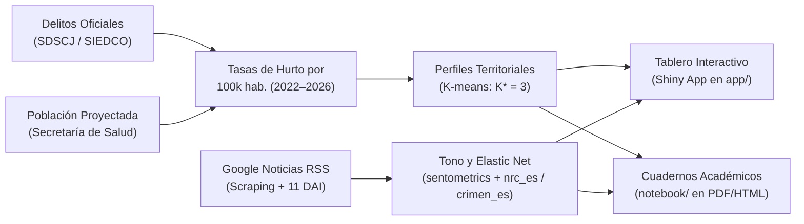

# Hurtos y Sentimiento Mediático en Bogotá (2022–2026)

**Trabajo Final — Taller de Programación en R (2026-02)**  
*Maestría en Economía Aplicada (MECA) — Universidad de los Andes*  

---

## Integrantes y Organización del Grupo

| Nombre Completo | Código Estudiantil | Sub-equipo de Trabajo | Rol en el Proyecto |
| :--- | :---: | :--- | :--- |
| **Miguelangel Palma** | `202621481` | Datos y Modelado | Facilitador de coordinación |
| **Gabriel Arturo Echeverry Castaño** | `201016705` | Datos y Modelado | Ingesta de datos y modelado |
| **Juan Esteban Carvajal Cruz** | `202614312` | Datos y Modelado | Ingesta de datos y modelado |
| **Juan José Echeverry** | `202616233` | NLP y Visualización | Facilitador de coordinación |
| **Sergio Alejandro López Valderrama** | `202111932` | NLP y Visualización | Modelado NLP y desarrollo Shiny |
| **Olga Lucía Ramírez Contreras** | `202624900` | NLP y Visualización | Modelado NLP y desarrollo Shiny |

> 📌 Para consultar el cronograma detallado (cierre al 17 de noviembre), las responsabilidades por hito y el protocolo colaborativo de Git, consulta el [**Plan de Trabajo Colaborativo**](docs/proyecto/plan_de_trabajo.md).

---

## 1. ¿De qué se trata este proyecto?

Queremos responder una pregunta concreta: **¿en las localidades de Bogotá donde más se registran hurtos, las noticias sobre inseguridad son más frecuentes y negativas?**

Para investigarlo, cruzamos los registros oficiales de delitos de la Secretaría de Seguridad (hurtos a personas, residencias y motos) con las noticias publicadas en prensa entre enero de 2022 y septiembre de 2026 (3.916 noticias únicas en las 19 localidades urbanas). Analizamos el tono de las noticias con procesamiento de lenguaje natural y regresión penalizada Elastic Net (`sentometrics`), y agrupamos las localidades con perfiles similares usando $K$-means ($K^* = 3$).

El objetivo no es probar causalidad ni asumir que las noticias reflejan la opinión de la ciudadanía, sino comparar los datos de las denuncias oficiales con la historia que cuentan los medios de comunicación.



---

## 2. Dónde encontrar cada cosa

Si necesitas revisar los detalles de alguna parte del proyecto, aquí tienes los accesos directos:

| Si buscas información sobre... | Consulta este archivo | Qué contiene |
| :--- | :--- | :--- |
| **Plan de trabajo y sub-equipos** | [**`docs/proyecto/plan_de_trabajo.md`**](docs/proyecto/plan_de_trabajo.md) | Distribución en dos sub-equipos de 3, facilitadores, cronograma con hitos al 17 de noviembre y flujo en Git. |
| **Propuesta y metodología** | [**`docs/proyecto/propuesta_proyecto.md`**](docs/proyecto/propuesta_proyecto.md) | Pregunta, hipótesis, fuentes, variables, `sentometrics` y plan de análisis. |
| **Enunciados y rúbricas del curso** | [**`docs/enunciados/README.md`**](docs/enunciados/README.md) | Reglas oficiales organizadas por hito: [Primera Entrega](docs/enunciados/01_primera_entrega/enunciado_primera_entrega.md), [Entrega Final](docs/enunciados/02_entrega_final_y_presentacion/enunciado_entrega_final_y_presentacion.md) y [Asignaciones Grupo 3 ↔ Grupo 1](docs/enunciados/03_asignaciones_y_coevaluacion/asignaciones_rubrica_plenaria.md). |
| **Documentación de sentometrics** | [**`docs/sentometrics/README.md`**](docs/sentometrics/README.md) | Paper JSS de Ardia et al. (2021), manual oficial de CRAN y resumen metodológico del paquete. |
| **Diccionario de datos** | [**`docs/diccionario_datos/README.md`**](docs/diccionario_datos/README.md) | Esquema campo a campo, llaves (`PK`/`FK`), linaje y diagrama ER de las 4 capas de datos. |
| **Reglas de código del grupo** | [**`docs/guias/estandares_programacion.md`**](docs/guias/estandares_programacion.md) | Guía de estilo MECA: Outline `----`, rutas con `{here}`, `{conflicted}` y control con `stopifnot()`. |
| **Pipeline y scripts de R** | [**`scripts/README.md`**](scripts/README.md) | Flujo secuencial y descripción de módulos de ingesta, procesamiento, clustering, `sentometrics` y Shiny. |
| **Ingesta de delitos y población** | [**`scripts/01_ingesta/01_delitos/`**](scripts/01_ingesta/01_delitos/README.md) · [**`02_poblacion/`**](scripts/01_ingesta/02_poblacion/README.md) | Descarga de la capa cartográfica/delictiva SDSCJ y proyecciones poblacionales de la SDS. |
| **Scraping de Google News RSS** | [**`scripts/01_ingesta/03_noticias/README.md`**](scripts/01_ingesta/03_noticias/README.md) | Extracción RSS por localidad, filtros contra homonimias y deduplicación dual (3.916 noticias). |
| **Estructura de las bases de datos** | [**`data/README.md`**](data/README.md) · [**`data/processed/README.md`**](data/processed/README.md) | Detalle de `data/raw/`, `data/processed/` (Parquet y 2 artefactos `.rds` consolidados). |
| **Cuadernos Quarto (PDF/HTML)** | [**`notebook/README.md`**](notebook/README.md) | Entrega 1, Cuaderno metodológico `02`, guía de estudio `05` y guías de código `03`–`07`. |
| **Aplicación interactiva Shiny** | [**`app/README.md`**](app/README.md) | Cómo ejecutar y navegar las 6 pestañas del tablero interactivo. |

---

## 3. Estructura de las carpetas

```text
Repo_Entrega_Final_Taller_R/
├── Repo_Entrega_Final_Taller_R.Rproj         # Proyecto de RStudio
├── README.md                                 # Esta guía principal
├── .gitignore                                # Archivos que Git no debe subir (temporales y datos pesados)
│
├── docs/                                     # Documentos del proyecto
│   ├── README.md                             # Índice general de documentación
│   ├── enunciados/                           # Pautas oficiales, rúbricas y asignaciones por etapa
│   │   ├── README.md                         # Índice de enunciados y cronograma de Grupo 3
│   │   ├── 01_primera_entrega/               # Enunciado .docx/.md + retroalimentación evaluada
│   │   ├── 02_entrega_final_y_presentacion/  # Enunciado .docx/.md de Documento Final y Presentación
│   │   └── 03_asignaciones_y_coevaluacion/   # Cronograma plenarias (18 y 25 nov) y rúbricas oficiales
│   ├── proyecto/                             # Planificación y formulación de la investigación
│   │   ├── README.md                         # Visión general y sub-equipos
│   │   ├── propuesta_proyecto.md             # Propuesta metodológica completa
│   │   └── plan_de_trabajo.md                # Plan de trabajo de los sub-equipos (Cierre 17-Nov)
│   ├── sentometrics/                         # Literatura y manuales de sentometrics
│   │   ├── README.md                         # Explicación del paquete, repo GitHub y sitio web
│   │   ├── paper_sentometrics_jss_2021.pdf   # Paper publicado en Journal of Statistical Software (JSS)
│   │   └── manual_referencia_sentometrics_cran.pdf # Manual de referencia oficial de CRAN (v1.0.1)
│   ├── guias/                                # Estándares y directrices técnicas
│   │   ├── README.md                         # Principios de reproducibilidad
│   │   └── estandares_programacion.md        # Guía de estilo de código del equipo
│   └── diccionario_datos/                    # Diccionario de datos completo (4 capas)
│       ├── README.md                         # Índice maestro, llaves PK/FK y diagrama ER
│       ├── 01_datos_crudos.md                # Fuentes primarias en data/raw/
│       ├── 02_tablas_procesadas.md           # Paneles mensuales/anuales y microdatos Parquet
│       ├── 03_artefactos_sentometrics_shiny.md # Artefactos .rds consolidados y bundle Shiny
│       └── 04_tablas_salida.md               # Tablas CSV de perfiles, sensibilidad y auditoría
│
├── data/                                     # Bases de datos
│   ├── README.md                             # Explicación de los datos y formatos
│   ├── raw/                                  # Insumos crudos organizados por fuente
│   │   ├── delitos/                          # Microdatos SIEDCO (SIEDCO.csv) y polígonos SDSCJ (localidades_bogota_raw.geojson)
│   │   ├── poblacion/                        # Proyecciones SDS (poblacion_localidades_raw.parquet)
│   │   └── noticias/                         # Noticias consolidadas (noticias_google_news_consolidado.*)
│   └── processed/                            # Bases limpias listas para analizar
│       ├── README.md                         # Diccionario de datos y objetos S3 (.rds)
│       ├── 01_delitos/                       # Conteo mensual de hurtos (delitos_localidad_mensual.parquet)
│       ├── 02_poblacion/                     # Panel mensual y tasas/100k (panel_delitos_poblacion_mensual.parquet)
│       ├── 03_noticias/                      # Corpus depurado (noticias_procesadas.parquet: 3.916 notas, 993 objetivo)
│       ├── sentometrics_pipeline.rds         # Bundle S3 único de sentometrics (corpus objetivo, 36 series y Elastic Net)
│       ├── panel_consolidado_localidad_anual.parquet  # Fusión anual de tasas delictivas y sentimiento objetivo
│       ├── clusters_localidades_kmeans.parquet        # Asignaciones de clústeres K-means (K* = 3)
│       └── datos_consolidados_shiny.rds               # Insumo consolidado para la aplicación Shiny
│
├── output/                                   # Resultados generados y entregables del curso
│   ├── tables/                               # 8 tablas CSV (K-Means, sensibilidad, descriptivos y DAI)
│   ├── figures/                              # Figuras exploratorias (figura1..9) y K-Means (kmeans_*.png)
│   └── entregas/                             # Entregables académicos de Grupo 3 + checklist maestro
│       ├── README.md                         # Checklist completo de qué entregar, fechas y formatos
│       ├── 01_primera_entrega/               # Propuesta (QMD/HTML/PDF), copia evaluada y respuestas
│       ├── 02_coevaluacion_grupo_1/          # Guion y plantilla Word (.docx) de 4 min (mié 18 nov)
│       ├── 03_presentacion_plenaria/         # Plantilla PowerPoint (.pptx) de 15 min (mié 25 nov)
│       └── 04_documento_final/               # Plantillas Quarto (.qmd/.pdf) y Word (.docx) máx. 5 págs + Anexos
│
├── scripts/                                  # Código en R
│   ├── README.md                             # Explicación del pipeline
│   ├── master.R                              # Orquestador reproducible de punta a punta
│   ├── 01_ingesta/                           # Exclusivo para descarga de datos crudos
│   │   ├── 01_delitos/                       # Ingesta de delitos oficiales (SDSCJ)
│   │   ├── 02_poblacion/                     # Ingesta de proyecciones demográficas (SDS)
│   │   └── 03_noticias/                      # Ingesta y scraping de prensa (Google News RSS)
│   ├── 02_procesamiento/                     # Transformación de datos raw a processed
│   │   ├── 01_delitos/                       # Procesamiento de delitos SIEDCO
│   │   ├── 02_poblacion/                     # Procesamiento demográfico y cálculo mensual de tasas
│   │   └── 03_noticias/                      # Limpieza de texto y depuración DAI
│   ├── 03_analisis_sentometrics.R            # Pipeline completo sentometrics (corpus 993 docs, 36 series, Elastic Net -> sentometrics_pipeline.rds)
│   ├── 04_clustering_kmeans.R                # Clustering K-means (K* = 3) y sensibilidad Tidymodels
│   ├── 05_export_insumos_shiny.R             # Empaquetado de artefactos para Shiny
│   └── 06_descriptivos_corpus.R              # Estadísticos descriptivos del corpus (corpus_summarize)
│
├── notebook/                                 # Cuadernos metodológicos en Quarto
│   ├── README.md                             # Instrucciones para compilar y guía de cuadernos
│   └── metodologia/                          # Cuadernos metodológicos y guías de estudio/código
│       ├── 02_modelado_clustering_sentometrics.* # Tasas, clustering K-means y Sentometrics (QMD, HTML, PDF)
│       ├── guia_estudio/
│       │   └── 05_guia_estudio_sustentacion.* # Guía de estudio para sustentación (QMD, PDF)
│       └── instrucciones_codigo/             # Guías línea a línea en PDF (03 a 07) y fuentes en qmd/
│           ├── 03_ingesta_tasas_poblacion.pdf
│           ├── 04_modelo_kmeans_clusters.pdf
│           ├── 05_flujo_delitos_ingesta_procesamiento.pdf
│           ├── 06_flujo_noticias_scraping_procesamiento.pdf
│           ├── 07_flujo_sentometrics_elasticnet_shiny.pdf
│           └── qmd/                          # Cuadernos fuente (.qmd) 03 a 07

└── app/                                      # Aplicación Shiny ("Bogo-Atrack")
    ├── README.md                             # Cómo funciona el tablero
    ├── app.R                                 # Código de la aplicación (interfaz y servidor)
    └── www/                                  # Hojas de estilo CSS (custom.css)
```

---

## 4. Entregas del curso (Grupo 3 — ver [Checklist detallado](output/entregas/README.md))

| Cuándo | Qué se entrega | Formato / Alcance | Requisitos clave |
| :--- | :--- | :--- | :--- |
| **Semana 11 (24 oct)** | **Primera Entrega: Propuesta y EDA (10 %)** | PDF máx. 3 págs (`output/entregas/01_primera_entrega/`) | Pregunta, motivación, datos, plan de análisis, $\ge 2$ gráficos y réplica metodológica al evaluador. |
| **Mié 18 nov (6:25 p. m.)** | **Co-evaluación al Grupo 1** | Oral 4 min (`02_coevaluacion_grupo_1/`) | Resumen (25 %), $\ge 2$ elogios concretos (25 %), $\ge 2$ mejoras viables (30 %); todos presentes (2 escogidos al azar). |
| **Mié 25 nov (6:25 p. m.)** | **Presentación Plenaria (Grupo 3)** | `.pptx` 15 min (`03_presentacion_plenaria/`) | Enviar **24 h antes (mar 24 nov, 7:30 p. m.)** al equipo pedagógico y Grupo 1; exponen todos los 6 integrantes. |
| **Semana 16 / Cierre** | **Documento Final + Script + Shiny (`Bogo-Atrack`)** | Máx. 5 págs + Anexos (`04_documento_final/`) | Informe en `.qmd`/`.pdf` o `.docx`, `scripts/master.R`, `app/app.R` y trazabilidad de retroalimentación (Criterio 7: 15 %). |

---

## 5. Cómo correr el proyecto en tu computador (< 5 minutos)

### Paso 1: Abrir el proyecto
Abre el archivo [`Repo_Entrega_Final_Taller_R.Rproj`](Repo_Entrega_Final_Taller_R.Rproj) en RStudio. Así R sabrá automáticamente dónde está la raíz del proyecto sin necesidad de usar `setwd()`.

### Paso 2: Instalar paquetes necesarios
```r
paquetes <- c(
  "here", "conflicted", "arrow", "readr", "dplyr", "tidyr", "stringr",
  "stringi", "data.table", "ggplot2", "plotly", "sentometrics", "syuzhet",
  "glmnet", "cluster", "tidymodels", "mclust", "sf", "shiny", "bslib",
  "DT", "leaflet", "httr", "jsonlite", "rvest", "xml2", "glue", "lubridate"
)
install.packages(setdiff(paquetes, rownames(installed.packages())))
```

### Paso 3: Correr el pipeline de datos completo
```r
source(here::here("scripts", "master.R"))
```

### Paso 4: Compilar los cuadernos Quarto (HTML / PDF)
```bash
# Primera Entrega (PDF académico):
quarto render output/entregas/01_primera_entrega/01_entrega_1_propuesta_eda.qmd --to pdf

# Plantilla Documento Final (PDF máx. 5 págs + Anexos):
quarto render output/entregas/04_documento_final/documento_final_grupo_3.qmd --to pdf

# Cuaderno metodológico integral (HTML y PDF):
quarto render notebook/metodologia/02_modelado_clustering_sentometrics.qmd --to html
quarto render notebook/metodologia/02_modelado_clustering_sentometrics.qmd --to pdf

# Guía de estudio para sustentación:
quarto render notebook/metodologia/guia_estudio/05_guia_estudio_sustentacion.qmd --to pdf
```

### Paso 5: Abrir el tablero interactivo de Shiny
```r
shiny::runApp(here::here("app"))
```
