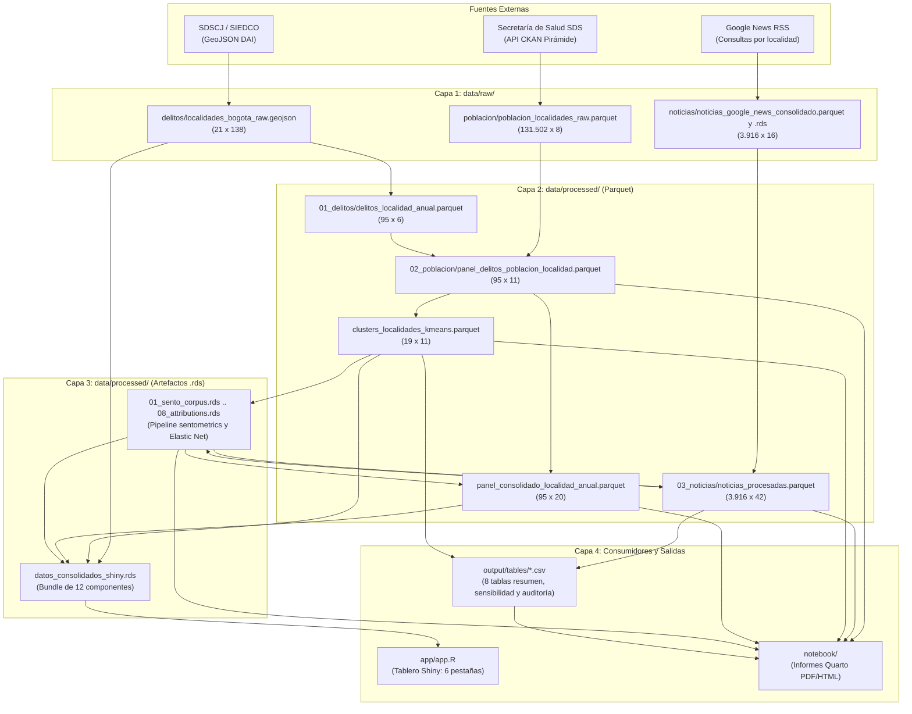
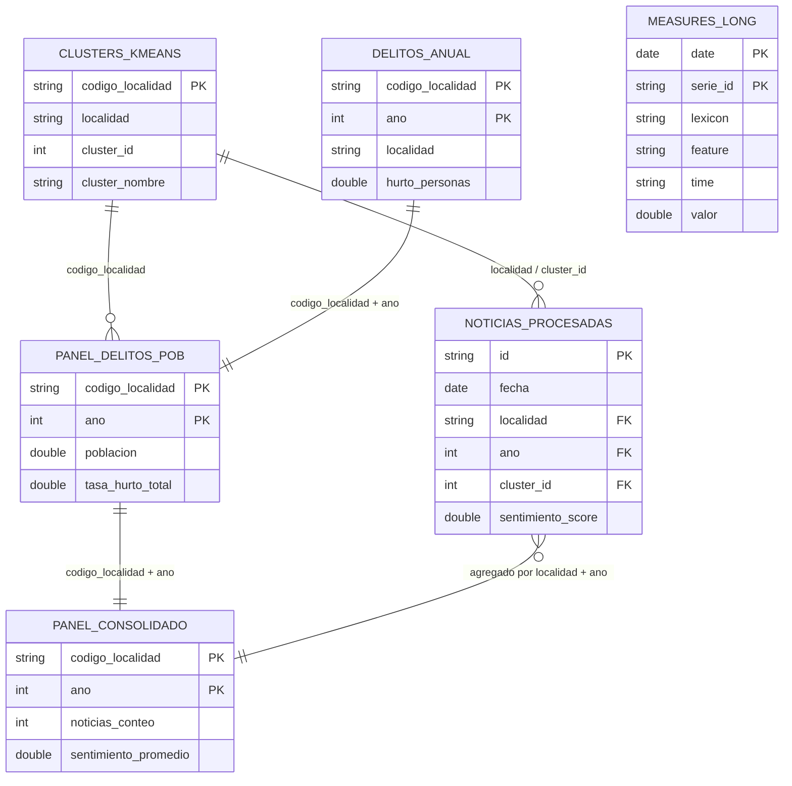

# Diccionario de Datos del Proyecto

**Proyecto:** Hurtos y Sentimiento Mediático en Bogotá (2022–septiembre de 2026)  
**Programa:** Maestría en Economía Aplicada (MECA) — *Taller de Programación en R*  
**Audiencia:** Evaluadores académicos, investigadores y equipo de desarrollo

---

## 1. Propósito y Alcance

Este diccionario documenta de manera integral todas las tablas, capas espaciales, objetos analíticos de `sentometrics` y archivos de salida empleados en el proyecto. Para cada conjunto de datos se detallan su **propósito y uso en el pipeline**, **unidad de observación (grano)**, **dimensiones verificadas**, **llaves de cruce (`PK`/`FK`)**, **linaje de generación y consumo**, **controles de calidad** y la **especificación campo a campo**.

El alcance cubre cuatro capas secuenciales que abarcan el periodo **enero de 2022 – septiembre de 2026** sobre las **19 localidades urbanas de Bogotá D.C.**:

| Capa | Ubicación en el repositorio | Contenido | Documento detallado |
| :--- | :--- | :--- | :--- |
| **1. Datos Crudos** | `data/raw/` | 3 fuentes primarias (4 archivos: GeoJSON vectorial, Parquet demográfico, Parquet/RDS de prensa) | [`01_datos_crudos.md`](./01_datos_crudos.md) |
| **2. Tablas Procesadas** | `data/processed/*.parquet` | 5 paneles y microdatos limpios en Apache Parquet | [`02_tablas_procesadas.md`](./02_tablas_procesadas.md) |
| **3. Artefactos `sentometrics` y Shiny** | `data/processed/*.rds` | 9 artefactos del contrato `sentometrics` (`01` a `08`) y 1 bundle integral para Shiny | [`03_artefactos_sentometrics_shiny.md`](./03_artefactos_sentometrics_shiny.md) |
| **4. Tablas de Salida** | `output/tables/*.csv` | 8 tablas resumen, sensibilidad $K$-means y auditoría exportadas en CSV | [`04_tablas_salida.md`](./04_tablas_salida.md) |

---

## 2. Arquitectura y Flujo de Datos

El siguiente diagrama muestra cómo fluyen y se transforman las tablas desde las fuentes externas hasta la aplicación Shiny, los cuadernos Quarto y las tablas de salida:

---

## 3. Modelo Relacional y Llaves de Cruce (`PK` / `FK`)

Todas las tablas del proyecto se integran alrededor de dos ejes: el **eje territorial-anual** (19 localidades urbanas × 5 años) y el **eje documental-mensual** (3.916 noticias y 52 meses efectivos tras la ventana móvil de 6 meses).

### Convención de Llaves Canónicas

| Llave | Formato y dominio | Tablas donde participa | Nota de homologación |
| :--- | :--- | :--- | :--- |
| `codigo_localidad` | Texto de 2 dígitos con cero a la izquierda (`"01"` a `"19"`) | `delitos_localidad_anual`, `panel_delitos_poblacion_localidad`, `clusters_localidades_kmeans`, `panel_consolidado_localidad_anual`, `geometrias` | En `localidades_bogota_raw.geojson` equivale a `CMIULOCAL`; en `poblacion_localidades_raw.parquet` proviene de `CODIGO_LOCALIDAD` numérico (`1..19`). Se excluyen `"00"`/`0` (Bogotá), `"20"` (Sumapaz) y `"99"` (Sin Localización). |
| `localidad` | Texto en Title Case con tildes oficiales (19 valores) | Todas las tablas analíticas de localidades, noticias y salida CSV | Homologa `"Candelaria"` (GeoJSON) a `"La Candelaria"` y corrige tildes faltantes (`Usaquén`, `San Cristóbal`, `Engativá`, `Fontibón`, `Los Mártires`, `Antonio Nariño`, `Ciudad Bolívar`). |
| `localidad_slug` | Identificador ASCII en `snake_case` sin guiones (`-`) | `noticias_procesadas.parquet` | Usa `"candelaria"` para La Candelaria (definido en `localidades_canonicas` de [`procesamiento_noticias.R`](../../scripts/02_procesamiento/03_noticias/procesamiento_noticias.R)). En cambio, los features `loc_*` de `sentometrics` se derivan de `localidad` y producen `loc_la_candelaria`. |
| `año` | Entero / numérico (`2022` a `2026`) | Paneles anuales, noticias y tablas de salida CSV | En `2026`, tanto los delitos SDSCJ como las noticias tienen corte a **septiembre de 2026**. |
| `id` | Texto secuencial `"doc_1"` a `"doc_3916"` | `noticias_procesadas.parquet`, `01_sento_corpus.rds`, `03_sentiment_scores.rds`, `04_peak_docs.rds`, `05_sento_measures.rds` (`attribWeights$W`) | Asignado determinísticamente tras ordenar por `(localidad, fecha)` en `procesamiento_noticias.R`. |
| `date` | `Date` (`YYYY-MM-DD`) | `01_sento_corpus`, `03_sentiment_scores`, `05_sento_measures`, `06_measures_*`, `07_global_index`, `08_attributions` | En series mensuales corresponde al primer día del mes (`2022-06-01` a `2026-09-01`, 52 meses efectivos tras `lag = 6`). |
| `serie_id` | `"<lexicon>--<feature>--<time>"` (364 combinaciones) | `05_sento_measures`, `06_measures_long`, `06_measures_wide`, `08_attributions$coeficientes` | Separador reservado `--` de `sentometrics`; exige que los nombres de `feature` no contengan guiones medios (`-`). |

---

## 4. Catálogo Maestro de Tablas y Artefactos

| Archivo (ruta relativa desde la raíz) | Formato / Clase | Filas × Cols | Grano | Script generador | Uso principal |
| :--- | :---: | :---: | :--- | :--- | :--- |
| `data/raw/delitos/localidades_bogota_raw.geojson` | GeoJSON (`sf`) | `21 × 138` | Localidad (incl. 20 y 99) | `descarga_delitos_sdscj.R` | Fuente primaria de delitos DAI (2018–2026) y geometrías poligonales |
| `data/raw/poblacion/poblacion_localidades_raw.parquet` | Parquet | `131.502 × 8` | Año × Loc × Sexo × Edad | `descarga_poblacion_sds.R` | Fuente primaria de proyecciones poblacionales SDS (2005–2035) |
| `data/raw/noticias/noticias_google_news_consolidado.parquet` | Parquet | `3.916 × 16` | Artículo deduplicado | `scraping_google_news.R` | Base cruda consolidada de prensa digital (2022–sep. 2026) |
| `data/raw/noticias/noticias_google_news_consolidado.rds` | RDS (`tbl_df`) | `3.916 × 16` | Artículo deduplicado | `scraping_google_news.R` | Respaldo binario R idéntico al archivo Parquet anterior |
| `data/processed/01_delitos/delitos_localidad_anual.parquet` | Parquet | `95 × 6` | Localidad × Año | `procesamiento_delitos.R` | Conteo anual oficial de hurtos a personas, residencias y motos |
| `data/processed/02_poblacion/panel_delitos_poblacion_localidad.parquet` | Parquet | `95 × 11` | Localidad × Año | `procesamiento_poblacion.R` | Panel con población anual y tasas por 100.000 habitantes |
| `data/processed/03_noticias/noticias_procesadas.parquet` | Parquet | `3.916 × 42` | Artículo (`id`) | `procesamiento_noticias.R` + `03_analisis_sentometrics.R` | Corpus depurado, clasificación oficial 11 DAI, scores y clúster |
| `data/processed/clusters_localidades_kmeans.parquet` | Parquet | `19 × 11` | Localidad | `04_clustering_kmeans.R` | Perfiles territoriales $K$-means ($K^* = 3$) y siluetas |
| `data/processed/panel_consolidado_localidad_anual.parquet` | Parquet | `95 × 20` | Localidad × Año | `03_analisis_sentometrics.R` | Fusión final de tasas delictivas y métricas anuales de prensa |
| `data/processed/01_sento_corpus.rds` | RDS (`sento_corpus`) | `3.916 docs` (`27` docvars) | Artículo (`id`) | `03_analisis_sentometrics.R` | Corpus estructurado con 26 features binarias para `sentometrics` |
| `data/processed/02_lexicons_es.rds` | RDS (`sento_lexicons`) | 3 tablas + 1 atr. | Palabra (`x`) | `03_analisis_sentometrics.R` | Léxicos `nrc_es`, `crimen_es` y modificadores de valencia (`t = 1..4`) |
| `data/processed/03_sentiment_scores.rds` | RDS (`sentiment`) | `3.916 × 55` | Artículo (`id`) | `03_analisis_sentometrics.R` | Puntajes documentales `proportionalPol` por léxico × feature |
| `data/processed/04_peak_docs.rds` | RDS (`list`) | 3 vec. + 2 tablas | Artículo (`id`) | `03_analisis_sentometrics.R` | Noticias extremas (`peakdocs()`) y catálogo enriquecido para Shiny |
| `data/processed/05_sento_measures.rds` | RDS (`sento_measures`) | `52 × 365` (`measures`) | Mes (`date`) | `03_analisis_sentometrics.R` | 364 series mensuales (`2 × 26 × 7`) y pesos documentales/temporales |
| `data/processed/06_measures_long.rds` | RDS (`list`) | `18.928 × 9` (`long`) / `52 × 365` (`wide`) | Mes × Serie | `03_analisis_sentometrics.R` | Series continuas en formato largo y ancho listas para graficar |
| `data/processed/06_measures_wide.rds` | RDS (`data.table`) | `52 × 365` | Mes (`date`) | `03_analisis_sentometrics.R` | Matriz ancha independiente de las 364 series mensuales |
| `data/processed/07_global_index.rds` | RDS (`list`) | `52 × 7` (`serie_global`) + 3 vec. | Mes (`date`) | `03_analisis_sentometrics.R` | Índice distrital ponderado de polaridad y fechas de alarma (`peakdates()`) |
| `data/processed/08_attributions.rds` | RDS (`list`) | 8 componentes | Mes (`date`) / Variable | `03_analisis_sentometrics.R` | Modelo Elastic Net (`BIC`, `h = 1`), ajuste temporal, betas y atribuciones |
| `data/processed/datos_consolidados_shiny.rds` | RDS (`list`) | 12 componentes | Mixto | `05_export_insumos_shiny.R` | Bundle único precalculado que consume `app/app.R` al iniciar |
| `output/tables/tabla_clustering_kmeans_perfiles.csv` | CSV | `19 × 11` | Localidad | `04_clustering_kmeans.R` | Espejo CSV de `clusters_localidades_kmeans.parquet` |
| `output/tables/tabla_sensibilidad_escalamientos_pca.csv` | CSV | `5 × 8` | Espacio / Escalamiento | `04_clustering_kmeans.R` | Sensibilidad de $K$-means a 5 escalamientos (`Z-score`, `Min-Max`, Robusto, `Log+Z`, PCA 2D) |
| `output/tables/tabla_comparacion_modelos_distancias.csv` | CSV | `6 × 7` | Modelo × Distancia | `04_clustering_kmeans.R` | Comparación entre `K-Means`, `PAM` (Euclidiana/Manhattan), `AGNES` (`Ward.D2`) y `GMM` |
| `output/tables/tabla_asignaciones_modelos_localidad.csv` | CSV | `19 × 11` | Localidad | `04_clustering_kmeans.R` | Asignación comparativa de clústeres por localidad en los 7 modelos evaluados |
| `output/tables/tabla_descriptivos_corpus.csv` | CSV | `5 × 7` | Año (`2022..2026`) | `06_descriptivos_corpus.R` | Resumen anual del corpus (noticias, DAI estricto, longitud, tono) |
| `output/tables/tabla_reclasificacion_dai.csv` | CSV | `122 × 3` | Categoría cruda × SDSCJ | `procesamiento_noticias.R` | Matriz de transición entre clasificación inicial y oficial SDSCJ |
| `output/tables/tabla_conteo_localidad_anio_dai.csv` | CSV | `95 × 5` | Localidad × Año | `procesamiento_noticias.R` | Auditoría de cobertura DAI (amplio, estricto y corte ene–sep) |
| `output/tables/muestra_validacion_manual_dai.csv` | CSV | `195 × 10` | Artículo muestreado | `procesamiento_noticias.R` | Muestra estratificada (13 clases × 15 noticias) para validación manual |

---

## 5. Mapa de Consumo por Entregable

| Consumidor | Archivos / Objetos leídos | Propósito de consumo |
| :--- | :--- | :--- |
| **`app/app.R`** (6 pestañas) | `data/processed/datos_consolidados_shiny.rds` | Pestaña *Panorama* (`panel_localidades`, `geometrias`); *Mi localidad* (`panel_localidades`, `peak_docs$tabla_completa`); *Hurto vs. prensa* (`panel_localidades`); *Clusters* (`panel_localidades`, `geometrias`); *Sentometrics y Elastic Net* (`measures_long`, `global_index$peakdates_neg`, `attributions`); *Datos y método* (`peak_docs$tabla_completa` y estadísticas del corpus). |
| **`notebook/entregas/01_entrega_1_propuesta_eda.qmd`** | `panel_consolidado_localidad_anual.parquet`, `noticias_procesadas.parquet` | Estadísticas descriptivas del panel (95 obs.) y gráficos exploratorios de la Primera Entrega. |
| **`notebook/metodologia/02_modelado_clustering_sentometrics.qmd`** | `panel_delitos_poblacion_localidad.parquet`, `noticias_procesadas.parquet`, `clusters_localidades_kmeans.parquet`, `tabla_descriptivos_corpus.csv`, `01_sento_corpus.rds` .. `08_attributions.rds`, `datos_consolidados_shiny.rds` | Cuaderno técnico completo: cálculo de tasas, diagnóstico de silueta $K$-means, descriptivos del corpus (`tbl-descriptivos-corpus-anual`), auditoría del contrato S3 de `sentometrics` y análisis del modelo Elastic Net. |
| **`scripts/06_descriptivos_corpus.R`** | `noticias_procesadas.parquet`, `01_sento_corpus.rds` | Generación de las figuras `figura3` a `figura9` en `output/figures/` y de `tabla_descriptivos_corpus.csv`. |

---

## 6. Reglas Transversales de Integridad y Negocio

1. **Ámbito geográfico urbano (19 localidades):** Todo análisis de delitos, tasas, clustering y cobertura excluye a **Sumapaz** (`codigo_localidad = "20"`, zona rural de páramo) y los registros **Sin Localización** (`codigo_localidad = "99"`), así como el agregado distrital (`CODIGO_LOCALIDAD = 0`) en población.
2. **Corte temporal del año 2026:** Tanto los delitos oficiales de la SDSCJ (`CMMES = "Ene-Sep (2018vs2026)"`) como el scraping de Google News abarcan hasta el **30 de septiembre de 2026** (`2026-09-30`). Las comparaciones interanuales frente a 2026 deben tener presente este corte parcial de nueve meses.
3. **Nomenclatura compatible con `sentometrics`:** Ninguna feature del corpus (`c_*`, `tema_*`, `loc_*`) puede contener guiones medios (`-`), ya que `sentometrics` reserva `--` para concatenar `<lexicon>--<feature>--<time>`.
4. **Cero valores nulos en llaves y texto analítico:** Los scripts validan mediante `stopifnot()` la ausencia de `NA` en `codigo_localidad`, `localidad`, `año`, `id`, `date`/`fecha`, `texto_completo_nlp` y tasas de hurto.
5. **Reproducibilidad desde sesión limpia:** El pipeline maestro [`scripts/master.R`](../../scripts/master.R) ejecuta secuencialmente los módulos de procesamiento (`02_procesamiento/`), clustering (`04_clustering_kmeans.R`), `sentometrics` (`03_analisis_sentometrics.R`), descriptivos (`06_descriptivos_corpus.R`) y empaquetado Shiny (`05_export_insumos_shiny.R`) usando rutas relativas con `here::here()` y semillas fijas para componentes estocásticos.

---

## 7. Glosario

| Término | Definición en el contexto del proyecto |
| :--- | :--- |
| **DAI** | **Delitos de Alto Impacto**: las 12 tipologías delictivas priorizadas oficialmente por la SDSCJ (`CMH`, `CMLP`, `CMHP`, `CMHR`, `CMHA`, `CMHC`, `CMHM`, `CMDS`, `CMVI`, `CME`, `CMS`, `CMHF`; en clasificación de prensa estricta `delito_sdscj` se cubren 11 categorías DAI oficiales más `"Hurto (modalidad no identificada)"` y `"No DAI"`). |
| **SDSCJ / SIEDCO** | **Secretaría Distrital de Seguridad, Convivencia y Justicia** y **Sistema de Información Estadístico, Delincuencial, Contravencional y Operativo** de la Policía Nacional. |
| **SDS** | **Secretaría Distrital de Salud de Bogotá**, fuente de las proyecciones poblacionales por localidad. |
| **`proportionalPol`** | Esquema de ponderación intra-documento de `sentometrics` que divide el puntaje neto de sentimiento únicamente entre el número de palabras polarizadas detectadas en el texto, evitando dilución en crónicas extensas. |
| **`valenceIn`** | Tabla de modificadores contextuales de valencia en español con cuatro tipos: `t = 1` (negadores), `t = 2` (amplificadores), `t = 3` (atenuadores) y `t = 4` (adversativos). |
| **Población flotante** | Población no residente que transita diariamente por localidades céntricas (La Candelaria, Santa Fe, Chapinero, Los Mártires). Genera tasas por 100.000 habitantes residentes estructuralmente elevadas porque el numerador incluye hechos contra visitantes y el denominador solo cuenta residentes. |
| **Silueta ($S_i$)** | Métrica de cohesión y separación en $[-1, 1]$ usada para validar la partición $K$-means. La partición óptima se obtuvo en $K^* = 3$ con silueta promedio de $0.5416$. |
| **Elastic Net (`BIC`, `h = 1`)** | Regresión penalizada mixta $L_1/L_2$ estimada con `sentometrics::sento_model()` para predecir la intensidad mensual de hurtos a un mes vista ($h = 1$) seleccionando hiperparámetros por criterio bayesiano de información ($\alpha^* = 0.2$, $\lambda^* = 13.465$). |

---

> ⬅️ Volver al [índice general de documentación](../README.md) | Ir al [README principal](../../README.md)
