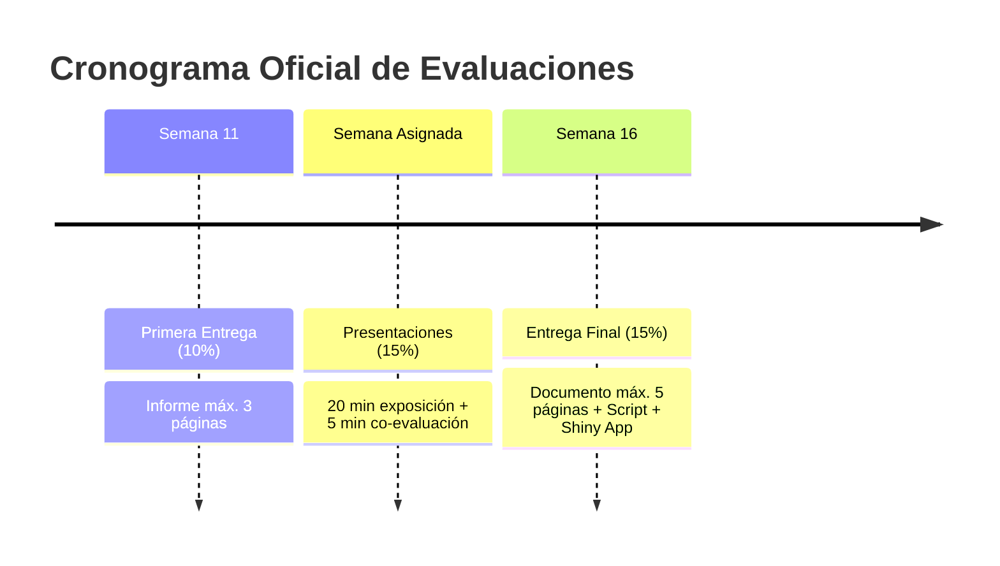

# Enunciados y Rúbricas Oficiales del Curso

Esta carpeta contiene las pautas oficiales, criterios de evaluación y rúbricas establecidas para las entregas académicas del curso **Taller de Programación Aplicada a R** (Maestría en Economía Aplicada - MECA).

---

## Documentos disponibles

| Archivo | Hito / Ponderación | Descripción |
| :--- | :--- | :--- |
| [**`enunciado_primera_entrega.md`**](file:///Users/juanjoseecheverry/Library/Mobile%20Documents/com~apple~CloudDocs/Universidad/Maestria%20%28MECA%29/Primer%20semestre/Taller%20R/Repo_Entrega_Final_Taller_R/docs/enunciados/enunciado_primera_entrega.md) | **Semana 11 (10%)** | Pautas oficiales del informe preliminar: máximo 3 páginas, límites de palabras por sección (Pregunta $\le 150$, Motivación $\le 150$, Datos $\le 150$, Metodología $\le 150$, EDA $\le 700$) y rúbrica detallada. |
| [**`enunciado_entrega_final_y_presentacion.md`**](file:///Users/juanjoseecheverry/Library/Mobile%20Documents/com~apple~CloudDocs/Universidad/Maestria%20%28MECA%29/Primer%20semestre/Taller%20R/Repo_Entrega_Final_Taller_R/docs/enunciados/enunciado_entrega_final_y_presentacion.md) | **Semana 16 (30% total)** | Lineamientos de la **Presentación en clase (15%)** (20 minutos de exposición + 5 de co-evaluación) y del **Documento Final + Script + Shiny App (15%)** (máx. 5 páginas + anexo). |

---

## Resumen de Fechas y Ponderaciones del Trabajo Final

---

> ⬅️ Volver al [índice de documentación](file:///Users/juanjoseecheverry/Library/Mobile%20Documents/com~apple~CloudDocs/Universidad/Maestria%20%28MECA%29/Primer%20semestre/Taller%20R/Repo_Entrega_Final_Taller_R/docs/README.md) | Volver al [README principal](file:///Users/juanjoseecheverry/Library/Mobile%20Documents/com~apple~CloudDocs/Universidad/Maestria%20%28MECA%29/Primer%20semestre/Taller%20R/Repo_Entrega_Final_Taller_R/README.md)
