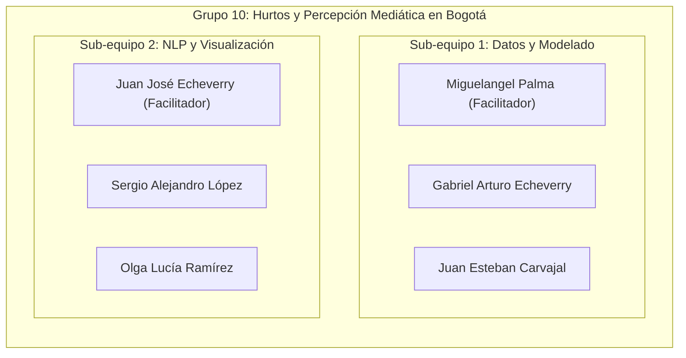

# Gestión y Definición del Proyecto

En esta carpeta se encuentran los documentos que definen tanto el marco conceptual y metodológico de la investigación, como la organización y el plan de trabajo colaborativo del **Grupo 10**.

---

## Documentos disponibles

| Archivo | Enfoque | Descripción |
| :--- | :--- | :--- |
| [**`propuesta_proyecto.md`**](file:///Users/juanjoseecheverry/Library/Mobile%20Documents/com~apple~CloudDocs/Universidad/Maestria%20%28MECA%29/Primer%20semestre/Taller%20R/Repo_Entrega_Final_Taller_R/docs/proyecto/propuesta_proyecto.md) | **Metodología y Contenido** | Propuesta completa: pregunta de investigación (*¿cómo se relacionan los hurtos registrados y el tono de las noticias en las 19 localidades de Bogotá?*), hipótesis, justificación, fuentes de datos abiertos, metodología NLP (`sentometrics` + NRC) y agrupamiento con $K$-means. |
| [**`plan_de_trabajo.md`**](file:///Users/juanjoseecheverry/Library/Mobile%20Documents/com~apple~CloudDocs/Universidad/Maestria%20%28MECA%29/Primer%20semestre/Taller%20R/Repo_Entrega_Final_Taller_R/docs/proyecto/plan_de_trabajo.md) | **Organización y Cronograma** | Distribución en dos sub-equipos temáticos de 3 integrantes (Sub-equipo de Datos y Modelado / Sub-equipo de NLP y Visualización), facilitadores, cronograma con fechas límite hasta el cierre del 17 de noviembre y protocolo de ramas en Git. |

---

## Organización de los Sub-Equipos

---

> ⬅️ Volver al [índice de documentación](file:///Users/juanjoseecheverry/Library/Mobile%20Documents/com~apple~CloudDocs/Universidad/Maestria%20%28MECA%29/Primer%20semestre/Taller%20R/Repo_Entrega_Final_Taller_R/docs/README.md) | Volver al [README principal](file:///Users/juanjoseecheverry/Library/Mobile%20Documents/com~apple~CloudDocs/Universidad/Maestria%20%28MECA%29/Primer%20semestre/Taller%20R/Repo_Entrega_Final_Taller_R/README.md)
