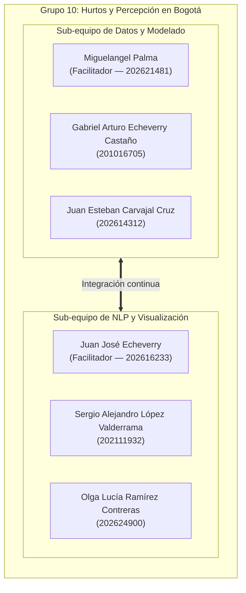
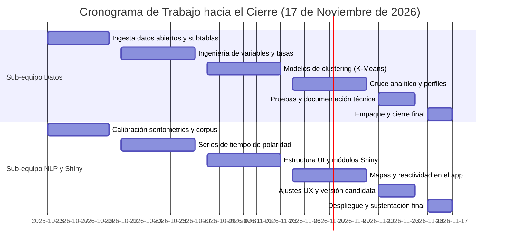

# Plan de Trabajo Colaborativo (Cierre al 17 de Noviembre de 2026)

Este documento detalla la organización interna, la distribución de responsabilidades y el cronograma de trabajo del **Grupo 10** para la entrega final de Taller de R (con fecha límite de cierre el **17 de noviembre de 2026**). 

El equipo trabaja bajo un esquema horizontal y colaborativo, dividido en dos sub-equipos temáticos de tres integrantes cada uno, acompañados por un facilitador que ayuda a coordinar avances, resolver dudas técnicas y asegurar la integración de todas las partes del proyecto.

---

## 1. Conformación de Sub-Equipos y Roles



### Sub-equipo 1: Datos y Modelado
* **Facilitador de coordinación:** Miguelangel Palma (202621481)
* **Integrantes:** Gabriel Arturo Echeverry Castaño (201016705) y Juan Esteban Carvajal Cruz (202614312).
* **Foco temático:**
  1. **Datos Abiertos:** Descarga, validación y actualización de las cifras oficiales de delitos de alto impacto (SIEDCO/SDSCJ), proyecciones de población y cartografía de localidades de Bogotá.
  2. **Scraping y Trazabilidad:** Supervisión de la ingesta de noticias en Google News, validación de las 19 subtablas locales y corrida de lotes pendientes mediante scraping incremental.
  3. **Modelos de Segmentación:** Limpieza de variables numéricas, cálculo de tasas por 100.000 habitantes, análisis de componentes principales (PCA) y modelos de agrupamiento (K-Means / Jerárquico) para clasificar las localidades según su dinámica delictiva.

### Sub-equipo 2: NLP y Visualización
* **Facilitador de coordinación:** Juan José Echeverry (202616233)
* **Integrantes:** Sergio Alejandro López Valderrama (202111932) y Olga Lucía Ramírez Contreras (202624900).
* **Foco temático:**
  1. **Análisis de Texto con `sentometrics`:** Procesamiento de lenguaje natural sobre el corpus consolidado de noticias (2.487 noticias históricas + extensiones), construcción de diccionarios de seguridad/legitimidad y cálculo de series temporales de polaridad mediática.
  2. **Aplicativo Web Interactivo (R Shiny):** Arquitectura y diseño visual con `bslib`, tableros temáticos, mapas interactivos con `leaflet`, gráficos dinámicos de series de tiempo y filtros por localidad.
  3. **Integración Analítica:** Cruce visual y estadístico entre los índices de sentimiento y los clusters de delincuencia calculados por el Sub-equipo 1.

---

## 2. Cronograma de Trabajo y Fechas Límite



| Fecha límite | Sub-equipo de Datos y Modelado | Sub-equipo de NLP y Visualización | Punto de Encuentro / Hito Compartido |
| :---: | :--- | :--- | :--- |
| **20 de octubre** | Validar la ingesta de datos abiertos (API Socrata) y comprobar la migración de las 19 subtablas de noticias en `historico_por_localidad/`. | Explorar el corpus unificado de 2.487 noticias, tokenización y prueba de diccionarios base de sentimiento en español. | **Hito 1:** Bases crudas verificadas, reproducibles y cargadas en `data/raw/` (Primera Entrega). |
| **27 de octubre** | Limpieza de bases, cálculo de tasas de hurto mensual por 100.000 habitantes y preparación de matrices para modelos. | Configuración de la matriz temporal en `sentometrics` (ponderaciones intra-mes, decaimiento exponencial) y pruebas de agregación por localidad. | **Hito 2:** Tablas intermedias listas en `data/processed/`. |
| **3 de noviembre** | Estimación de modelos de clustering (K-Means / PCA) para segmentar las localidades por perfil de inseguridad. | Diseño de la maqueta de Shiny (`app/`) con `bslib`: navegación por tarjetas, selector de localidades y panel de series de tiempo. | **Hito 3:** Primeros clusters estimados y esqueleto funcional del tablero Shiny. |
| **10 de noviembre** | Validación estadística de clusters (siluetas, interpretabilidad de variables) y exportación de resultados para la app. | Integración de mapas coropléticos interactivos en Shiny (`leaflet`) mostrando clusters y evolución del sentimiento mediático. | **Hito 4:** Aplicación Shiny conectada a las salidas analíticas de ambos sub-equipos. |
| **14 de noviembre** | Redacción del reporte de metodología, verificación de scripts de reproducción con `master.R` y pruebas de robustez. | Ajustes de experiencia de usuario, diseño responsive en Shiny, optimización de velocidad de carga y revisión de textos. | **Hito 5:** Versión candidata a entrega probada de punta a punta. |
| **17 de noviembre** | Empaque final del repositorio, validación de instrucciones en README y verificación de dependencias (`renv` / paquetes). | Despliegue de la app Shiny en Posit Connect / shinyapps.io, entrega de informe y sustentación en clase. | **Hito 6:** Entrega final y sustentación del proyecto (Cierre). |

---

## 3. Protocolo de Trabajo en Git y Colaboración

Para mantener el repositorio limpio y evitar conflictos al fusionar cambios, seguimos estas pautas colaborativas:

1. **Ramas por función (`feature/`):**
   * Nadie sube cambios directamente a la rama `main` sin previo acuerdo.
   * Las ramas de datos usan el prefijo `feature/datos-...` (ejemplo: `feature/datos-clustering-localidades`).
   * Las ramas de visualización usan el prefijo `feature/nlp-...` o `feature/shiny-...` (ejemplo: `feature/shiny-mapa-leaflet`).

2. **Actualización antes de trabajar:**
   * Antes de empezar una sesión de trabajo, actualizar siempre la copia local:
     ```bash
     git checkout main
     git pull origin main
     ```
   * Si estás en tu rama de trabajo, incorpora los cambios más recientes de `main` con frecuencia para que no se acumulen diferencias grandes.

3. **Revisión cruzada y apoyo entre facilitadores:**
   * Los pull requests se revisan entre ambos sub-equipos. Miguelangel y Juan José apoyan la revisión de código para asegurar que las rutas (`here::here()`) y la reproducibilidad se mantengan intactas.

---

## 4. Trazabilidad de los Datos Históricos

El repositorio cuenta con un protocolo específico para la información extraída de Google Noticias:

1. **Conservación de subtablas brutas:** Cada una de las 19 localidades cuenta con su archivo individual en `data/raw/noticias/historico_por_localidad/` (formato Parquet y RDS), garantizando que no se pierda el rastro de ninguna búsqueda original.
2. **Consolidación metodológica:** El script `scripts/01_ingesta/02_scraping_noticias/00_consolidar_subtablas_historicas.R` unifica las tablas aplicando los filtros de presencia de ciudad, deduplicación de enlaces y validación territorial, produciendo la base de 2.487 noticias con cero valores nulos.
3. **Expansión incremental:** El archivo `data/raw/noticias/cobertura_historica.json` registra con exactitud qué meses ya fueron procesados. Si en el futuro se desea expandir la ventana temporal (por ejemplo, últimos meses de 2025 o año 2026), el scraper omite de manera automática los meses ya existentes y descarga únicamente los nuevos registros.
