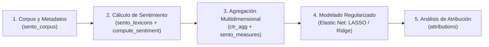

# Marco Metodológico y Documentación de `sentometrics`

Esta carpeta reúne la literatura académica, los manuales técnicos y las referencias oficiales del paquete de R [**`sentometrics`**](https://sentometrics-research.com/), herramienta central empleada en nuestro proyecto para cuantificar y agregar series de tiempo de sentimiento a partir de noticias de prensa sobre Bogotá.

---

## 📚 Documentos PDF disponibles en esta carpeta

| Archivo PDF | Tipo de documento | Descripción y cita |
| :--- | :--- | :--- |
| [**`paper_sentometrics_jss_2021.pdf`**](file:///Users/juanjoseecheverry/Library/Mobile%20Documents/com~apple~CloudDocs/Universidad/Maestria%20%28MECA%29/Primer%20semestre/Taller%20R/Repo_Entrega_Final_Taller_R/docs/sentometrics/paper_sentometrics_jss_2021.pdf) | **Paper Académico (JSS)** | **Ardia, D., Bluteau, K., Borms, S. y Boudt, K. (2021).** *The R Package sentometrics to Compute, Aggregate, and Predict with Textual Sentiment*. Journal of Statistical Software, 99(2), 1–40. [doi:10.18637/jss.v099.i02](https://doi.org/10.18637/jss.v099.i02). Explica el diseño econométrico integral, fórmulas de agregación y caso empírico de predicción del índice VIX. |
| [**`manual_referencia_sentometrics_cran.pdf`**](file:///Users/juanjoseecheverry/Library/Mobile%20Documents/com~apple~CloudDocs/Universidad/Maestria%20%28MECA%29/Primer%20semestre/Taller%20R/Repo_Entrega_Final_Taller_R/docs/sentometrics/manual_referencia_sentometrics_cran.pdf) | **Manual de Referencia CRAN** | Manual técnico oficial del paquete en CRAN (versión 1.0.1, 58 páginas). Describe exhaustivamente cada función, parámetros de entrada, estructuras S3 devueltas y ejemplos reproducibles. |

---

## 🌐 Enlaces Oficiales y Repositorios

* **Página web oficial de Sentometrics:** [https://www.sentometrics.com/](https://www.sentometrics.com/)  
  *Sitio de la iniciativa de investigación Sentometrics, con publicaciones, conferencias internacionales y recursos en economía y finanzas.*
* **Documentación y tutoriales del paquete:** [https://sentometrics-research.com/sentometrics/](https://sentometrics-research.com/sentometrics/)  
  *Guía interactiva paso a paso, vignettes y catálogo de funciones.*
* **Repositorio oficial en GitHub:** [https://github.com/SentometricsResearch/sentometrics](https://github.com/SentometricsResearch/sentometrics)  
  *Código fuente en R y C++ (RcppArmadillo / RcppParallel), seguimiento de issues y versiones de desarrollo.*
* **Repositorio CRAN:** [https://CRAN.R-project.org/package=sentometrics](https://CRAN.R-project.org/package=sentometrics)

---

## 🧠 ¿Qué es `sentometrics` y cómo funciona?

El término **sentometrics** surge de la combinación entre **análisis de sentimiento textual** (*sentiment analysis*) y **econometría de series de tiempo** (*econometrics*). 

A diferencia de los paquetes tradicionales de minería de texto que solo calculan polaridades puntuales, `sentometrics` proporciona un flujo integrado de 5 etapas para transformar millones de palabras no estructuradas en paneles multidimensionales de variables macroeconómicas o sectoriales:

### 1. Gestión del Corpus (`sento_corpus()`)
Estructura una base tabular rectangular con cuatro elementos esenciales:
* `id`: Identificador único de cada documento.
* `date`: Fecha en formato `yyyy-mm-dd`.
* `texts`: Contenido textual (titular, resumen o cuerpo completo).
* `features`: Variables binarias o continuas asociadas a cada texto (en nuestro caso, las **19 localidades urbanas de Bogotá**).

### 2. Cuantificación con Léxicos y Modificadores de Valencia (`compute_sentiment()`)
Permite calibrar la polaridad considerando modificadores lingüísticos (*valence shifters*):
* **Negadores** ($t=1$): invierten el signo de la polaridad (*"no es seguro"* $\to$ negativo).
* **Amplificadores** ($t=2$): intensifican el sentimiento (*"muy peligroso"*).
* **Deamplificadores** ($t=3$): atenúan la carga (*"apenas alarmante"*).
* **Conjunciones adversativas** ($t=4$): ponderan cláusulas (*"pero", "sin embargo"*).

Soporta esquemas a nivel de unigramas, bigramas o ventanas/clústeres alrededor de palabras con carga emocional.

### 3. Ponderación y Agregación Multidimensional (`ctr_agg()`)
El paquete formaliza tres niveles de agregación matemática:
1. **Intra-documento ($\omega_i$):** Ponderación de palabras dentro de la misma noticia (conteo simple, proporcional a la longitud o raíz cuadrada).
2. **Entre documentos ($\theta_n$):** Ponderación de textos en una misma fecha (peso igualitario `equal_weight` o proporcional `proportional`).
3. **A lo largo del tiempo ($b_t$):** Modelado de la persistencia y decaimiento temporal de la noticia mediante esquemas móviles:
   * Decaimiento exponencial (`exponential`).
   * Decaimiento lineal (`linear`).
   * Polinomios de Almon (`almon`).
   * Curvas Beta (`beta`).

### 4. Modelado Predictivo y Regularización (`sento_model()`)
Integra modelos penalizados mediante `glmnet` y `caret` (Elastic Net) para manejar paneles de alta dimensionalidad evitando el sobreajuste.

### 5. Atribución de Pronósticos (`attributions()`)
Permite descomponer exactamente cuánto aportó cada léxico, cada tema/localidad y cada retraso temporal a una estimación.

---

## 🎯 Aplicación en Nuestro Proyecto

En nuestro repositorio, `sentometrics` se implementa en el script [**`scripts/03_analisis_sentometrics.R`**](file:///Users/juanjoseecheverry/Library/Mobile%20Documents/com~apple~CloudDocs/Universidad/Maestria%20%28MECA%29/Primer%20semestre/Taller%20R/Repo_Entrega_Final_Taller_R/scripts/03_analisis_sentometrics.R):

1. **Corpus:** Cargamos 2.487 noticias validadas de Google News recopiladas entre 2022 y 2025.
2. **Características:** Mapeamos la pertenencia a las **19 localidades urbanas** de Bogotá como variables numéricas en el `sento_corpus`.
3. **Léxico:** Empleamos el léxico de polaridad en español (NRC traducido / validado).
4. **Agregación:** Construimos índices de sentimiento agregados por localidad y año para contrastarlos con las tasas oficiales de hurto a personas, residencias y motocicletas, alimentando el clustering con $K$-means y la aplicación Shiny en [**`app/`**](file:///Users/juanjoseecheverry/Library/Mobile%20Documents/com~apple~CloudDocs/Universidad/Maestria%20%28MECA%29/Primer%20semestre/Taller%20R/Repo_Entrega_Final_Taller_R/app/README.md).

---

> ⬅️ Volver al [índice de documentación](file:///Users/juanjoseecheverry/Library/Mobile%20Documents/com~apple~CloudDocs/Universidad/Maestria%20%28MECA%29/Primer%20semestre/Taller%20R/Repo_Entrega_Final_Taller_R/docs/README.md) | Volver al [README principal](file:///Users/juanjoseecheverry/Library/Mobile%20Documents/com~apple~CloudDocs/Universidad/Maestria%20%28MECA%29/Primer%20semestre/Taller%20R/Repo_Entrega_Final_Taller_R/README.md)
