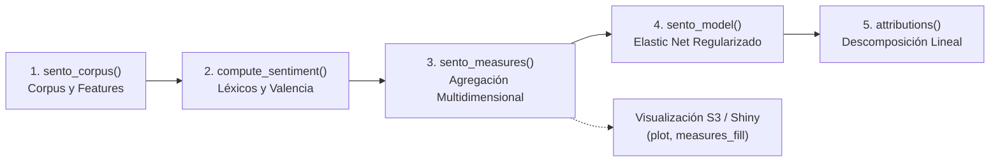

# Guía Técnica y Catálogo de Funciones de `sentometrics`

**Proyecto:** Hurtos y Sentimiento Mediático en Bogotá (2022–2025)  
**Programa:** Maestría en Economía Aplicada (MECA) — *Taller de Programación en R*  
**Integrantes:** Juan José Echeverry, Sergio López Valderrama, Olga Lucía Ramírez (Sub-equipo NLP y Visualización)  

---

Esta guía documenta cada una de las funciones del paquete [`sentometrics`](https://sentometrics-research.com/) que empleamos en el proyecto para procesar el corpus de prensa digital sobre Bogotá, construir series de tiempo de polaridad, modelar la relación con los delitos registrados y transferir los insumos analíticos a la aplicación interactiva Shiny.

---

## 1. Documentos de Referencia en esta Carpeta

| Archivo | Tipo | Descripción y cita |
| :--- | :--- | :--- |
| [**`paper_sentometrics_jss_2021.pdf`**](file:///Users/juanjoseecheverry/Library/Mobile%20Documents/com~apple~CloudDocs/Universidad/Maestria%20%28MECA%29/Primer%20semestre/Taller%20R/Repo_Entrega_Final_Taller_R/docs/sentometrics/paper_sentometrics_jss_2021.pdf) | Paper JSS | **Ardia, D., Bluteau, K., Borms, S. y Boudt, K. (2021).** *The R Package sentometrics to Compute, Aggregate, and Predict with Textual Sentiment*. Journal of Statistical Software, 99(2), 1–40. [doi:10.18637/jss.v099.i02](https://doi.org/10.18637/jss.v099.i02). |
| [**`manual_referencia_sentometrics_cran.pdf`**](file:///Users/juanjoseecheverry/Library/Mobile%20Documents/com~apple~CloudDocs/Universidad/Maestria%20%28MECA%29/Primer%20semestre/Taller%20R/Repo_Entrega_Final_Taller_R/docs/sentometrics/manual_referencia_sentometrics_cran.pdf) | Manual CRAN | Manual oficial de referencia técnica (versión 1.0.1, 58 páginas) con la especificación completa de funciones y clases S3. |

* **Documentación oficial y tutoriales:** [https://sentometrics-research.com/sentometrics/](https://sentometrics-research.com/sentometrics/)
* **Repositorio en GitHub:** [https://github.com/SentometricsResearch/sentometrics](https://github.com/SentometricsResearch/sentometrics)
* **Repositorio en CRAN:** [https://CRAN.R-project.org/package=sentometrics](https://CRAN.R-project.org/package=sentometrics)

---

## 2. Flujo de Trabajo y Contratos de Datos

El pipeline se estructura en cinco etapas secuenciales que transforman textos no estructurados en paneles econométricos reproducibles:



### Tabla de Objetos S3 y Archivos `.rds` en `data/processed/`

| Fase | Función Principal | Clase S3 Devuelta | Archivo Entregable | Responsable |
| :--- | :--- | :--- | :--- | :--- |
| **1. Corpus** | `sento_corpus()`, `add_features()` | `sento_corpus`, `corpus` | `data/processed/01_sento_corpus.rds` | Juan José (T-07) |
| **2. Léxicos** | `sento_lexicons()` | `sento_lexicons`, `list` | `data/processed/02_lexicons_es.rds` | Juan José (T-09) |
| **2. Puntuaciones** | `compute_sentiment()`, `as.sentiment()` | `sentiment`, `data.table` | `data/processed/03_sentiment_scores.rds` | Juan José (T-10) |
| **2. Noticias Pico** | `peakdocs()` | `data.table` | `data/processed/04_peak_docs.rds` | Sergio (T-11) |
| **3. Medidas** | `ctr_agg()`, `sento_measures()` | `sento_measures`, `list` | `data/processed/05_sento_measures.rds` | Juan José (T-13) |
| **3. Series Long** | `measures_fill()`, `as.data.table()` | `data.table` | `data/processed/06_measures_long.rds` | Sergio (T-14) |
| **3. Índice Global** | `aggregate(..., do.global=TRUE)`, `peakdates()` | `data.table`, `list` | `data/processed/07_global_index.rds` | Juan José (T-15) |
| **4. Modelo / Atribución** | `ctr_model()`, `sento_model()`, `attributions()` | `sento_model`, `attributions` | `data/processed/08_attributions.rds` | Juan José (T-17) |

---

## 3. Catálogo Detallado de Funciones para la Entrega

### 3.1 Fase 1: Gestión del Corpus y Creación de Características

#### `sento_corpus(corpusdf)`
Construye la estructura base tabular requerida por el paquete a partir de un `data.frame` o `data.table`.

* **Entrada obligatoria:**
  * `id`: Identificador único de cada noticia (carácter o entero).
  * `date`: Fecha en formato `Date` de R (`yyyy-mm-dd`). No admite marcas de tiempo con zona horaria ni valores nulos.
  * `texts`: Cadena de texto a procesar (unión de titular y resumen).
  * Columnas numéricas adicionales: Variables indicadoras binarias `[0, 1]` o continuas que representan las características de cada documento.
* **Regla estricta de nomenclatura:** Los nombres de las columnas de características nunca deben incluir guiones medios (`-`), pues el paquete los reserva como separadores internos de dimensión (por ejemplo, `localidad--lexico--tiempo`). Se debe usar guion bajo: `barrios_unidos`, `puente_aranda`, `santa_fe`.
* **Ejemplo en R:**
  ```r
  corpus_base <- df_noticias |>
    dplyr::mutate(
      id    = as.character(dplyr::row_number()),
      date  = as.Date(fecha_chunk_desde),
      texts = paste(coalesce(titulo, ""), coalesce(resumen, ""), sep = ". ")
    )
  
  corpus_sento <- sentometrics::sento_corpus(
    corpusdf = corpus_base[, c("id", "date", "texts", localidades_19, temas)]
  )
  ```

#### `add_features(sento_corpus, features)`
Permite incorporar columnas numéricas de características a un objeto `sento_corpus` ya existente, útil para agregar etiquetas temáticas (seguridad, movilidad, comercio) obtenidas mediante expresiones regulares o modelos de tópicos.

#### `corpus_summarize(sento_corpus, by = "month")`
Calcula estadísticas descriptivas agregadas del corpus (recuento de documentos, palabras totales y presencia de características en el tiempo). Lucía utiliza este método para generar los gráficos exploratorios de evolución del corpus en la primera entrega y en el tablero interactivo.

---

### 3.2 Fase 2: Configuración Léxica y Cómputo de Sentimiento

#### `sento_lexicons(lexiconsIn, valenceIn)`
Empaqueta los diccionarios de polaridad y las tablas de modificadores contextuales de valencia en un objeto de clase `sento_lexicons`.

* **Argumentos:**
  * `lexiconsIn`: Lista nombrada de tablas (`data.frame` o `data.table`) con columnas `x` (palabra) e `y` (puntuación numérica). En nuestro proyecto usamos:
    * `nrc_es`: Léxico NRC traducido y validado al español.
    * `crimen_es`: Léxico especializado en criminalidad y seguridad urbana de Bogotá (incorporando términos como *atraco*, *fleteo*, *raponazo*, *sicariato*, *patrullaje*, *desarticulado*).
  * `valenceIn`: Tabla con columnas `x` (palabra), `y` (magnitud del efecto) y `t` (tipo de modificador):
    * `t = 1`: Negadores (*no*, *nunca*, *jamás*, *sin*). Invierten el signo de la polaridad.
    * `t = 2`: Amplificadores (*muy*, *sumamente*, *altamente*). Incrementan la intensidad emocional en un 80% (`y = 0.8`).
    * `t = 3`: Deamplificadores o atenuadores (*apenas*, *poco*, *parcialmente*). Disminuyen la intensidad en un 80% (`y = 0.8`).
    * `t = 4`: Adversativos (*pero*, *sin embargo*, *aunque*). Ponderan las cláusulas adyacentes.
* **Ejemplo en R:**
  ```r
  lexicons_sento <- sentometrics::sento_lexicons(
    lexiconsIn = list(nrc_es = lexico_nrc, crimen_es = lexico_bogota),
    valenceIn  = tabla_valence_es
  )
  ```

#### `compute_sentiment(sento_corpus, lexicons, how, do.sentence)`
Calcula la puntuación de sentimiento para cada noticia aplicando los léxicos y la ventana contextual de modificadores de valencia (clúster de 4 palabras previas y 2 posteriores alrededor de cada término con carga).

* **Argumentos clave:**
  * `how`: Esquema de ponderación intra-documento ($\omega_i$). Usamos `"proportionalPol"`, que divide el sentimiento neto exclusivamente entre el número de palabras con carga emocional detectadas, evitando que las crónicas extensas se diluyan artificialmente por contener párrafos de contexto neutral.
  * `do.sentence`: Valor lógico. Si es `TRUE`, descompone los artículos en oraciones antes de computar el sentimiento; si es `FALSE`, evalúa el documento completo de forma directa.
* **Salida:** Objeto `sentiment` (`data.table`) con columnas `id`, `date`, `word_count` y las puntuaciones por cada cruce de léxico y característica.

#### `as.sentiment(sentimentdf)`
Convierte una tabla externa con puntuaciones ya calculadas en un objeto de clase `sentiment`, permitiendo integrar indicadores calculados fuera del pipeline si se requiere una auditoría manual.

#### `peakdocs(sentiment, n = 5, type = "both")`
Extrae del objeto `sentiment` los documentos con las puntuaciones más altas (`type = "pos"`), más bajas (`type = "neg"`) o de mayor magnitud absoluta (`type = "both"`). Sergio emplea esta función para generar el archivo `04_peak_docs.rds`, el cual alimenta la tabla de noticias críticas en la aplicación Shiny.

---

### 3.3 Fase 3: Agregación Multidimensional y Series de Tiempo

#### `ctr_agg(howWithin, howDocs, howTime, by, lag, ...)`
Define la función de control con los hiperparámetros que gobiernan la agregación en tres niveles: dentro del texto ($\omega$), entre textos ($\theta$) y en el tiempo ($b$).

* **Configuración del equipo para Bogotá:**
  * `howWithin = "proportionalPol"`: Normalización por palabras emotivas reales.
  * `howDocs = "proportional"`: Pondera las noticias del mes según su extensión en palabras, asignando mayor representatividad a reportajes de fondo que a notas breves.
  * `howTime = c("linear", "exponential", "beta")`: Modela la memoria y la persistencia de la alarma social. El esquema exponencial usa `alphasExp = c(0.2, 0.5)` para capturar olvido moderado y rápido; las curvas Beta usan `aBeta = c(1, 2)` y `bBeta = c(2, 3)` para modelar picos retardados de debate público.
  * `by = "month"`: Frecuencia mensual para coincidir con la periodicidad de los registros delictivos.
  * `lag = 6`: Ventana temporal de agregación retrospectiva de 6 meses.
  * `do.ignoreZeros = TRUE`: Parámetro crítico que ignora documentos con sentimiento exactamente igual a 0 al calcular los pesos entre noticias, impidiendo que el índice se sesgue artificialmente hacia la neutralidad.
* **Ejemplo en R:**
  ```r
  control_agg <- sentometrics::ctr_agg(
    howWithin      = "proportionalPol",
    howDocs        = "proportional",
    howTime        = c("linear", "exponential", "beta"),
    by             = "month",
    lag            = 6,
    alphasExp      = c(0.2, 0.5),
    aBeta          = c(1, 2),
    bBeta          = c(2, 3),
    do.ignoreZeros = TRUE
  )
  ```

#### `sento_measures(sento_corpus, lexicons, ctrSetup)`
Aplica el control de agregación sobre el corpus y los léxicos para generar el objeto multidimensional `sento_measures`. Contiene un panel ordenado por fechas con todas las series resultantes de combinar características, léxicos y esquemas de suavizamiento temporal.

#### `measures_fill(sento_measures, fill = "zero")`
Garantiza la continuidad del calendario temporal imputando fechas intermedias que no registren noticias (por ejemplo, con valor 0 o arrastrando la última observación). Es un paso previo indispensable para transformar las medidas al formato largo que consume Plotly en Shiny.

#### `measures_subset(sento_measures, dates, features, lexicons, time)`
Filtra filas o columnas del panel de medidas según un vector de fechas de interés o dimensiones específicas, permitiendo sincronizar la ventana temporal del sentimiento con los registros de delitos antes de modelar.

#### `aggregate(sento_measures, do.global = TRUE)`
Colapsa todas las dimensiones de un objeto `sento_measures` mediante una suma ponderada para obtener una serie única de sentimiento general para toda la ciudad.

#### `peakdates(sento_measures, n = 5, type = "neg")`
Detecta las fechas (meses o días) en las que el sentimiento agregado alcanzó sus niveles más extremos. Permite aislar los momentos históricos de mayor negatividad en Bogotá entre 2022 y 2025 para contextualizarlos con eventos de orden público.

---

### 3.4 Fase 4: Modelado Regularizado y Análisis de Atribución

#### `ctr_model(model, type, alphas, h, ...)`
Configura la estimación del modelo predictivo.

* **Parámetros utilizados:**
  * `model = "elasticnet"`: Regresión lineal con penalización mixta $L_1$ y $L_2$ (Zou y Hastie, 2005).
  * `type = "cv"`: Calibración del parámetro de penalización $\lambda$ mediante validación cruzada en 10 pliegues (*10-fold cross-validation*).
  * `alphas = c(0.2, 0.5, 0.8)`: Rejilla de búsqueda para el balance entre Ridge ($\alpha = 0$) y LASSO ($\alpha = 1$). El valor $\alpha = 0.5$ ofrece un equilibrio entre selección estricta de variables y retención de grupos de series correlacionadas.
  * `h = 1`: Horizonte de pronóstico a un mes hacia adelante ($y_{t+1}$ en función de $s_t$), evaluando la capacidad predictiva adelantada sin contemporaneidad.
  * `do.shrinkage = TRUE`: Activa el encogimiento de coeficientes hacia cero.

#### `sento_model(sentMeasures, y, ctr, x = NULL)`
Estima el modelo regularizado utilizando la librería `glmnet` bajo el capó. Ajusta la variable dependiente $y$ (tasa mensual de hurtos a personas por 100.000 habitantes en una localidad) en función de las series de sentimiento generadas y posibles controles exógenos $x$. Devuelve un objeto `sento_model`.

* **Ejemplo en R:**
  ```r
  control_mod <- sentometrics::ctr_model(
    model        = "elasticnet",
    type         = "cv",
    alphas       = c(0.2, 0.5, 0.8),
    h            = 1,
    do.shrinkage = TRUE
  )
  
  modelo_estimado <- sentometrics::sento_model(
    sentMeasures = medidas_alineadas,
    y            = serie_tasas_hurto,
    ctr          = control_mod
  )
  ```

#### `attributions(sento_model, sentMeasures, do.normalize = TRUE)`
Aprovecha la aditividad lineal de `sentometrics` para descomponer exactamente cuánto aportó cada dimensión del sentimiento a la predicción de la tasa de hurtos en cada fecha:

$$\hat{y}_{u+h} = \hat{\delta} + \hat{\gamma}^\top x_u + \sum_{m=1}^M \hat{\beta}_m s_{u,m}$$

* **Descomposiciones devueltas en la lista:**
  * `attr[["features"]]`: Aporte atribuible a cada una de las localidades o temas.
  * `attr[["lexicons"]]`: Aporte del léxico NRC general frente al léxico local de criminalidad.
  * `attr[["time"]]`: Aporte de los esquemas de persistencia temporal (inmediato lineal frente a memoria exponencial).
  * `attr[["documents"]]`: Relevancia cuantitativa de artículos individuales en fechas clave.
* El argumento `do.normalize = TRUE` escala las atribuciones entre -1 y 1 para facilitar su comparación e interpretación gráfica en Shiny.

---

### 3.5 Fase 5: Métodos Gráficos S3 e Integración con Shiny

#### `plot(sento_measures)` / `plot.sento_measures()`
Genera gráficos de series temporales basados en `ggplot2`. Permite agrupar las trayectorias por características (`group = "features"`), por léxicos (`group = "lexicons"`) o por esquemas de tiempo (`group = "time"`).

* **Pauta técnica para Shiny:** En lugar de renderizar el gráfico estático, extraemos la tabla de datos subyacente con `p[["data"]]` y la convertimos en un gráfico interactivo mediante `plotly::ggplotly()`, asegurando filtros reactivos fluidos y etiquetas flotantes (*tooltips*).

#### `plot(attributions)` / `plot.attributions()`
Produce diagramas de barras apiladas a lo largo del tiempo, donde cada barra descompone la predicción del delito en las capas de sentimiento que la originaron. Lucía integra este componente en la pestaña *Impacto y Atribuciones* de la aplicación web.

---

## 4. Cuadro Resumen de Parámetros y Decisiones Metodológicas

| Nivel de Decisión | Argumento / Parámetro | Valor Seleccionado | Justificación Metodológica |
| :--- | :--- | :--- | :--- |
| **Intra-documento** | `howWithin` | `"proportionalPol"` | Normaliza por palabras con carga emocional real; evita la atenuación artificial del tono en reportajes extensos. |
| **Modificadores** | `valenceIn` | $t \in \{1, 2, 3, 4\}$ | Ajusta negaciones, amplificaciones, atenuaciones y cláusulas adversativas en ventanas contextuales de clúster. |
| **Entre documentos** | `howDocs` | `"proportional"` | Otorga mayor representatividad a investigaciones periodísticas profundas que a cables breves. |
| **Omisión de ceros** | `do.ignoreZeros` | `TRUE` | Evita que textos neutrales o irrelevantes arrastren artificialmente el índice promedio mensual hacia cero. |
| **Frecuencia** | `by` | `"month"` | Homologa la escala temporal de la prensa con los registros oficiales de delitos de la Secretaría de Seguridad. |
| **Memoria temporal** | `lag` | `6` meses | Captura la persistencia de la alarma social y el debate sobre seguridad ciudadana en el mediano plazo. |
| **Curvas de tiempo** | `howTime` | `linear`, `exponential`, `beta` | Modela olvido gradual, decaimiento rápido y picos de discusión pública retardados post-evento criminal. |
| **Modelo predictivo** | `model` | `"elasticnet"` | Resuelve la alta dimensionalidad ($P \approx N$) y la multicolinealidad entre localidades mediante penalización mixta. |
| **Horizonte predictivo** | `h` | `1` mes | Evalúa capacidad predictiva adelantada sin contemporaneidad, evitando afirmar causalidad directa. |

---

## 5. Reglas Técnicas y Control de Errores

Para evitar fallos de ejecución en el script orquestador `master.R` y en la aplicación Shiny, el equipo debe verificar siempre cuatro directrices:

1. **Sin guiones en features:** Ninguna columna indicadora de localidad o tema puede nombrarse con guion medio (`-`). Se debe usar siempre guion bajo (`_`).
2. **Fechas estrictas:** La columna `date` debe tener clase `Date` (`as.Date()`). No se admiten objetos `POSIXct` con zonas horarias ni cadenas de texto sin convertir.
3. **Cero valores `NA`:** El constructor `sento_corpus()` aborta la ejecución si encuentra valores perdidos en `texts`, `date` o en las columnas de características.
4. **Remodelado para Shiny:** La aplicación web nunca debe procesar objetos `sento_measures` en tiempo real de renderizado. Debe consumir tablas precargadas en formato plano y largo (`data/processed/06_measures_long.rds`), generadas mediante `measures_fill()` y `as.data.table()`.

---

> ⬅️ Volver al [índice general de documentación](file:///Users/juanjoseecheverry/Library/Mobile%20Documents/com~apple~CloudDocs/Universidad/Maestria%20%28MECA%29/Primer%20semestre/Taller%20R/Repo_Entrega_Final_Taller_R/docs/README.md) | Volver al [README principal](file:///Users/juanjoseecheverry/Library/Mobile%20Documents/com~apple~CloudDocs/Universidad/Maestria%20%28MECA%29/Primer%20semestre/Taller%20R/Repo_Entrega_Final_Taller_R/README.md)
