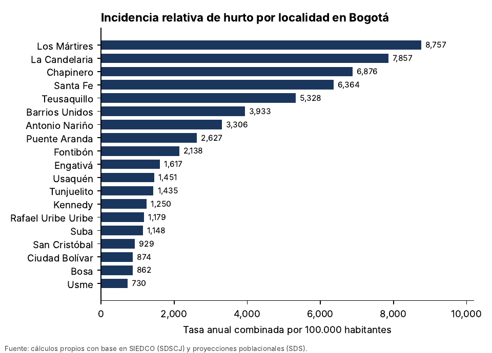
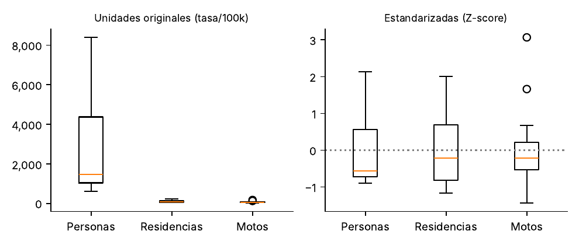
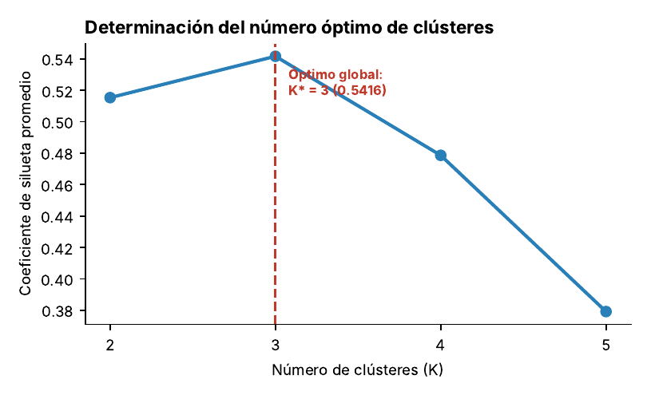
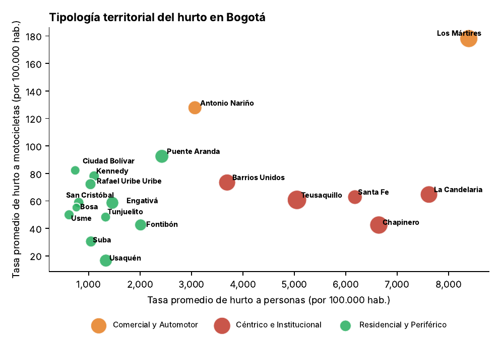
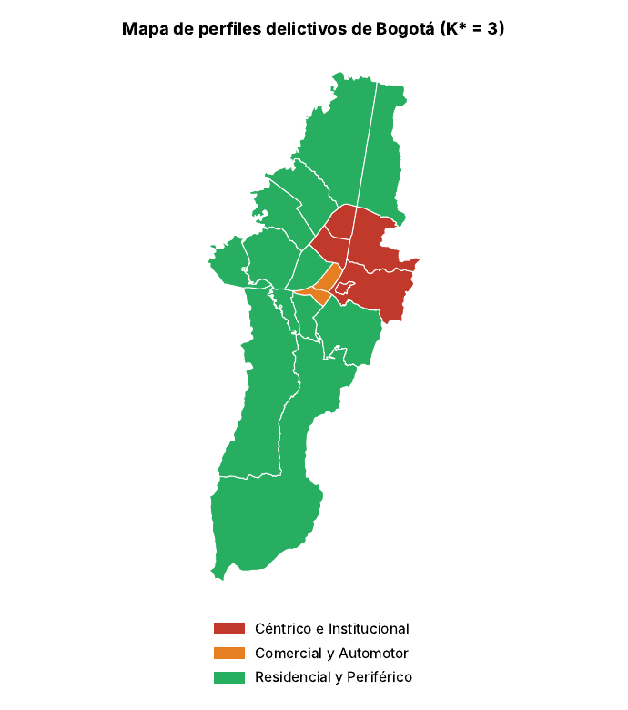

# Script de agrupamiento: `04_clustering_kmeans.R`

Este script agrupa las 19 localidades urbanas de Bogotá según qué tan parecidas son sus tasas de hurto. Lee el panel de tasas que deja el procesamiento de población, estandariza las variables, decide cuántos grupos conviene formar, estima el modelo K-Means y guarda la asignación de cada localidad. Está en `scripts/04_clustering_kmeans.R`.

## Encabezado y configuración

El script empieza como todos los del proyecto, con la cabecera, las opciones generales, las librerías y las rutas de trabajo.

::: {.columns}
::: {.column width="52%"}

```{.r .numberLines startFrom="2"}
# PROYECTO: Hurtos y Sentimiento Mediático en Bogotá (2022–septiembre de 2026)
# SCRIPT: scripts/04_clustering_kmeans.R
# ROL: Agrupamiento Territorial de Criminalidad con K-Means (K* = 3)
# AUTORES: Grupo 10 — Taller de Programación en R (MECA, Uniandes)
# PRODUCE: data/processed/clusters_localidades_kmeans.parquet
#          output/tables/tabla_clustering_kmeans_perfiles.csv
# ==============================================================================

# 1. Configuración y Dependencias ----

## 1.1 Opciones globales y semilla ----
options(scipen = 999)
set.seed(20261014)

## 1.2 Carga de librerías ----
library(here)
library(conflicted)
library(arrow)
library(readr)
library(dplyr)
library(tidyr)
library(cluster)

## 1.3 Resolución explícita de conflictos ({conflicted}) ----
conflict_prefer("filter", "dplyr", quiet = TRUE)
conflict_prefer("lag",    "dplyr", quiet = TRUE)
conflict_prefer("select", "dplyr", quiet = TRUE)

## 1.4 Definición de rutas relativas ({here}) ----
ruta_datos_clean    <- here("data", "processed")
ruta_salida_tablas  <- here("output", "tables")
ruta_salida_figuras <- here("output", "figures")

if (!dir.exists(ruta_salida_tablas)) {
  dir.create(ruta_salida_tablas, recursive = TRUE, showWarnings = FALSE)
}
if (!dir.exists(ruta_salida_figuras)) {
  dir.create(ruta_salida_figuras, recursive = TRUE, showWarnings = FALSE)
}
```

:::

::: {.column width="3%"}
:::

::: {.column width="45%"}

Los comentarios iniciales identifican el script y los archivos que produce. Se quita la notación científica y se fija la semilla del proyecto (`20261014`), que hace repetibles los resultados del K-Means. Se cargan `here`, `conflicted`, `arrow`, `readr`, `dplyr`, `tidyr` y `cluster`, esta última para la función `silhouette()`. Los conflictos de nombres se resuelven a favor de `dplyr` y se definen las rutas de datos, tablas y figuras, creando las carpetas de salida si no existen.

:::
:::

# Preparación de los datos

El K-Means necesita tasas por habitante y un solo valor por localidad. En esta sección se justifica el uso de tasas, se promedian los cinco años del panel y se describen los datos de entrada.

## Por qué se usan tasas por población

Comparar conteos brutos de denuncias entre territorios lleva a conclusiones sesgadas por el tamaño de la población. Localidades muy pobladas como Suba o Kennedy, con más de un millón de residentes cada una, registran naturalmente muchas denuncias. En cambio, las localidades céntricas tienen pocos residentes y mucha población flotante, y por eso su riesgo por habitante es bastante mayor. Para corregir esa diferencia se calcula la tasa anual de hurto por cada 100.000 habitantes.

$$\text{Tasa}_{it}^{(m)} = \frac{\text{Denuncias del delito } m \text{ en la localidad } i \text{ en el año } t}{\text{Población residente proyectada en la localidad } i \text{ en el año } t} \times 100.000$$

Aquí $m$ puede ser personas, residencias, motocicletas o el total, e $i$ indexa las 19 localidades urbanas de Bogotá. Sumapaz se excluye por ser rural. Por ejemplo, en Fontibón en 2022 hubo 14.252 denuncias de hurto a personas y 384.590 habitantes proyectados, lo que da $14.252/384.590 \times 100.000 = 3.705{,}76$ por 100.000 habitantes.

## Carga del panel y promedio por localidad

El script lee el panel que dejó el procesamiento de población, con 95 filas de 19 localidades por 5 años, comprueba que esté completo y promedia las tasas de los cinco años para tener una sola fila por localidad.

::: {.columns}
::: {.column width="52%"}

```{.r .numberLines startFrom="44"}
## 2.1 Carga del panel delictivo y selección de variables ----
archivo_panel <- file.path(
  ruta_datos_clean,
  "02_poblacion",
  "panel_delitos_poblacion_localidad.parquet"
)
panel_delitos <- read_parquet(archivo_panel)

stopifnot(nrow(panel_delitos) == 95)
stopifnot(length(unique(panel_delitos$codigo_localidad)) == 19)
```

:::

::: {.column width="3%"}
:::

::: {.column width="45%"}

**Líneas 45--49.** `file.path()` arma la ruta del panel `panel_delitos_poblacion_localidad.parquet` dentro de la carpeta de datos procesados.

**Línea 50.** `read_parquet()` lee el archivo y lo guarda en `panel_delitos`.

**Líneas 52--53.** `stopifnot()` detiene el script si el panel no tiene exactamente 95 filas o si no hay 19 localidades distintas. *Revisamos que el archivo sea el correcto antes de usarlo.*

:::
:::

::: {.columns}
::: {.column width="52%"}

```{.r .numberLines startFrom="55"}
## 2.2 Agregación promedio anual por localidad y estandarización (Z-score) ----
matriz_localidad <- panel_delitos |>
  group_by(codigo_localidad, localidad) |>
  summarise(
    tasa_personas_prom = mean(tasa_hurto_personas, na.rm = TRUE),
    tasa_resid_prom    = mean(tasa_hurto_residencias, na.rm = TRUE),
    tasa_motos_prom    = mean(tasa_hurto_motos, na.rm = TRUE),
    tasa_total_prom    = mean(tasa_hurto_total, na.rm = TRUE),
    poblacion_prom     = mean(poblacion, na.rm = TRUE),
    .groups = "drop"
  )
```

:::

::: {.column width="3%"}
:::

::: {.column width="45%"}

**Líneas 56--57.** `group_by(codigo_localidad, localidad)` agrupa las filas de cada localidad, con 5 años por grupo.

**Líneas 58--62.** `summarise()` calcula el promedio de las tasas de hurto a personas, residencias, motocicletas y total, con `mean(..., na.rm = TRUE)`.

**Línea 63.** También se promedia la población en `poblacion_prom`. Esa columna no entra en el cálculo de distancias y queda como dato de referencia.

**Línea 64.** `.groups = "drop"` quita el agrupamiento al terminar. *Pasamos de cinco años por localidad a un solo promedio por localidad, que es lo que vamos a agrupar.*

:::
:::

## Estadísticas descriptivas del panel

El panel contiene las 19 localidades urbanas durante 2022 a 2026, lo que da 95 observaciones de localidad y año. La @tbl-desc resume la media, la dispersión y los extremos de las cuatro tasas.

|Modalidad delictiva|Media|Desv. est.|Mediana|Mínimo|Máximo|
|:---|---:|---:|---:|---:|---:|
|Hurto a personas|2.910,7|2.905,0|1.602,7|410,3|13.348,3|
|Hurto a residencias|108,4|72,0|90,5|27,7|398,1|
|Hurto a motocicletas|68,2|43,2|60,0|11,4|291,2|
|Tasa combinada total|3.087,3|2.984,0|1.758,9|490,8|13.730,2|

: Estadísticas descriptivas de tasas anuales de hurto por 100.000 habitantes en Bogotá (2022-2026) {#tbl-desc}


La tasa de hurto a personas domina la escala. Su media (2.910,7) es más de 26 veces la de residencias (108,4) y más de 42 veces la de motocicletas (68,2). Además, la desviación estándar de cada tasa es muy alta frente a su media, lo que indica una fuerte heterogeneidad entre localidades. Esa diferencia de escala es la razón por la que más adelante se estandarizan las variables.

La @tbl-anual muestra la tasa total promedio por año.

|Año|Denuncias hurto a personas|Tasa total media|Observación|
|:---|---:|---:|:---|
|2022|212.770|5.125|Año atípicamente alto|
|2023|120.238|2.876||
|2024|96.773|2.784||
|2025|95.259|2.442||
|2026|84.494|2.211|Incompleto (corte septiembre)|

: Hurto a personas (denuncias totales) y tasa combinada promedio de las 19 localidades, por año {#tbl-anual}


> **Dos cautelas sobre los años extremos**
>
> El año 2022 presenta una tasa muy superior a la de los años siguientes. Los conteos de hurto a personas pasan de 212.770 en 2022 a 120.238 en 2023, así que conviene confirmar con la fuente si hubo un cambio de criterio de registro antes de leer esa caída como una mejora real. El año 2026 está incompleto porque la capa oficial tiene corte a septiembre, mientras que la población proyectada corresponde al año completo. Por eso su tasa queda subestimada.

## Ranking territorial de criminalidad promedio

Al promediar las tasas anuales de 2022 a 2026 para cada localidad se ve una fuerte concentración de denuncias por habitante en el corredor central y comercial de la ciudad, en Los Mártires, La Candelaria, Chapinero, Santa Fe y Teusaquillo.

{#fig-ranking width="88%" fig-alt="Tasa promedio anual de hurto total por cada 100.000 habitantes por localidad (2022--2026)"}

# Estandarización de las variables

## Por qué se estandariza

K-Means mide la similitud entre localidades con la distancia euclidiana. Si se usaran las tasas en sus unidades originales, las diferencias de miles de puntos en el hurto a personas dominarían la distancia y volverían irrelevante lo que pasa con residencias y motocicletas. Para que las tres modalidades pesen igual se aplica la estandarización Z-score a cada variable $j \in \{1,2,3\}$.

$$Z_{ij} = \frac{X_{ij} - \bar{X}_j}{s_j}$$

Aquí $\bar{X}_j$ es el promedio y $s_j$ la desviación estándar de la modalidad $j$ entre las 19 localidades. Después de la transformación las tres variables quedan medidas en desviaciones estándar respecto al promedio de Bogotá, con media 0 y varianza 1. Un valor $Z_{ij}=+2{,}0$ indica que la localidad $i$ supera en dos desviaciones estándar el promedio distrital en la modalidad $j$.

{#fig-zscore width="90%" fig-alt="Distribución de las tres tasas antes y después de la estandarización (19 localidades)"}

Por ejemplo, Los Mártires tiene una tasa promedio de hurto a personas de 8.389,9 por 100.000 habitantes. Con una media de 2.910,7 y una desviación estándar de 2.574,8 entre localidades, su valor estandarizado es $Z=(8.389{,}9-2.910{,}7)/2.574{,}8 \approx +2{,}13$, lo que significa que está 2,13 desviaciones estándar por encima del promedio distrital.

## Elaboración del script

Se separan las tres tasas que describen a cada localidad, se convierten en una matriz y se estandarizan con `scale()`. Después dos controles confirman que cada columna quedó con media 0 y desviación estándar 1.

::: {.columns}
::: {.column width="52%"}

```{.r .numberLines startFrom="67"}
# Conversión de las 3 tasas delictivas a matriz numérica y normalización Z-score
mat_num <- matriz_localidad |>
  select(tasa_personas_prom, tasa_resid_prom, tasa_motos_prom) |>
  as.matrix()

rownames(mat_num) <- matriz_localidad$localidad
matriz_scale <- scale(mat_num)

stopifnot(all(abs(colMeans(matriz_scale)) < 1e-10))
stopifnot(all(abs(apply(matriz_scale, 2, sd) - 1) < 1e-10))
```

:::

::: {.column width="3%"}
:::

::: {.column width="45%"}

**Líneas 68--70.** `select()` deja solo las tres tasas promedio (personas, residencias y motocicletas) y `as.matrix()` las convierte en una matriz numérica. *Nos quedamos con las tres medidas que definen el perfil de cada localidad.*

**Línea 72.** Los nombres de las localidades se usan como nombres de fila para identificarlas después.

**Línea 73.** `scale()` aplica el Z-score a cada columna, restando el promedio y dividiendo por la desviación estándar. *Ponemos las tres tasas en la misma escala para que ninguna pese más que las otras.*

**Líneas 75--76.** Los dos `stopifnot()` verifican que el promedio de cada columna sea prácticamente 0 y su desviación estándar prácticamente 1, con una tolerancia de `1e-10`.

:::
:::

# El algoritmo K-Means

## Fundamentos del algoritmo

K-Means es un método de aprendizaje automático *no supervisado*. Clasifica un conjunto de observaciones, que aquí son las $N=19$ localidades urbanas, en un número $K$ de grupos o clústeres $(C_1,\dots,C_K)$, sin partir de etiquetas previas. El método busca dos cosas a la vez. La primera es que las localidades de un mismo clúster tengan perfiles delictivos lo más parecidos posible, lo que se conoce como cohesión interna. La segunda es que los clústeres se diferencien claramente entre sí, lo que se conoce como separación externa.

Cada localidad $i$ se describe con un vector de tres tasas promedio anuales de hurto por 100.000 habitantes.

$$\mathbf{x}_i = (\text{Tasa Hurto Personas}_i,\ \text{Tasa Hurto Residencias}_i,\ \text{Tasa Hurto Motocicletas}_i) \in \mathbb{R}^3$$

## Las cuatro etapas del algoritmo

Con las 19 localidades ubicadas en el espacio estandarizado $\mathbf{z}_i=(Z_{i,\text{pers}},Z_{i,\text{resid}},Z_{i,\text{motos}})$, el algoritmo de Hartigan-Wong, que es el que usa por defecto la función `kmeans()` de R, busca minimizar la suma de cuadrados intra-clúster (*Within-Cluster Sum of Squares*, WSS), también llamada inercia interna.

$$\min_{C_1,\dots,C_K} \text{WSS}(K) = \sum_{k=1}^{K}\sum_{i\in C_k}\lVert \mathbf{z}_i-\boldsymbol{\mu}_k\rVert_2^2 = \sum_{k=1}^{K}\sum_{i\in C_k}\sum_{j=1}^{3}(Z_{ij}-\mu_{kj})^2$$

Aquí $\boldsymbol{\mu}_k=(\mu_{k,1},\mu_{k,2},\mu_{k,3})$ es el centroide del clúster $k$, el punto promedio o centro de gravedad del grupo. Para encontrar la mejor partición el algoritmo repite cuatro pasos.

1.  Se eligen $K$ puntos iniciales como centroides provisionales $\boldsymbol{\mu}_1^{(0)},\dots,\boldsymbol{\mu}_K^{(0)}$. Una mala elección al azar puede estancar el algoritmo en un óptimo local, así que se usa `nstart = 50`. El computador repite todo el proceso desde 50 configuraciones iniciales distintas y conserva la solución con menor WSS.

2.  Cada localidad se asigna al clúster cuyo centroide esté más cerca, según la distancia euclidiana. $$d(\mathbf{z}_i,\boldsymbol{\mu}_k)=\sqrt{(Z_{i,\text{pers}}-\mu_{k,\text{pers}})^2+(Z_{i,\text{resid}}-\mu_{k,\text{resid}})^2+(Z_{i,\text{motos}}-\mu_{k,\text{motos}})^2}$$

3.  Cada centroide se recalcula como el promedio exacto de las localidades de su grupo. $$\boldsymbol{\mu}_k=\frac{1}{|C_k|}\sum_{i\in C_k}\mathbf{z}_i$$

4.  Los pasos 2 y 3 se repiten hasta que ninguna localidad cambie de clúster entre una iteración y la siguiente.

# Elección del número de clústeres

El número de grupos $K$ hay que fijarlo de antemano, así que se necesita un criterio objetivo para decidir si Bogotá se segmenta mejor en 2, 3, 4 o 5 perfiles. Para eso se combinan dos indicadores.

-   La proporción de varianza explicada ($\text{BSS}/\text{TSS}$). La variabilidad total ($\text{TSS}$) se descompone en la dispersión dentro de los grupos ($\text{WSS}$) más la dispersión entre grupos ($\text{BSS}$). El cociente $\text{BSS}/\text{TSS}=1-\text{WSS}/\text{TSS}$ mide qué porcentaje de la heterogeneidad delictiva capturan los $K$ perfiles. Con tres variables estandarizadas y 19 localidades, $\text{TSS}=3\times18=54$.

-   El coeficiente de ancho de silueta. Para cada localidad $i$ se comparan $a(i)$, la distancia promedio a las demás localidades de su mismo clúster, donde los valores pequeños son deseables, y $b(i)$, la distancia promedio a las localidades del clúster vecino más cercano, donde los valores grandes son deseables.

$$S(i)=\frac{b(i)-a(i)}{\max\{a(i),b(i)\}}\in[-1,1]$$

Un $S(i)$ cercano a $+1$ indica que la localidad está bien clasificada. Un valor cercano a $0$ indica que está en la frontera entre dos grupos, y uno negativo sugiere que probablemente está en el grupo equivocado. El $K^{*}$ óptimo es el que maximiza la silueta promedio $\bar{S}(K)=\frac{1}{19}\sum_{i=1}^{19}S(i)$.

|Número de clústeres (K)|Silueta promedio|WSS (inercia interna)|BSS/TSS (%)|
|---:|---:|---:|---:|
|2|0,5153|23,31|56,82|
|3|0,5416|13,58|74,85|
|4|0,4786|8,15|84,90|
|5|0,3792|5,90|89,07|

: Diagnóstico del número óptimo de agrupamientos $K$ mediante coeficiente de silueta e inercia intra-clúster {#tbl-diag}


Como reporta la @tbl-diag y se ve en la @fig-silueta, el coeficiente de silueta promedio alcanza su máximo en $K^{*}=3$ ($\bar{S}=0{,}5416$). Con ese valor la inercia interna baja de 54,00, que corresponde a un solo grupo, a 13,58, y se explica el 74,85 % de la varianza tridimensional del hurto.

{#fig-silueta width="72%" fig-alt="Coeficiente de silueta promedio para $K$ entre 2 y 5 (óptimo en $K^{*}=3$)"}

Pasar de $K=3$ a $K=4$ explica más varianza (84,90 %) pero empeora la silueta, porque los grupos adicionales dejan de estar bien separados. Por eso se da prioridad a la silueta sobre la varianza explicada, que siempre crece cuando aumenta $K$.

## Elaboración del script

Para cada $K$ de 2 a 5 se estima el modelo y se guardan su silueta promedio y su inercia interna. Luego se escoge el $K$ con mayor silueta.

::: {.columns}
::: {.column width="52%"}

```{.r .numberLines startFrom="81"}
dist_euclidea <- dist(matriz_scale)

diagnostico_k <- tibble(
  k             = 2:5,
  silueta_media = numeric(4),
  wss           = numeric(4)
)
```

:::

::: {.column width="3%"}
:::

::: {.column width="45%"}

**Línea 81.** `dist()` calcula la distancia euclidiana entre todas las parejas de localidades en el espacio estandarizado. *Medimos qué tan lejos o cerca está cada localidad de las demás.*

**Líneas 83--87.** `tibble()` crea la tabla `diagnostico_k`, con una fila por cada $K$ de 2 a 5 y las columnas de silueta y de inercia (`wss`) listas para llenarse. *Dejamos preparada la tabla donde se anotan los resultados de cada prueba.*

:::
:::

::: {.columns}
::: {.column width="52%"}

```{.r .numberLines startFrom="89"}
for (i in seq_along(2:5)) {
  k_val <- (2:5)[i]
  set.seed(20261014)
  km_temp <- kmeans(matriz_scale, centers = k_val, nstart = 50)
  sil_temp <- silhouette(km_temp$cluster, dist_euclidea)
  diagnostico_k$silueta_media[i] <- round(mean(sil_temp[, 3]), 4)
  diagnostico_k$wss[i]           <- round(km_temp$tot.withinss, 4)
}
```

:::

::: {.column width="3%"}
:::

::: {.column width="45%"}

**Líneas 89--90.** El ciclo recorre los cuatro valores de $K$ y `k_val` guarda el de la vuelta actual.

**Línea 91.** `set.seed()` antes de cada estimación hace que el resultado sea repetible.

**Línea 92.** `kmeans(matriz_scale, centers = k_val, nstart = 50)` estima el modelo con 50 arranques distintos y se queda con el mejor. *Probamos agrupar las localidades en $K$ grupos, repitiendo el intento 50 veces para no depender del azar.*

**Línea 93.** `silhouette()` calcula la silueta de cada localidad con las distancias de la línea 81.

**Líneas 94--95.** En la tabla se guardan la silueta promedio, que está en la tercera columna del resultado (`sil_temp[, 3]`), y la inercia interna total (`tot.withinss`), redondeadas a 4 decimales.

:::
:::

::: {.columns}
::: {.column width="52%"}

```{.r .numberLines startFrom="99"}
k_optimo <- diagnostico_k$k[which.max(diagnostico_k$silueta_media)]
stopifnot(k_optimo == 3L)
message(
  ">>> Modelo óptimo seleccionado según coeficiente de silueta: K* = ",
  k_optimo,
  " (silueta = ",
  max(diagnostico_k$silueta_media),
  ")"
)
```

:::

::: {.column width="3%"}
:::

::: {.column width="45%"}

**Línea 99.** `which.max()` encuentra la fila con la mayor silueta y se toma su $K$. *Elegimos el número de grupos que mejor separa a las localidades.*

**Línea 100.** `stopifnot(k_optimo == 3L)` exige que el resultado sea $K=3$. Si los datos cambiaran y ganara otro $K$, el script se detendría y habría que revisar la decisión.

**Líneas 101--107.** `message()` imprime en consola el $K$ elegido y su silueta.

:::
:::

# Modelo final y perfiles

Con $K=3$ se estima el modelo definitivo. K-Means numera los grupos al azar, así que el script los identifica por la posición de sus centroides y les pone nombre. De esa forma Céntrico, Comercial y Residencial siempre significan lo mismo, sin importar cómo numere los grupos el algoritmo.

## Elaboración del script

::: {.columns}
::: {.column width="52%"}

```{.r .numberLines startFrom="112"}
set.seed(20261014)
km_final <- kmeans(matriz_scale, centers = k_optimo, nstart = 50)
sil_final <- silhouette(km_final$cluster, dist_euclidea)
```

:::

::: {.column width="3%"}
:::

::: {.column width="45%"}

**Líneas 112--113.** Se fija la semilla y se estima el modelo final con `kmeans()`, con $K=3$ y 50 arranques. *Es el mismo agrupamiento de la prueba anterior, ahora guardado como resultado definitivo.*

**Línea 114.** Se calcula la silueta de cada localidad en el modelo final (`sil_final`).

:::
:::

::: {.columns}
::: {.column width="52%"}

```{.r .numberLines startFrom="117"}
centroides_df <- as_tibble(km_final$centers) |>
  mutate(cluster_raw = row_number())

id_comercial <- centroides_df |>
  slice_max(tasa_motos_prom, n = 1) |>
  pull(cluster_raw)

id_centro <- centroides_df |>
  filter(cluster_raw != id_comercial) |>
  slice_max(tasa_personas_prom, n = 1) |>
  pull(cluster_raw)

id_residencial <- setdiff(1:3, c(id_comercial, id_centro))
```

:::

::: {.column width="3%"}
:::

::: {.column width="45%"}

**Líneas 117--118.** `km_final$centers` guarda el centroide de cada grupo, que es su perfil promedio en unidades estandarizadas. Se pasa a tabla y se agrega el número original del grupo en `cluster_raw`.

**Líneas 120--122.** El grupo con el mayor promedio de hurto a motocicletas (`slice_max(..., n = 1)`) es el Comercial. *Identificamos cada grupo por lo que lo caracteriza, sin depender del número que le tocó.*

**Líneas 124--127.** Entre los otros dos, el de mayor hurto a personas es el Céntrico.

**Línea 129.** `setdiff()` toma el grupo que queda, que es el Residencial.

:::
:::

::: {.columns}
::: {.column width="52%"}

```{.r .numberLines startFrom="131"}
df_clusters <- matriz_localidad |>
  mutate(
    cluster_raw = km_final$cluster,
    silueta_localidad = round(as.numeric(sil_final[, 3]), 4),
    cluster_id = case_when(
      cluster_raw == id_centro      ~ 1L,
      cluster_raw == id_comercial   ~ 2L,
      cluster_raw == id_residencial ~ 3L
    ),
```

:::

::: {.column width="3%"}
:::

::: {.column width="45%"}

**Líneas 131--134.** A la tabla de promedios por localidad se le agrega el grupo que asignó el algoritmo (`cluster_raw`) y la silueta de cada localidad (`sil_final[, 3]`, redondeada a 4 decimales).

**Líneas 135--139.** `case_when()` convierte el grupo original en un número fijo, 1 para el Céntrico, 2 para el Comercial y 3 para el Residencial. *Dejamos una numeración estable que no cambia entre ejecuciones.*

:::
:::

::: {.columns}
::: {.column width="52%"}

```{.r .numberLines startFrom="140"}
    cluster_nombre = case_when(
      cluster_id == 1L ~ "Céntrico e Institucional",
      cluster_id == 2L ~ "Comercial y Automotor",
      cluster_id == 3L ~ "Residencial y Periférico"
    ),
    perfil_seguridad = case_when(
      cluster_id == 1L ~ "Alta criticidad en hurto a personas y residencias (núcleo céntrico)",
      cluster_id == 2L ~ "Alta concentración de hurto automotor y motocicletas (corredor comercial)",
      cluster_id == 3L ~ "Tasa per cápita moderada en zonas de alta densidad residencial"
    )
  ) |>
  select(-cluster_raw) |>
  arrange(cluster_id, desc(tasa_total_prom))

stopifnot(nrow(df_clusters) == 19)
stopifnot(length(unique(df_clusters$cluster_nombre)) == 3)
```

:::

::: {.column width="3%"}
:::

::: {.column width="45%"}

**Líneas 140--144.** Se asigna el nombre de cada perfil según su número, que puede ser Céntrico e Institucional, Comercial y Automotor o Residencial y Periférico.

**Líneas 145--149.** Se agrega una frase que describe el perfil de seguridad de cada grupo.

**Líneas 151--152.** `select(-cluster_raw)` elimina la numeración original y `arrange()` ordena por perfil y, dentro de cada perfil, de mayor a menor tasa total. *Dejamos la tabla limpia y ordenada para leerla con facilidad.*

**Líneas 154--155.** Los controles finales verifican que haya 19 localidades y 3 nombres de perfil distintos.

:::
:::

## Caracterización de los perfiles

K-Means asigna números enteros arbitrarios (1, 2, 3) a los grupos, según el azar de los puntos iniciales. Para que los nombres de los perfiles sean siempre los mismos, el script los asigna de forma determinística según la posición de los centroides. El clúster con la mayor tasa de hurto a motocicletas se llama *Comercial y Automotor*. De los dos restantes, el de mayor tasa de hurto a personas se llama *Céntrico e Institucional*. El que queda se llama *Residencial y Periférico*. Los tres perfiles resultantes son estos.

-   El clúster 1, Céntrico e Institucional ($n=5$), reúne a La Candelaria, Chapinero, Santa Fe, Teusaquillo y Barrios Unidos. Tiene las mayores tasas medias de hurto a personas (5.834,7) y de hurto a residencias (175,9). Corresponde al corredor central, financiero, universitario e institucional, donde una población residente reducida convive con millones de visitantes y trabajadores diarios, la llamada población flotante.

-   El clúster 2, Comercial y Automotor ($n=2$), reúne a Los Mártires y Antonio Nariño. Tiene el valor extremo en hurto a motocicletas (153,0), más del doble que cualquier otro grupo, con altas tasas de hurto a personas (5.727,9) y residencias (150,9). Captura zonas de comercio mayorista, talleres mecánicos y venta de autopartes.

-   El clúster 3, Residencial y Periférico ($n=12$), reúne a Puente Aranda, Fontibón, Engativá, Usaquén, Tunjuelito, Kennedy, Rafael Uribe Uribe, Suba, San Cristóbal, Ciudad Bolívar, Bosa y Usme. Tiene tasas moderadas en las tres modalidades (1.222,8 en personas, 73,3 en residencias y 57,1 en motocicletas), por los altos denominadores de población residente.

|Perfil|N.°|Personas|Resid.|Motos|Total|Localidades miembro|
|:---|---:|---:|---:|---:|---:|:---|
|Céntrico e Institucional|5|5.834,7|175,9|60,8|6.071,4|La Candelaria, Chapinero, Santa Fe, Teusaquillo, Barrios Unidos|
|Comercial y Automotor|2|5.727,9|150,9|153,0|6.031,8|Los Mártires, Antonio Nariño|
|Residencial y Periférico|12|1.222,8|73,3|57,1|1.353,2|Puente Aranda, Fontibón, Engativá, Usaquén, Tunjuelito, Kennedy, Rafael Uribe Uribe, Suba, San Cristóbal, Ciudad Bolívar, Bosa, Usme|

: Perfiles delictivos promedio por clúster territorial (tasas anuales por 100.000 habitantes) {#tbl-perfiles}


Los centroides en unidades estandarizadas (@tbl-centroides) ofrecen otra forma de leer los grupos. El perfil Céntrico se destaca por personas y residencias, el Comercial por motocicletas ($+2{,}36$ desviaciones estándar) y el Residencial queda por debajo del promedio distrital en las tres modalidades.

|Perfil|Hurto personas|Hurto residencias|Hurto motos|
|:---|---:|---:|---:|
|Céntrico e Institucional|+1,136|+1,238|-0,205|
|Comercial y Automotor|+1,094|+0,780|+2,364|
|Residencial y Periférico|-0,656|-0,646|-0,309|

: Centroides de K-Means en unidades estandarizadas (desviaciones estándar respecto al promedio de Bogotá) {#tbl-centroides}


## Calidad del ajuste por localidad

La silueta de cada localidad muestra qué tan firme es su pertenencia al grupo (@tbl-silueta).

|Localidad|Perfil|Personas|Resid.|Motos|S(i)|
|:---|:---|---:|---:|---:|---:|
|Chapinero|Céntrico e Institucional|6.640,7|192,4|42,5|0,6334|
|La Candelaria|Céntrico e Institucional|7.615,0|177,2|64,7|0,6056|
|Teusaquillo|Céntrico e Institucional|5.049,3|217,5|60,8|0,5933|
|Santa Fe|Céntrico e Institucional|6.176,6|124,7|62,8|0,3843|
|Barrios Unidos|Céntrico e Institucional|3.691,7|167,7|73,4|0,3582|
|Los Mártires|Comercial y Automotor|8.389,9|189,3|178,2|0,1841|
|Antonio Nariño|Comercial y Automotor|3.065,9|112,5|127,8|-0,2116|
|San Cristóbal|Residencial y Periférico|807,2|63,4|58,8|0,7615|
|Usme|Residencial y Periférico|619,7|60,1|49,9|0,7519|
|Tunjuelito|Residencial y Periférico|1.329,6|57,4|48,3|0,7384|
|Bosa|Residencial y Periférico|761,5|45,3|55,2|0,7365|
|Rafael Uribe Uribe|Residencial y Periférico|1.035,6|71,3|72,2|0,7186|
|Kennedy|Residencial y Periférico|1.106,5|65,2|78,1|0,6943|
|Ciudad Bolívar|Residencial y Periférico|738,7|53,1|82,2|0,6712|
|Suba|Residencial y Periférico|1.045,3|72,0|30,5|0,6567|
|Engativá|Residencial y Periférico|1.461,2|96,9|58,6|0,6327|
|Fontibón|Residencial y Periférico|2.010,3|84,9|42,6|0,6273|
|Usaquén|Residencial y Periférico|1.335,5|98,6|16,6|0,4742|
|Puente Aranda|Residencial y Periférico|2.423,1|111,1|92,5|0,2803|
|**Silueta promedio (19 localidades)**|||||**0,5416**|

: Tasas promedio y coeficiente de silueta $S(i)$ por localidad {#tbl-silueta}


Los resultados son sólidos para los perfiles Residencial (silueta promedio $0{,}645$) y Céntrico ($0{,}515$). El perfil Comercial tiene una silueta promedio cercana a cero ($-0{,}014$) y Antonio Nariño tiene silueta negativa, porque sus tasas de personas y motocicletas lo ubican entre los demás grupos. Esto es coherente con que el clúster tiene solo dos miembros y se explica sobre todo por Los Mártires, que es un caso extremo del distrito.

## Visualización de los clústeres

La @fig-disp proyecta las 19 localidades en el plano de personas y motocicletas y usa el tamaño del punto para la tercera dimensión, que son las residencias. La @fig-mapa muestra la distribución espacial de los tres perfiles sobre las localidades urbanas.

{#fig-disp width="90%" fig-alt="Proyección bidimensional de las 19 localidades en el espacio de tasas de hurto (el tamaño del punto representa el hurto a residencias)"}

{#fig-mapa width="55%" fig-alt="Distribución espacial de los tres clústeres delictivos en las 19 localidades urbanas de Bogotá"}

# Exportación de resultados

El script guarda la asignación de cada localidad en Parquet, para que otros scripts la usen, y una tabla de perfiles en CSV para el informe.

::: {.columns}
::: {.column width="52%"}

```{.r .numberLines startFrom="160"}
archivo_salida_clusters <- file.path(
  ruta_datos_clean,
  "clusters_localidades_kmeans.parquet"
)
write_parquet(df_clusters, archivo_salida_clusters)

## 5.2 Exportación de tabla resumen de clústeres ----
archivo_tabla_clusters <- file.path(
  ruta_salida_tablas,
  "tabla_clustering_kmeans_perfiles.csv"
)
write_csv(df_clusters, archivo_tabla_clusters)

message("✔ Asignaciones de clustering guardadas en: ", archivo_salida_clusters)
message("✔ Tabla de perfiles exportada en: ", archivo_tabla_clusters)
```

:::

::: {.column width="3%"}
:::

::: {.column width="45%"}

**Líneas 160--164.** `write_parquet()` guarda `df_clusters` en `data/processed/clusters_localidades_kmeans.parquet`.

**Líneas 167--171.** `write_csv()` guarda la misma tabla en `output/tables/tabla_clustering_kmeans_perfiles.csv`.

**Líneas 173--174.** Dos mensajes confirman las rutas. *Los resultados quedan guardados en dos formatos, uno para el análisis y otro para presentar.*

:::
:::

# Conclusiones y límites de interpretación

## Conclusiones principales

1.  Estandarizar por población cambia el ranking. Las localidades con más hurto por habitante son Los Mártires, La Candelaria, Chapinero, Santa Fe y Teusaquillo, que no coinciden con las más pobladas.

2.  Bogotá se resume bien en tres perfiles. $K^{*}=3$ maximiza la silueta ($0{,}5416$) y explica el 74,85 % de la varianza de las tres tasas.

3.  Hay un gradiente claro entre el centro y la periferia. Las 12 localidades del perfil Residencial tienen una tasa de hurto a personas unas 4,8 veces menor que la del perfil Céntrico (1.222,8 frente a 5.834,7).

## Límites de interpretación

-   Es una tipología descriptiva y no explica causas. El agrupamiento ordena las localidades por la similitud de sus tasas, pero no dice por qué difieren.

-   La población usada es la residente. En localidades con mucha población flotante, como el centro y el corredor comercial, la tasa por residente exagera el riesgo relativo de quien vive allí.

-   La muestra es pequeña. Con $N=19$ localidades un solo caso extremo puede mover el resultado, y Los Mártires está a más de dos desviaciones estándar del promedio en personas y en motocicletas.

-   El promedio de 2022 a 2026 mezcla años atípicos, ya que 2022 es muy alto y 2026 está incompleto, como se advirtió en la descripción de los datos.

## Prueba de sensibilidad exploratoria

Para medir qué tan estable es la segmentación se repitió el agrupamiento con las mismas tres variables, la estandarización Z-score y 300 arranques aleatorios, usando otros periodos de promediación. Esta prueba se ejecutó fuera del repositorio, con Python (`scikit-learn`), como verificación adicional y no forma parte del pipeline en R.

|Periodo|S (K=2)|S (K=3)|S (K=4)|S (K=5)|K óptimo|Tamaños (K=3)|¿Mártires y A. Nariño en el mismo grupo?|
|:---|---:|---:|---:|---:|:---:|:---:|:---|
|2022-2026 (base)|0,5153|0,5416|0,4786|0,3792|3|12 / 5 / 2|Sí|
|2023-2026|0,5354|0,5520|0,4736|0,3270|3|12 / 5 / 2|Sí|
|2022-2025|0,4973|0,5062|0,4528|0,3765|3|13 / 5 / 1|No|
|2023-2025|0,5100|0,5011|0,4334|0,3411|2|12 / 6 / 1|No|

: Sensibilidad del agrupamiento al periodo de promediación de las tasas {#tbl-sens}


Los resultados (@tbl-sens) muestran dos cosas. La primera es que la separación entre el perfil Céntrico (5 localidades) y el Residencial (12) es estable cuando el periodo incluye 2026. Con 2022--2026 y con 2023--2026 la partición es idéntica y $K^{*}=3$, con siluetas de $0{,}5416$ y $0{,}5520$. La segunda es que el perfil Comercial y Automotor es frágil. Al excluir 2026 (periodos 2022--2025 y 2023--2025), Los Mártires queda solo en su propio grupo y Antonio Nariño se une a otro perfil. Además, en 2023--2025 el valor óptimo pasa a ser $K=2$ (silueta $0{,}5100$ frente a $0{,}5011$ con $K=3$). En otras palabras, ese perfil de dos localidades depende de que se incluya 2026, que es un año incompleto.

Por eso el perfil Comercial se interpreta como una zona de alta incidencia en hurto de motocicletas asociada sobre todo a Los Mártires, y no como una categoría robusta de dos localidades. El agrupamiento en tres perfiles se mantiene como especificación principal y esta sensibilidad se reporta como una limitación del perfil Comercial y Automotor.
