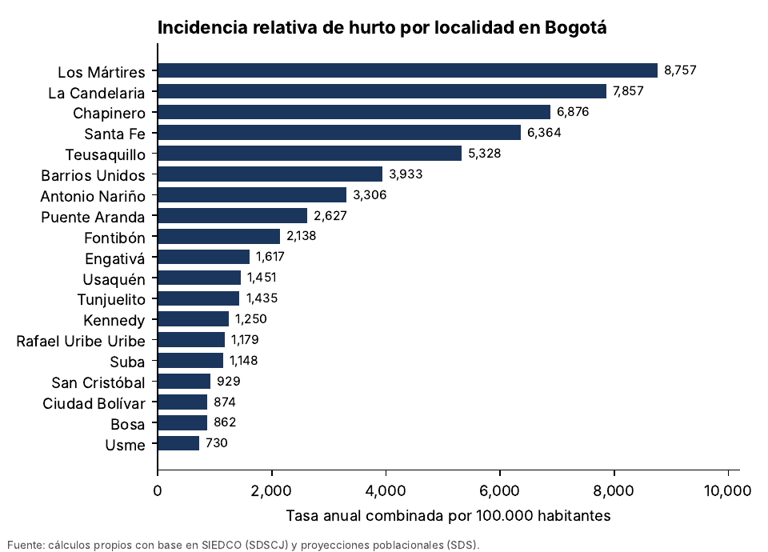
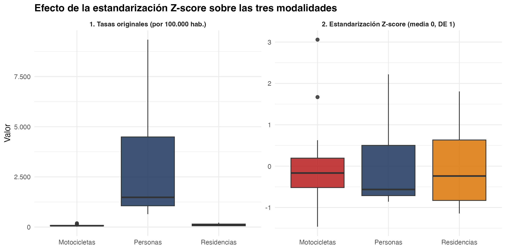
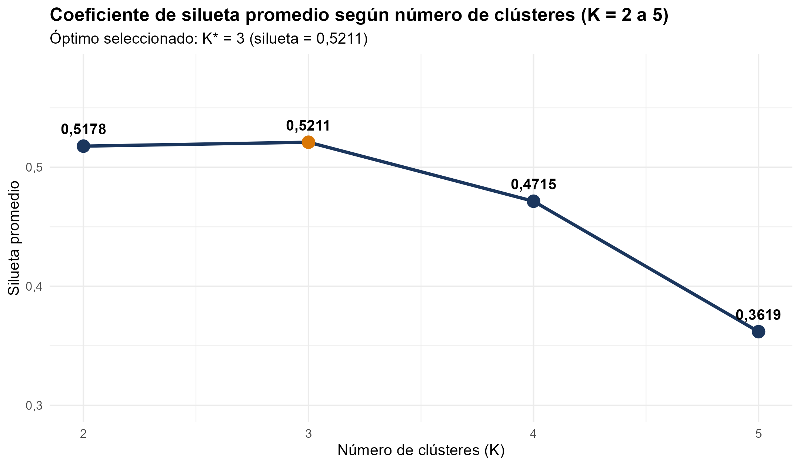
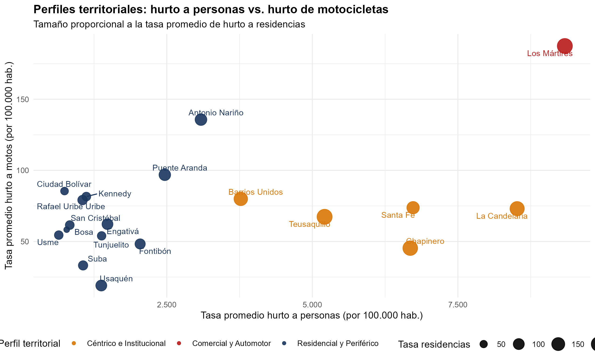

Este documento explica tanto la **teoría completa** como el **código línea por línea** de `scripts/04_clustering_kmeans.R`, el script que agrupa las **19 localidades urbanas de Bogotá** en perfiles territoriales de seguridad (2022–2026). Para leer las tablas de código: a la izquierda está el código tal como aparece en el archivo, con su número de línea original; a la derecha, qué hace (`L` indica las líneas explicadas), y la frase en cursiva al final resume la idea sin tecnicismos.

\begin{center}
\begin{tikzpicture}[
  node distance=0.48cm,
  every node/.style={font=\sffamily\footnotesize},
  stepbox/.style={rectangle, rounded corners=4pt, draw=AmberEdge, fill=AmberSoft!60, thick, text width=12.0cm, align=center, inner sep=5pt},
  filebox/.style={rectangle, rounded corners=2pt, draw=NavyBlue!70, fill=GraySoft, dashed, text width=11.5cm, align=center, inner sep=4pt},
  arrow/.style={-{Stealth[length=2.6mm, width=1.8mm]}, thick, draw=NavyBlue}
]
\node[filebox] (in) {\textbf{Entrada}: \texttt{panel\_delitos\_poblacion\_localidad.parquet} (95 filas: 19 localidades $\times$ 5 a\~nos)};
\node[stepbox, below=of in] (s1) {\textbf{Preparaci\'on (\texttt{recipes})}: Promedia tasas 2022--2026 por localidad y aplica receta base \texttt{Z-score}};
\node[stepbox, below=of s1] (s2) {\textbf{Selecci\'on de $K$}: Eval\'ua $K=2..5$ con Silueta media, Inercia (WSS) y Gap bootstrap $\rightarrow$ $K^{*}=3$};
\node[stepbox, below=of s2] (s3) {\textbf{Experimentaci\'on}: Contrasta 5 escalamientos/PCA, Euclidiana vs. Manhattan y K-Means/PAM/AGNES/GMM};
\node[filebox, below=of s3] (out) {\textbf{Salida}: Etiquetado determin\'istico + \texttt{clusters\_localidades\_kmeans.parquet} y 4 tablas CSV};
\draw[arrow] (in) -- (s1);
\draw[arrow] (s1) -- (s2);
\draw[arrow] (s2) -- (s3);
\draw[arrow] (s3) -- (out);
\end{tikzpicture}
\end{center}

# Fundamentos teóricos antes de empezar

## ¿Qué es el agrupamiento (*clustering* no supervisado)?

El *clustering* es un método de aprendizaje automático **no supervisado**: clasifica un conjunto de observaciones —aquí las $N=19$ localidades urbanas de Bogotá— en un número $K$ de grupos o clústeres $(C_1,\dots,C_K)$ sin partir de etiquetas previas. Cada localidad $i$ se representa como un vector tridimensional de tasas promedio anuales de hurto por 100.000 habitantes:

$$\mathbf{x}_i = (\text{Tasa Hurto Personas}_i,\ \text{Tasa Hurto Residencias}_i,\ \text{Tasa Hurto Motocicletas}_i) \in \mathbb{R}^3$$

El agrupamiento persigue dos objetivos simultáneos: **cohesión interna** (que las localidades de un mismo clúster tengan perfiles delictivos lo más parecidos posible) y **separación externa** (que los clústeres se diferencien claramente entre sí).

## Cómo medimos la cercanía: Distancia Euclidiana vs. Manhattan

Para decidir si dos localidades $\mathbf{z}_a$ y $\mathbf{z}_b$ se parecen, los algoritmos miden la distancia entre sus vectores estandarizados:

- **Distancia Euclidiana:** mide la **línea recta** más corta en el espacio tridimensional:
  $$d_{\text{Euclidiana}}(\mathbf{z}_a, \mathbf{z}_b) = \sqrt{\sum_{j=1}^{3} (Z_{aj} - Z_{bj})^2}$$
  Como eleva cada diferencia al cuadrado, penaliza con fuerza las diferencias grandes. Esto hace que localidades con valores extremos en una modalidad (como Los Mártires en hurto de motocicletas) ejerzan mayor atracción sobre los centroides.
- **Distancia Manhattan:** suma las diferencias absolutas eje por eje, como caminar por cuadras sin cruzar en diagonal:
  $$d_{\text{Manhattan}}(\mathbf{z}_a, \mathbf{z}_b) = \sum_{j=1}^{3} |Z_{aj} - Z_{bj}|$$
  Al no elevar al cuadrado, es menos sensible a valores atípicos aislados y permite comprobar si esos extremos distorsionan la partición.

## Por qué estandarizamos las variables (Z-score, escalamientos alternativos y PCA)

En nuestros datos, el hurto a personas alcanza miles de casos por 100.000 habitantes (hasta `8.389,9`), mientras que el hurto a residencias y el hurto de motocicletas se mueven en decenas o pocos cientos (`45` a `217`). Si se usaran las tasas en sus unidades originales, las diferencias de miles de puntos en hurto a personas dominarían la distancia y volverían irrelevante lo que ocurre con residencias y motos.

Para que las tres modalidades pesen igual aplicamos la **estandarización Z-score** a cada variable $j \in \{1,2,3\}$:

$$Z_{ij} = \frac{X_{ij} - \bar{X}_j}{s_j}$$

Aquí $\bar{X}_j$ es el promedio y $s_j$ la desviación estándar de la modalidad $j$ entre las 19 localidades. Las tres variables quedan medidas en desviaciones estándar respecto al promedio de Bogotá, con media $0$ y varianza $1$. Por ejemplo, Los Mártires tiene una tasa promedio de hurto a personas de `8.389,9` por 100.000 habitantes; con una media de `2.910,7` y una desviación estándar de `2.574,8`, su valor estandarizado es $Z = (8.389{,}9 - 2.910{,}7) / 2.574{,}8 \approx +2{,}13$, es decir, $2{,}13$ desviaciones estándar por encima del promedio distrital.

En la fase de experimentación contrastamos el Z-score base frente a otras cuatro transformaciones: **Min-Max $[0,1]$** (escala al rango mínimo–máximo), **Robusto (Mediana/IQR)** (centra en la mediana y divide por el rango intercuartílico para atenuar extremos), **`log(1 + x)` + Z-score** (comprime colas derechas) y **PCA 2D** (proyecta las 3 variables en 2 componentes principales ortogonales que retienen el `96,38%` de la varianza total).

## El algoritmo K-Means y sus cuatro etapas (Hartigan-Wong)

Con las 19 localidades ubicadas en el espacio estandarizado $\mathbf{z}_i = (Z_{i,\text{pers}}, Z_{i,\text{resid}}, Z_{i,\text{motos}})$, la función `kmeans()` de R minimiza la **suma de cuadrados intra-clúster** (*Within-Cluster Sum of Squares*, **WSS**), también llamada inercia interna:

$$\min_{C_1,\dots,C_K} \text{WSS}(K) = \sum_{k=1}^{K}\sum_{i\in C_k}\lVert \mathbf{z}_i - \boldsymbol{\mu}_k\rVert_2^2 = \sum_{k=1}^{K}\sum_{i\in C_k}\sum_{j=1}^{3}(Z_{ij} - \mu_{kj})^2$$

Aquí $\boldsymbol{\mu}_k = (\mu_{k,1}, \mu_{k,2}, \mu_{k,3})$ es el **centroide** del clúster $k$ (el centro de gravedad del grupo). El algoritmo repite cuatro pasos:

1. Se eligen $K$ puntos iniciales provisionales $\boldsymbol{\mu}_1^{(0)}, \dots, \boldsymbol{\mu}_K^{(0)}$. Como una mala inicialización aleatoria puede estancar la búsqueda en un óptimo local, fijamos `nstart = 50` para repetir el proceso desde 50 arranques distintos y conservar la solución de menor WSS.
2. Cada localidad se asigna al centroide más cercano según la distancia euclidiana:
   $$d(\mathbf{z}_i, \boldsymbol{\mu}_k) = \sqrt{(Z_{i,\text{pers}} - \mu_{k,\text{pers}})^2 + (Z_{i,\text{resid}} - \mu_{k,\text{resid}})^2 + (Z_{i,\text{motos}} - \mu_{k,\text{motos}})^2}$$
3. Cada centroide se recalcula como el promedio exacto de las localidades asignadas a su grupo: $\boldsymbol{\mu}_k = \frac{1}{|C_k|}\sum_{i \in C_k}\mathbf{z}_i$.
4. Los pasos 2 y 3 se repiten hasta que ninguna localidad cambie de clúster entre iteraciones.

## Criterios de evaluación y modelos alternativos contrastados

- **Proporción de varianza explicada ($\text{BSS}/\text{TSS}$):** la variabilidad total ($\text{TSS} = 3 \times 18 = 54$ con 3 variables estandarizadas y 19 localidades) se descompone en dispersión interna ($\text{WSS}$) más dispersión entre grupos ($\text{BSS}$). El cociente $\text{BSS}/\text{TSS} = 1 - \text{WSS}/\text{TSS}$ mide qué porcentaje de la heterogeneidad delictiva capturan los $K$ perfiles.
- **Coeficiente de ancho de silueta ($S(i)$ y $\bar{S}$):** para cada localidad $i$ compara $a(i)$ (distancia promedio a las demás localidades de su mismo clúster) frente a $b(i)$ (distancia promedio a las del clúster vecino más cercano):
  $$S(i) = \frac{b(i) - a(i)}{\max\{a(i), b(i)\}} \in [-1, 1]$$
  Un $S(i)$ cercano a $+1$ indica buena clasificación; cercano a $0$, frontera ambigua; y negativo (`n_silueta_neg`), que la localidad está más cerca de otro grupo. Una silueta promedio $\bar{S}$ más alta refleja mejor cohesión y separación.
- **Estadístico Gap e Índice de Rand Ajustado (ARI):** el Gap compara la dispersión observada contra $100$ simulaciones aleatorias uniformes (*bootstrap*); el **ARI** mide la coincidencia entre dos clasificaciones descontando el azar ($1{,}0000$ = asignación idéntica).
- **Modelos alternativos:** **PAM** (*Partitioning Around Medoids*) usa localidades reales como centros y admite distancia Manhattan; **AGNES (Ward.D2)** construye un dendrograma jerárquico fusionando pares que menos elevan la varianza; y **GMM** (*Gaussian Mixture Models*) estima clústeres elípticos mediante probabilidad y distancia de Mahalanobis.

---

# Script de modelado: `04_clustering_kmeans.R`

## Encabezado y configuración (`Sección 1`)

:::: {layout="[54, -3, 43]" layout-valign="top"}
::: {}

```{.r .numberLines startFrom="1"}
# ==============================================================================
# PROYECTO: Hurtos y Sentimiento Mediático en Bogotá (2022–septiembre de 2026)
# SCRIPT: scripts/04_clustering_kmeans.R
# ROL: Agrupamiento Territorial (K-Means) y Experimentación con Lógica Tidymodels
# AUTORES: Grupo 10 — Taller de Programación en R (MECA, Universidad de los Andes)
# PRODUCE: data/processed/clusters_localidades_kmeans.parquet
#          output/tables/tabla_clustering_kmeans_perfiles.csv
#          output/tables/tabla_sensibilidad_escalamientos_pca.csv
#          output/tables/tabla_comparacion_modelos_distancias.csv
#          output/tables/tabla_asignaciones_modelos_localidad.csv
# ==============================================================================

# 1. Configuración y Dependencias ----

## 1.1 Opciones globales y semilla ----
options(scipen = 999)
set.seed(20261014)
```

:::

::: {}

- **L1–11 (Cabecera):** Documenta el propósito del script y lista los 5 archivos que genera: 1 base maestra en Parquet (`clusters_localidades_kmeans.parquet`) y 4 tablas de auditoría en CSV.
- **L16 (Notación):** `options(scipen = 999)` evita que R imprima números grandes o decimales en notación científica (como `1e+05`).
- **L17 (Semilla):** `set.seed(20261014)` fija el generador aleatorio para que los `50` arranques de K-Means y las `100` simulaciones del Gap den exactamente el mismo resultado en cualquier computador.

*Fijamos las reglas de lectura numérica y reproducibilidad desde el arranque.*

:::
::::

:::: {layout="[54, -3, 43]" layout-valign="top"}
::: {}

```{.r .numberLines startFrom="19"}
## 1.2 Carga de librerías ----
library(here)       # Rutas relativas portables
library(conflicted) # Evita colisiones silenciosas entre funciones
library(arrow)      # Lectura/escritura rápida en formato Parquet
library(readr)      # Exportación de tablas CSV
library(dplyr)      # Manipulación de datos (Tidyverse)
library(tidyr)      # Remodelado de tablas
library(purrr)      # Programación funcional sin bucles for
library(recipes)    # Preprocesamiento declarativo estilo tidymodels
library(broom)      # Extracción ordenada (tidy/glance) de modelos
library(cluster)    # PAM, siluetas y estadístico Gap
library(mclust)     # Mezclas Gaussianas (GMM) y Adjusted Rand Index (ARI)

## 1.3 Resolución explícita de conflictos ({conflicted}) ----
conflict_prefer("filter", "dplyr", quiet = TRUE)
conflict_prefer("lag",    "dplyr", quiet = TRUE)
conflict_prefer("select", "dplyr", quiet = TRUE)
conflict_prefer("map",    "purrr", quiet = TRUE)

## 1.4 Definición de rutas relativas ({here}) ----
ruta_datos_clean   <- here("data", "processed")
ruta_salida_tablas <- here("output", "tables")

if (!dir.exists(ruta_salida_tablas)) {
  dir.create(ruta_salida_tablas, recursive = TRUE, showWarnings = FALSE)
}
```

:::

::: {}

- **L20–30 (Librerías):** Carga `{here}` (rutas portables), `{arrow}`/`{readr}` (Parquet/CSV), `{dplyr}`/`{tidyr}`/`{purrr}` (manipulación y programación funcional), `{recipes}`/`{broom}` (preprocesamiento y extracción ordenada estilo *tidymodels*), `{cluster}` (PAM, silueta, Gap) y `{mclust}` (GMM y ARI).
- **L33–36 (Conflictos):** `conflict_prefer()` declara qué paquete gana cuando dos librerías tienen funciones homónimas (`filter`, `lag`, `select` de `dplyr`; `map` de `purrr`).
- **L39–44 (Rutas):** `here()` construye rutas desde la raíz del proyecto; `dir.create(..., recursive = TRUE)` crea `output/tables/` si aún no existe.

*Preparamos librerías, evitamos choques silenciosos de nombres y aseguramos carpetas portables.*

:::
::::

## Preparación de los datos y receta base (`Sección 2`)

Para construir una tipología territorial comparable entre localidades de distinto tamaño y estable en el tiempo, el análisis parte de **tasas por cada 100.000 habitantes** y de un **promedio anual (2022–2026)** por localidad. Por ejemplo, en Fontibón en 2022 hubo `14.252` denuncias de hurto a personas y `384.590` habitantes proyectados, lo que da $14.252 / 384.590 \times 100.000 = 3.705{,}76$ por 100.000 habitantes.

Elegimos estas tres modalidades (`hurto_personas`, `hurto_residencias`, `hurto_motos`) porque son los delitos patrimoniales cotidianos que más afectan la **percepción de inseguridad ciudadana** en Bogotá, explicando por qué el miedo al delito diverge de las cifras de homicidios (Restrepo & Moreno, 2007, *"Bogotá: ¿más crimen?, ¿más miedo?"*, *Desarrollo y Sociedad* 59, DOI: `10.13043/dys.59.5`; Encuesta de Percepción y Victimización de la CCB; ECSC del DANE).

{#fig-ranking width="85%"}

:::: {layout="[54, -3, 43]" layout-valign="top"}
::: {}

```{.r .numberLines startFrom="46"}
# 2. Preparación de Datos y Receta Principal (recipes) ----

## 2.1 Carga del panel delictivo y agregación promedio por localidad ----
archivo_panel <- file.path(
  ruta_datos_clean,
  "02_poblacion",
  "panel_delitos_poblacion_localidad.parquet"
)
panel_delitos <- read_parquet(archivo_panel)

matriz_localidad <- panel_delitos |>
  group_by(codigo_localidad, localidad) |>
  summarise(
    tasa_personas_prom = mean(tasa_hurto_personas, na.rm = TRUE),
    tasa_resid_prom    = mean(tasa_hurto_residencias, na.rm = TRUE),
    tasa_motos_prom    = mean(tasa_hurto_motos, na.rm = TRUE),
    tasa_total_prom    = mean(tasa_hurto_total, na.rm = TRUE),
    poblacion_prom     = mean(poblacion, na.rm = TRUE),
    .groups = "drop"
  )

## 2.2 Receta base de preprocesamiento: estandarización Z-score ----
receta_base <- recipe(
  ~ tasa_personas_prom + tasa_resid_prom + tasa_motos_prom,
  data = matriz_localidad
) |>
  step_normalize(all_numeric_predictors())

receta_base_prep <- prep(receta_base, training = matriz_localidad)
matriz_scale     <- bake(receta_base_prep, new_data = NULL) |> as.matrix()
rownames(matriz_scale) <- matriz_localidad$localidad
```

:::

::: {}

- **L49–54 (Lectura):** Construye la ruta de `panel_delitos_poblacion_localidad.parquet` (`95` filas: `19` localidades × `5` años) y lo carga con `read_parquet()`.
- **L56–65 (Agregación):** Agrupa por `codigo_localidad` y `localidad`, y promedia las tasas 2022–2026 (`na.rm = TRUE`) obteniendo `19` filas estables.
- **L68–72 (Receta):** `recipe()` declara las `3` modalidades específicas (excluyendo `tasa_total_prom` para no duplicar información ni inducir colinealidad) y `step_normalize()` especifica estandarización *Z-score*.
- **L74–76 (Prep & Bake):** `prep()` estima $\bar{X}_j$ y $s_j$; `bake(new_data = NULL)` devuelve la matriz estandarizada `19 × 3` y `rownames()` la etiqueta por localidad.

*Resumimos cinco años por localidad e igualamos la escala de las tres tasas.*

:::
::::

{#fig-zscore width="88%"}

## Elección del número óptimo de clústeres ($K = 2$ a $5$, `Sección 3`)

:::: {layout="[54, -3, 43]" layout-valign="top"}
::: {}

```{.r .numberLines startFrom="90"}
# 3. Selección del Número Óptimo de Clústeres (K = 2 a 5) ----

## 3.1 Evaluación de K candidatos mediante Silueta, Inercia (WSS) y Gap ----
dist_euclidea <- dist(matriz_scale, method = "euclidean")

diagnostico_k <- tibble(k = 2:5) |>
  mutate(
    modelo = map(k, function(k_val) {
      set.seed(20261014)
      kmeans(matriz_scale, centers = k_val, nstart = 50)
    }),
    silueta_media = map_dbl(modelo, function(km) {
      sil <- silhouette(km$cluster, dist_euclidea)
      round(mean(sil[, 3]), 4)
    }),
    wss = map_dbl(modelo, ~ round(glance(.x)$tot.withinss, 4))
  ) |>
  select(k, silueta_media, wss)

set.seed(20261014)
gap_kmeans <- clusGap(
  matriz_scale,
  FUNcluster = function(x, k) kmeans(x, centers = k, nstart = 50),
  K.max      = 5L,
  B          = 100L,
  verbose    = FALSE
)

## 3.2 Selección automática del K óptimo (máxima silueta promedio) ----
k_optimo <- diagnostico_k$k[which.max(diagnostico_k$silueta_media)]

message(
  ">>> Modelo óptimo seleccionado según coeficiente de silueta: K* = ",
  k_optimo, " (silueta = ", max(diagnostico_k$silueta_media), ")"
)
```

:::

::: {}

- **L93 (Distancias):** `dist(..., method = "euclidean")` calcula la matriz de distancias euclidianas entre las `19` localidades estandarizadas.
- **L95–107 (Barrido $K=2..5$):** Con `purrr::map()` ajusta `kmeans()` para cada $K$ usando `nstart = 50` (50 inicializaciones aleatorias para evitar óptimos locales). Extrae la silueta media (`silhouette()`) y la inercia interna `tot.withinss` vía `broom::glance()`.
- **L109–116 (Gap):** `clusGap(..., B = 100L)` compara la dispersión observada contra `100` muestras aleatorias uniformes (*bootstrap*).
- **L119–124 (Selección):** `which.max()` elige automáticamente el $K^*$ de mayor silueta promedio ($K^*=3$) y lo reporta en consola con `message()`.

*Probamos de 2 a 5 grupos y elegimos el que mejor separa las localidades.*

:::
::::

|Número de clústeres ($K$)|Silueta promedio|WSS (inercia interna)|Varianza explicada ($\text{BSS}/\text{TSS}$, %)|
|---:|---:|---:|---:|
|2|0,5153|23,31|56,82|
|3|0,5416|13,58|74,85|
|4|0,4786|8,15|84,90|
|5|0,3792|5,90|89,07|

: Diagnóstico del número óptimo $K$ mediante coeficiente de silueta e inercia intra-clúster {#tbl-diag}

Como muestra la @tbl-diag y la @fig-silueta:

- **¿Qué significa una silueta promedio de `0,5416`?** Valores entre `0,51` y `0,70` indican una **estructura sólida y bien definida**: en promedio, cada localidad está más de dos veces más cerca de su propio grupo que del perfil vecino más cercano.
- **¿Qué es el `WSS` (`13,58`) y por qué equivale al `74,85%`?** Partiendo de una dispersión total de `54,00` ($K=1$), dividir en $K=3$ reduce la inercia interna a `13,58`, capturando el `74,85%` de la variabilidad delictiva.
- **¿Por qué no elegimos $K=4$ o $K=5$?** El WSS siempre baja al partir grupos (`8,15` y `5,90`), pero la silueta cae a `0,4786` y `0,3792` porque los grupos adicionales pierden separación entre sí.

{#fig-silueta width="70%"}

## Experimentación y sensibilidad metodológica (`Sección 4`)

Antes de consolidar y exportar el modelo definitivo, contrastamos escalamientos alternativos (`recipes`), PCA 2D, distancias Euclidiana vs. Manhattan y algoritmos PAM, AGNES y GMM.

:::: {layout="[54, -3, 43]" layout-valign="top"}
::: {}

```{.r .numberLines startFrom="131"}
# 4. Experimentación y Sensibilidad (Estilo Tidymodels: Recetas x Modelos) ----

## 4.1 Modelo K-Means de referencia sobre la receta base ----
set.seed(20261014)
km_base  <- kmeans(matriz_scale, centers = k_optimo, nstart = 50)
sil_base <- silhouette(km_base$cluster, dist_euclidea)

## 4.2 Definición de recetas alternativas con {recipes} ----
receta_base_formula <- ~ tasa_personas_prom + tasa_resid_prom + tasa_motos_prom

hornear_matriz <- function(receta, datos) {
  receta |>
    prep(training = datos) |>
    bake(new_data = NULL) |>
    as.matrix()
}

receta_minmax <- recipe(receta_base_formula, data = matriz_localidad) |>
  step_range(all_numeric_predictors(), min = 0, max = 1)

receta_robusta <- recipe(receta_base_formula, data = matriz_localidad) |>
  step_mutate(
    tasa_personas_prom = (tasa_personas_prom - median(tasa_personas_prom)) / IQR(tasa_personas_prom),
    tasa_resid_prom    = (tasa_resid_prom    - median(tasa_resid_prom))    / IQR(tasa_resid_prom),
    tasa_motos_prom    = (tasa_motos_prom    - median(tasa_motos_prom))    / IQR(tasa_motos_prom)
  )

receta_log_z <- recipe(receta_base_formula, data = matriz_localidad) |>
  step_log(all_numeric_predictors(), offset = 1) |>
  step_normalize(all_numeric_predictors())

receta_pca2 <- recipe(receta_base_formula, data = matriz_localidad) |>
  step_normalize(all_numeric_predictors()) |>
  step_pca(all_numeric_predictors(), num_comp = 2)

pca_tasas <- prcomp(matriz_scale, center = FALSE, scale. = FALSE)
var_pca   <- summary(pca_tasas)$importance
```

:::

::: {}

- **L134–136 (Referencia base):** Ajusta `km_base` sobre la matriz *Z-score* con $K^*=3$ y guarda sus siluetas individuales (`sil_base`) para usarlas como punto de comparación.
- **L139–146 (Función auxiliar):** Define la fórmula común (`~` 3 tasas) y `hornear_matriz()`, que encapsula `prep() |> bake() |> as.matrix()` para evitar repetir código.
- **L148–164 (4 recetas alternativas):** Crea `Min-Max [0,1]` (`step_range`), `Robusto` (mediana e IQR escritos explícitamente porque `step_mutate()` no evalúa `across()`), `Log(1+x) + Z-score` (`step_log` + `step_normalize`) y `PCA 2D` (`step_pca` con 2 componentes).
- **L166–167 (Varianza PCA):** `prcomp()` sobre la matriz ya escalada extrae el % de varianza explicada por `PC1` y `PC2`.

*Preparamos cuatro escalas alternativas y PCA para probar la estabilidad del agrupamiento.*

:::
::::

:::: {layout="[54, -3, 43]" layout-valign="top"}
::: {}

```{.r .numberLines startFrom="178"}
## 4.3 Evaluación de K-Means (K = 3) en cada espacio preprocesado ----
evaluar_receta_kmeans <- function(receta, nombre_espacio) {
  mat_espacio <- hornear_matriz(receta, matriz_localidad)
  set.seed(20261014)
  km_esp  <- kmeans(mat_espacio, centers = 3L, nstart = 50)
  sil_esp <- silhouette(km_esp$cluster, dist(mat_espacio))

  tibble(
    espacio         = nombre_espacio,
    silueta_media   = round(mean(sil_esp[, 3]), 4),
    n_silueta_neg   = sum(sil_esp[, 3] < 0),
    wss             = round(glance(km_esp)$tot.withinss, 4),
    ari_vs_base     = round(adjustedRandIndex(km_esp$cluster, km_base$cluster), 4),
    pca_var_pc1     = round(var_pca[2, 1], 4),
    pca_var_pc2     = round(var_pca[2, 2], 4),
    pca_var_acum_2d = round(var_pca[3, 2], 4)
  )
}

catalogo_recetas <- list(
  "Z-score (base)"              = receta_base,
  "Min-Max [0, 1]"              = receta_minmax,
  "Robusto (Mediana / IQR)"     = receta_robusta,
  "Log(1 + x) + Z-score"        = receta_log_z,
  "PCA (PC1 + PC2 = 96,4% var)" = receta_pca2
)

tabla_sensibilidad_escalamientos <- imap_dfr(catalogo_recetas, evaluar_receta_kmeans)
```

:::

::: {}

- **L179–195 (`evaluar_receta_kmeans`):** Para cualquier receta dada, hornea su matriz, corre K-Means ($K=3$, `nstart=50`) con la misma semilla y calcula: silueta promedio, conteo de siluetas negativas (`< 0`), inercia `WSS`, similitud `ARI` frente a `km_base` (`adjustedRandIndex`) y varianza PCA.
- **L197–205 (Catálogo funcional):** Agrupa las 5 recetas en una lista nombrada (`catalogo_recetas`) y usa `imap_dfr()` para iterar sobre ellas y apilar los 5 resúmenes en una sola tabla comparativa.

*Evaluamos en igualdad de condiciones qué cambia al variar el preprocesamiento.*

:::
::::

```{r}
#| label: tbl-sens-escalamientos
#| tbl-cap: "Sensibilidad de K-Means (K = 3) a diferentes escalamientos y redimensionamiento PCA"

sens_esc <- readr::read_csv(
  here::here("output", "tables", "tabla_sensibilidad_escalamientos_pca.csv"),
  show_col_types = FALSE
)
knitr::kable(
  sens_esc,
  digits = 4,
  col.names = c("Espacio", "Silueta", "Neg.", "WSS", "ARI base", "PC1", "PC2", "Acum. 2D")
)
```

- **Por qué elegimos `Z-score`:** `Z-score` (`0,5416`), `Robusto` (`0,4635`, `wss = 14,1014`) y `PCA 2D` (`96,38%` de varianza, `0,5819`) producen **exactamente la misma partición** ($\text{ARI} = 1{,}0000$). Preferimos `Z-score` sobre `PCA` porque conserva la interpretabilidad directa en las tres tasas originales sin cambiar una sola localidad.

:::: {layout="[54, -3, 43]" layout-valign="top"}
::: {}

```{.r .numberLines startFrom="207"}
## 4.4 Contraste de distancias (Euclidiana vs. Manhattan) y modelos alternativos ----
dist_manhattan <- dist(matriz_scale, method = "manhattan")

pam_euc <- pam(dist_euclidea,  k = 3L)
pam_man <- pam(dist_manhattan, k = 3L)
hc_euc  <- cutree(hclust(dist_euclidea,  method = "ward.D2"), k = 3L)
hc_man  <- cutree(hclust(dist_manhattan, method = "ward.D2"), k = 3L)

set.seed(20261014)
gmm_fit <- Mclust(matriz_scale, G = 3L, verbose = FALSE)

evaluar_particion <- function(clusters_vec, dist_ref, nombre_modelo, metric_dist) {
  sil_obj  <- silhouette(clusters_vec, dist_ref)
  tamanios <- paste(sort(as.integer(table(clusters_vec)), decreasing = TRUE), collapse = " / ")

  tibble(
    modelo         = nombre_modelo,
    distancia      = metric_dist,
    silueta_media  = round(mean(sil_obj[, 3]), 4),
    n_silueta_neg  = sum(sil_obj[, 3] < 0),
    tamanios_grupo = tamanios,
    ari_vs_kmeans  = round(adjustedRandIndex(clusters_vec, km_base$cluster), 4),
    gap_k3         = round(gap_kmeans$Tab[3, "gap"], 4)
  )
}

tabla_comparacion_modelos <- bind_rows(
  evaluar_particion(km_base$cluster,        dist_euclidea,  "K-Means (base)",      "Euclidiana"),
  evaluar_particion(pam_euc$clustering,     dist_euclidea,  "PAM (Medoides)",      "Euclidiana"),
  evaluar_particion(pam_man$clustering,     dist_manhattan, "PAM (Medoides)",      "Manhattan"),
  evaluar_particion(hc_euc,                 dist_euclidea,  "AGNES (Ward.D2)",     "Euclidiana"),
  evaluar_particion(hc_man,                 dist_manhattan, "AGNES (Ward.D2)",     "Manhattan"),
  evaluar_particion(gmm_fit$classification, dist_euclidea,  "GMM (Mezcla Gauss.)", "Mahalanobis / EM")
)
```

:::

::: {}

- **L208–216 (4 algoritmos):** Calcula `dist_manhattan` y ajusta modelos alternativos con $K=3$: **PAM** (`pam()` con distancia Euclidiana y Manhattan), **AGNES jerárquico** (`hclust(..., method = "ward.D2")` + `cutree()`) y **GMM** (`Mclust(..., G = 3L)`).
- **L218–231 (`evaluar_particion`):** Función unificada que recibe cualquier vector de etiquetas y su distancia de referencia, devolviendo silueta media, siluetas negativas, tamaños de clúster ordenados, `ARI` vs. K-Means base y `gap_k3`.
- **L233–240 (Tabla de contraste):** `bind_rows()` consolida los 6 modelos en `tabla_comparacion_modelos`.

*Contrastamos K-Means contra tres familias distintas de modelos y dos métricas de distancia.*

:::
::::

```{r}
#| label: tbl-sens-modelos
#| tbl-cap: "Contraste de modelos (K-Means, PAM, AGNES Ward y GMM) y distancias (Euclidiana vs. Manhattan) para K = 3"

comp_mod <- readr::read_csv(
  here::here("output", "tables", "tabla_comparacion_modelos_distancias.csv"),
  show_col_types = FALSE
)
knitr::kable(comp_mod, digits = 4)
```

- **Por qué `K-Means` es el modelo definitivo:** logra la **silueta media más alta (`0,5416`)** sobre `Z-score`. **PAM** y **AGNES** coinciden en **18 de 19 localidades** ($\text{ARI} = 0,8484$), moviendo únicamente a Antonio Nariño (el único caso frontera con silueta `-0,2116` en *k-means*) y dejando a Los Mártires aislado (`13 / 5 / 1`), mientras K-Means preserva tres perfiles comparables (`12 / 5 / 2`).

## Modelo definitivo, etiquetado determinístico y exportación (`Secciones 5 y 6`)

:::: {layout="[54, -3, 43]" layout-valign="top"}
::: {}

```{.r .numberLines startFrom="250"}
# 5. Ajuste Definitivo, Etiquetado Determinístico y Auditoría ----

## 5.1 Etiquetado determinístico de centroides (broom::tidy) ----
km_final  <- km_base
sil_final <- sil_base

centroides_df <- tidy(km_final) |>
  mutate(cluster_raw = as.integer(cluster))

id_comercial <- centroides_df |>
  slice_max(tasa_motos_prom, n = 1) |>
  pull(cluster_raw)

id_centro <- centroides_df |>
  filter(cluster_raw != id_comercial) |>
  slice_max(tasa_personas_prom, n = 1) |>
  pull(cluster_raw)

id_residencial <- setdiff(1:3, c(id_comercial, id_centro))

df_clusters <- matriz_localidad |>
  mutate(
    cluster_raw       = km_final$cluster,
    silueta_localidad = round(as.numeric(sil_final[, 3]), 4),
    cluster_id = case_when(
      cluster_raw == id_centro      ~ 1L,
      cluster_raw == id_comercial   ~ 2L,
      cluster_raw == id_residencial ~ 3L
    ),
    cluster_nombre = case_when(
      cluster_id == 1L ~ "Céntrico e Institucional",
      cluster_id == 2L ~ "Comercial y Automotor",
      cluster_id == 3L ~ "Residencial y Periférico"
    ),
    perfil_seguridad = case_when(
      cluster_id == 1L ~ "Alta criticidad en hurto a personas y residencias (núcleo céntrico)",
      cluster_id == 2L ~ "Alta concentración de hurto automotor y motocicletas (corredor comercial)",
      cluster_id == 3L ~ "Tasa per cápita moderada en zonas de alta densidad residencial"
    )
  ) |>
  select(-cluster_raw) |>
  arrange(cluster_id, desc(tasa_total_prom))
```

:::

::: {}

- **L253–268 (Anclaje de centroides):** Como los IDs crudos (`1, 2, 3`) de `kmeans()` dependen del arranque, `broom::tidy()` extrae los centroides y asigna de forma determinística: el de mayor `tasa_motos_prom` a `id_comercial`, el siguiente mayor en `tasa_personas_prom` a `id_centro`, y el restante (`setdiff`) a `id_residencial`.
- **L270–291 (Tabla `df_clusters`):** Añade a las `19` localidades su `silueta_localidad`, el `cluster_id` fijo (`1L, 2L, 3L`), `cluster_nombre` y `perfil_seguridad`, eliminando `cluster_raw` y ordenando de mayor a menor tasa total.

*Garantizamos que las etiquetas de cada perfil nunca permuten entre corridas.*

:::
::::

:::: {layout="[54, -3, 43]" layout-valign="top"}
::: {}

```{.r .numberLines startFrom="302"}
## 5.2 Auditoría de asignaciones por localidad entre modelos ----
matriz_pca2 <- hornear_matriz(receta_pca2, matriz_localidad)
set.seed(20261014)
km_pca2 <- kmeans(matriz_pca2, centers = 3L, nstart = 50)

tabla_asignaciones_modelos <- matriz_localidad |>
  transmute(
    codigo_localidad = codigo_localidad,
    localidad        = localidad,
    kmeans_base      = km_final$cluster,
    pca2_kmeans      = km_pca2$cluster,
    pam_euclidiana   = pam_euc$clustering,
    pam_manhattan    = pam_man$clustering,
    agnes_euclidiana = hc_euc,
    agnes_manhattan  = hc_man,
    gmm_3            = gmm_fit$classification
  ) |>
  left_join(
    df_clusters |> select(codigo_localidad, cluster_nombre, silueta_localidad),
    by = "codigo_localidad"
  )

# 6. Exportación Conjunta de Resultados (Contrato Sentometrics / Shiny) ----

## 6.1 Guardado en data/processed/ y tablas en output/tables/ ----
archivo_salida_clusters <- file.path(ruta_datos_clean, "clusters_localidades_kmeans.parquet")
archivo_tabla_clusters  <- file.path(ruta_salida_tablas, "tabla_clustering_kmeans_perfiles.csv")

write_parquet(df_clusters, archivo_salida_clusters)
write_csv(df_clusters, archivo_tabla_clusters)
write_csv(tabla_sensibilidad_escalamientos, file.path(ruta_salida_tablas, "tabla_sensibilidad_escalamientos_pca.csv"))
write_csv(tabla_comparacion_modelos,        file.path(ruta_salida_tablas, "tabla_comparacion_modelos_distancias.csv"))
write_csv(tabla_asignaciones_modelos,       file.path(ruta_salida_tablas, "tabla_asignaciones_modelos_localidad.csv"))

message("✔ Asignaciones de clustering guardadas en: ", archivo_salida_clusters)
message("✔ Tabla de perfiles exportada en: ", archivo_tabla_clusters)
message("✔ Tablas de sensibilidad (recipes, PCA, distancias y modelos) guardadas en: ", ruta_salida_tablas)
```

:::

::: {}

- **L303–322 (Auditoría por localidad):** Ajusta `km_pca2` y usa `transmute()` para reunir lado a lado las asignaciones de las `19` localidades en los 7 modelos/especificaciones (`kmeans_base`, `pca2_kmeans`, `pam_euclidiana`, `pam_manhattan`, `agnes_euclidiana`, `agnes_manhattan`, `gmm_3`), cruzando nombre y silueta final con `left_join()`.
- **L327–338 (Exportación conjunta):** Guarda `clusters_localidades_kmeans.parquet` (contrato de entrada para `03_analisis_sentometrics.R` y el dashboard Shiny) y las 4 tablas CSV de resultados y auditoría en `output/tables/`, imprimiendo confirmación en consola.

*Todo el resultado final y su auditoría salen juntos al terminar la experimentación.*

:::
::::

## Caracterización de los perfiles y mapas resultantes

- **Clúster 1 — Céntrico e Institucional ($n=5$):** La Candelaria, Chapinero, Santa Fe, Teusaquillo y Barrios Unidos. Mayores tasas medias de hurto a personas (`5.834,7`) y residencias (`175,9`), reflejando el corredor central, financiero y universitario con enorme población flotante.
- **Clúster 2 — Comercial y Automotor ($n=2$):** Los Mártires y Antonio Nariño. Valor extremo en hurto a motocicletas (`153,0`, $+2{,}36$ desviaciones estándar), más del doble que cualquier otro grupo, asociado a zonas de comercio mayorista, talleres y autopartes.
- **Clúster 3 — Residencial y Periférico ($n=12$):** Puente Aranda, Fontibón, Engativá, Usaquén, Tunjuelito, Kennedy, Rafael Uribe Uribe, Suba, San Cristóbal, Ciudad Bolívar, Bosa y Usme. Tasas moderadas (`1.222,8` en personas; `4,8` veces menor que el perfil Céntrico) por sus altos denominadores de población residente.

|Perfil|N.°|Personas|Resid.|Motos|Total|Localidades miembro|
|:---|---:|---:|---:|---:|---:|:---|
|Céntrico e Institucional|5|5.834,7|175,9|60,8|6.071,4|La Candelaria, Chapinero, Santa Fe, Teusaquillo, Barrios Unidos|
|Comercial y Automotor|2|5.727,9|150,9|153,0|6.031,8|Los Mártires, Antonio Nariño|
|Residencial y Periférico|12|1.222,8|73,3|57,1|1.353,2|Puente Aranda, Fontibón, Engativá, Usaquén, Tunjuelito, Kennedy, Rafael Uribe Uribe, Suba, San Cristóbal, Ciudad Bolívar, Bosa, Usme|

: Perfiles delictivos promedio por clúster territorial (tasas anuales por 100.000 habitantes) {#tbl-perfiles}

|Perfil|Hurto personas|Hurto residencias|Hurto motos|
|:---|---:|---:|---:|
|Céntrico e Institucional|+1,136|+1,238|-0,205|
|Comercial y Automotor|+1,094|+0,780|+2,364|
|Residencial y Periférico|-0,656|-0,646|-0,309|

: Centroides estandarizados (Z-score) de los tres perfiles territoriales {#tbl-centroides}

{#fig-disp width="85%"}

{#fig-mapa width="55%"}

---

# Conclusiones, límites y sensibilidad temporal

## Síntesis de hallazgos y validación del modelo

1. **Estandarizar por población invierte el mapa de riesgo aparente:** las localidades con mayor carga delictiva por cada 100.000 habitantes (Los Mártires `8.757`, La Candelaria `7.857`, Chapinero `6.876`, Santa Fe `6.364` y Teusaquillo `5.328`) no coinciden con las más pobladas ni con las que concentran mayor volumen absoluto de denuncias (como Suba o Kennedy).
2. **Bogotá se estructura sólidamente en tres perfiles territoriales ($K^* = 3$):** la partición maximiza la silueta promedio (`0,5416`) y explica el `74,85%` de la varianza total (`WSS = 13,58` frente a `TSS = 54,00`). El grupo **Céntrico e Institucional** ($n=5$) lidera en hurto a personas (`5.834,7`) y residencias (`175,9`); el **Comercial y Automotor** ($n=2$) presenta un pico atípico en motocicletas (`153,0`, $+2{,}36$ desviaciones estándar); y el **Residencial y Periférico** ($n=12$) exhibe tasas moderadas (`1.353,2` en total).
3. **Robustez metodológica frente a escalamientos y algoritmos:** la partición base en `Z-score` es idéntica ($\text{ARI} = 1{,}0000$) a la obtenida bajo escalamiento **Robusto (Mediana/IQR)** y **PCA 2D** ($96{,}38\%$ de varianza retenida), por lo que conservar `Z-score` preserva la interpretabilidad directa en las tasas originales sin sacrificar estructura. Frente a **PAM** y **AGNES (Ward.D2)**, la concordancia es de **18 de 19 localidades** ($\text{ARI} = 0{,}8484$), difiriendo únicamente en **Antonio Nariño** (el único caso frontera del modelo base, con silueta `-0,2116`).

## Límites de interpretación y sensibilidad al periodo

- **Tipología descriptiva, no causal:** los clústeres caracterizan similitud en tasas promedio de hurto patrimonial; no miden determinantes socioeconómicos, presencia policial ni causalidad.
- **Sesgo de población flotante en el denominador:** las proyecciones de la SDS miden población *residente*. En localidades céntricas y comerciales con altísima afluencia diaria de trabajadores, estudiantes y visitantes (La Candelaria, Santa Fe, Chapinero, Los Mártires), el denominador subestima la población efectivamente expuesta, elevando las tasas per cápita.
- **Sensibilidad muestral ($N=19$) y efecto del corte `2026`:** como muestra la @tbl-sens, el perfil **Comercial y Automotor** ($n=2$) depende de la inclusión de `2026` (corte enero–septiembre): al promediar solo hasta `2025`, Antonio Nariño migra de clúster y Los Mártires queda como grupo unitario (`13 / 5 / 1`).

|Periodo|S (K=2)|S (K=3)|S (K=4)|S (K=5)|K óptimo|Tamaños (K=3)|¿Mártires y A. Nariño juntos?|
|:---|---:|---:|---:|---:|:---:|:---:|:---|
|2022-2026 (base)|0,5153|0,5416|0,4786|0,3792|3|12 / 5 / 2|Sí|
|2023-2026|0,5354|0,5520|0,4736|0,3270|3|12 / 5 / 2|Sí|
|2022-2025|0,4973|0,5062|0,4528|0,3765|3|13 / 5 / 1|No|
|2023-2025|0,5100|0,5011|0,4334|0,3411|2|12 / 6 / 1|No|

: Sensibilidad del agrupamiento al periodo de promediación de las tasas {#tbl-sens}

## Reproducibilidad y ejecución

- **Prerrequisito:** debe existir `data/processed/02_poblacion/panel_delitos_poblacion_localidad.parquet` (generado por `procesamiento_poblacion.R`).
- **Ejecución:** correr `source(here::here("scripts", "04_clustering_kmeans.R"))` o ejecutar el pipeline completo desde `master.R`.
- **Salidas consumidas aguas abajo:** `data/processed/clusters_localidades_kmeans.parquet` (para `03_analisis_sentometrics.R` y Shiny) y las 4 tablas CSV en `output/tables/`.
