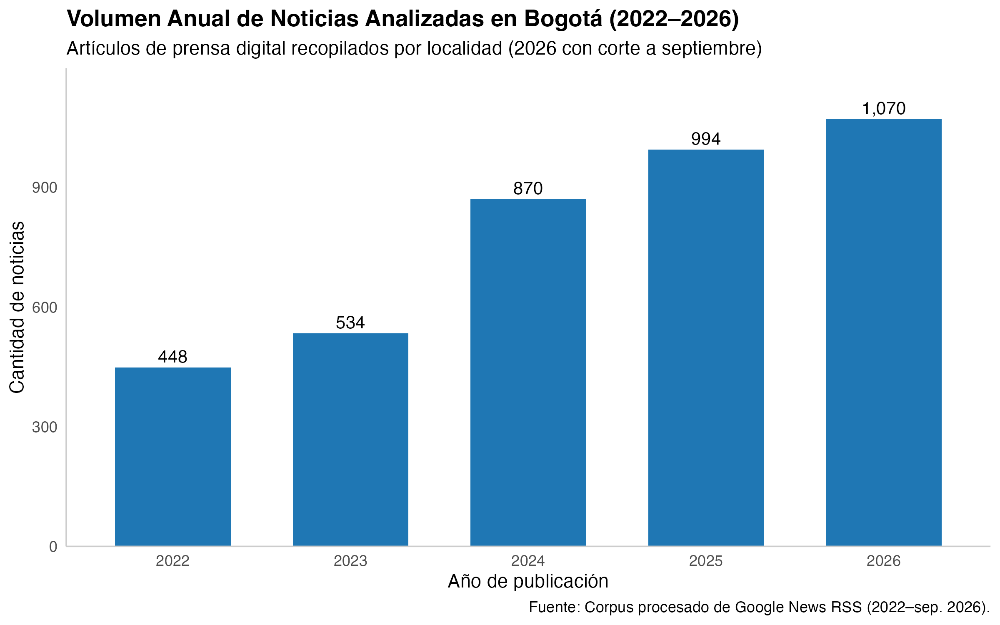
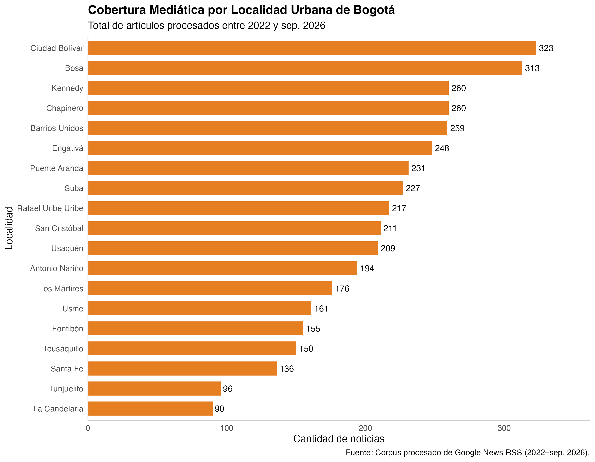

Este documento explica paso a paso cómo funcionan `scraping_google_news.R` y `procesamiento_noticias.R`, encargados de recopilar, deduplicar, limpiar y clasificar **3.916 noticias** locales de Bogotá (2022–septiembre de 2026). Para leer las tablas de código: a la izquierda está el código tal como aparece en el archivo, con su número de línea original; a la derecha, qué hace (`L` indica las líneas explicadas), y las frases en cursiva al final resumen la idea sin tecnicismos.

# Conceptos clave: RSS, XML, homonimias, limpieza NLP y clasificador DAI

\begin{center}
\begin{tikzpicture}[
  node distance=0.5cm,
  every node/.style={font=\sffamily\footnotesize},
  stepbox/.style={rectangle, rounded corners=4pt, draw=NewsEdge, fill=NewsSoft!60, thick, text width=12.0cm, align=center, inner sep=5pt},
  filebox/.style={rectangle, rounded corners=2pt, draw=NavyBlue!70, fill=GraySoft, dashed, text width=11.5cm, align=center, inner sep=4pt},
  arrow/.style={-{Stealth[length=2.6mm, width=1.8mm]}, thick, draw=NavyBlue}
]
\node[stepbox] (s1) {\textbf{1. Scraping (\texttt{scraping\_google\_news.R})}: Consulta Google News RSS (XML), filtra homonimias, deduplica por URL y titular};
\node[filebox, below=of s1] (f1) {\textbf{Crudo}: \texttt{data/raw/noticias/noticias\_google\_news\_consolidado.parquet} (3.916 noticias \'unicas)};
\node[stepbox, below=of f1] (s2) {\textbf{2. Procesamiento (\texttt{procesamiento\_noticias.R})}: Crea \texttt{localidad\_slug}, limpia HTML/cookies y clasifica en 11 DAI};
\node[filebox, below=of s2] (f2) {\textbf{Limpio}: \texttt{noticias\_procesadas.parquet} (2.588 DAI estrictos, 538 hurto s/i, 790 No DAI) + 3 CSVs};
\draw[arrow] (s1) -- (f1);
\draw[arrow] (f1) -- (s2);
\draw[arrow] (s2) -- (f2);
\end{tikzpicture}
\end{center}

- **RSS (*Really Simple Syndication*):** canal oficial y ligero que ofrecen los portales de noticias (incluido Google Noticias) para entregar titulares de forma estructurada a programas lectores. Lo usamos en lugar de automatizar un navegador (como Selenium) porque no requiere renderizar JavaScript, evita bloqueos por CAPTCHAs/publicidad y permite enviar búsquedas booleanas exactas mediante URL (`https://news.google.com/rss/search?q=[Consulta]&hl=es-419&gl=CO&ceid=CO:es-419`) combinando operadores `OR`, comillas exactas, ventanas `after:`/`before:` y exclusiones `-`.
- **XML (*eXtensible Markup Language*):** formato de texto jerárquico con etiquetas de apertura y cierre que devuelve Google News RSS. Cada noticia viene encapsulada en un nodo `<item>...</item>` con subetiquetas `<title>`, `<link>`, `<pubDate>`, `<description>` y `<source>`, que extraemos directamente con XPath (`xml2::read_xml()`, `xml_find_all()`, `xml_find_first()`).
- **Homonimias territoriales y deduplicación dual:** varios nombres de localidades de Bogotá coinciden con clubes deportivos (*Santa Fe*), ciudades o regiones de otros países (*San Cristóbal* en Venezuela/México, *Ciudad Bolívar* en Venezuela, *La Candelaria* en Medellín, *Bosa* en Italia) o universidades (*Antonio Nariño*). Por ello cada localidad lleva exclusiones booleanas negativas (`-futbol`, `-venezuela`, `-universidad`) y, tras descargar, se verifica `confianza_geografica` buscando menciones de barrios reales. Además, como una misma nota de agencia suele republicarse en varios medios, aplicamos deduplicación dual: primero por URL canónica (eliminando `?utm_...`, `?fbclid=...`) y luego por titular normalizado (sin tildes ni mayúsculas).
- **Slugs sin guiones medios para `sentometrics`:** el paquete `sentometrics` construye nombres de columnas compuestos usando `--` como separador interno entre diccionario, característica y tiempo. Si una localidad llevara `-` (como `san-cristobal`), rompería el parseo de columnas; por eso `localidad_slug` reemplaza espacios y guiones por `_` (`san_cristobal`) y elimina prefijos (`la_candelaria` $\rightarrow$ `candelaria`).
- **Limpieza NLP y clasificador jerárquico de 11 DAI:** los resúmenes y cuerpos capturados de la web suelen traer etiquetas HTML, avisos de *cookies* y bloques *"Lea también..."* que mencionan otros crímenes ajenos a la nota. `limpiar_cuerpo_web()` depura ese ruido antes de clasificar. Luego, el clasificador evalúa en cascada **título $\rightarrow$ resumen $\rightarrow$ cuerpo**, exige cercanía de máximo 4 palabras entre verbo y objeto, aplica *negative lookaheads* (p. ej. `rob(?!(ust|ot...))` para ignorar *robot*), filtra accidentes de tránsito (`es_transito`) y homologa las categorías al catálogo oficial de **11 Delitos de Alto Impacto (DAI)** de la SDSCJ/SIEDCO.

```xml
<rss version="2.0"><channel><item>
  <title>Atracan a pasajeros de bus en Kennedy - El Tiempo</title>
  <link>https://news.google.com/rss/articles/CBMi...?oc=5</link>
  <pubDate>Tue, 14 May 2024 13:20:00 GMT</pubDate>
  <description>&lt;a href="..."&gt;Atracan a pasajeros...&lt;/a&gt; El Tiempo</description>
  <source url="https://www.eltiempo.com">El Tiempo</source>
</item></channel></rss>
```

---

# Script de ingesta: `scraping_google_news.R`

Su ruta es `scripts/01_ingesta/03_noticias/scraping_google_news.R`. Consulta Google News RSS (en modo `"incremental"`) o audita la base ya descargada (en modo `"consolidar"`), filtra homonimias, deduplica y exporta `data/raw/noticias/noticias_google_news_consolidado.parquet` y `.rds`.

## Configuración, modos, homonimias y familias DAI

:::: {layout="[54, -3, 43]" layout-valign="top"}
::: {}

```{.r .numberLines startFrom="42"}
## 1.3 Parámetros de ejecución ----
if (!exists("modo_scraping")) {
  modo_scraping <- "consolidar"
}

fecha_inicio_muestra  <- as.Date("2022-01-01")
fecha_fin_muestra     <- as.Date("2026-09-30")
umbral_notas_celda    <- 4L
max_consultas_corrida <- 250L
pausa_min_seg         <- 1.0
pausa_max_seg         <- 2.5

# 2. Catálogo Territorial, Homonimias y Familias DAI ----

## 2.1 Mapeo de localidades y filtros de exclusión ----
catalogo_localidades <- tibble(
  localidad = c(
    "Usaquén", "Chapinero", "Santa Fe", "San Cristóbal", "Usme",
    "Tunjuelito", "Bosa", "Kennedy", "Fontibón", "Engativá",
    "Suba", "Barrios Unidos", "Teusaquillo", "Los Mártires",
    "Antonio Nariño", "Puente Aranda", "La Candelaria",
    "Rafael Uribe Uribe", "Ciudad Bolívar"
  )
) |>
  mutate(
    loc_slug = tolower(stri_trans_general(localidad, "Latin-ASCII")),
    exclusiones = case_when(
      loc_slug == "santa fe"           ~ "-futbol -liga -campin -dimayor -cardenal -partido -estadio -gol -independiente -antioquia -ralito",
      loc_slug == "san cristobal"      ~ "-venezuela -tachira -mexico -chiapas -bolivar",
      loc_slug == "la candelaria"      ~ "-medellin -valle -antioquia -atlantico",
      loc_slug == "ciudad bolivar"     ~ "-venezuela -antioquia -orinoco",
      loc_slug == "antonio narino"     ~ "-universidad -uan -pregrado -matricula -facultad",
      loc_slug == "rafael uribe uribe" ~ "-cali",
      loc_slug == "bosa"               ~ "-italia -cerdeña",
      TRUE                             ~ ""
    )
  )
```

:::

::: {}

- **L43–52**: Define el modo por defecto (`"consolidar"`, para correr `master.R` offline en 1 segundo), el horizonte temporal (`2022-01-01` a `2026-09-30`), el umbral mínimo por celda (`4` noticias) y pausas aleatorias entre `1` y `2,5` s.

- **L57–77**: Lista las 19 localidades urbanas y agrega exclusiones (`-futbol`, `-venezuela`, `-universidad`, etc.) para evitar homonimias con equipos de fútbol, universidades o ciudades de otros países. *Evitamos que Santa Fe nos traiga partidos de fútbol o Bosa noticias de Italia.*

:::
::::

:::: {layout="[54, -3, 43]" layout-valign="top"}
::: {}

```{.r .numberLines startFrom="79"}
## 2.2 Familias de búsqueda booleana alineadas con los 11 DAI ----
# Taxonomía oficial de 11 Delitos de Alto Impacto (DAI) de la SDSCJ / SIEDCO:
# https://datosabiertos.bogota.gov.co/dataset/delito-de-alto-impacto-bogota-d-c
familias_dai <- tibble(
  familia = c(
    "hurto_personas", "hurto_inmuebles", "hurto_vehiculos",
    "vida_integridad", "extorsion_sexual_vif"
  ),
  terminos = c(
    "(hurto OR robo OR atraco OR raponazo OR cosquilleo OR fleteo OR celular OR bicicleta)",
    "(hurto OR robo OR asalto) (residencia OR apartamento OR vivienda OR comercio OR tienda OR local OR banco)",
    "(hurto OR robo) (carro OR vehiculo OR camioneta OR moto OR motocicleta OR autopartes)",
    "(homicidio OR asesinato OR sicariato OR feminicidio OR apunalado OR rina OR \"lesiones personales\")",
    "(extorsion OR \"abuso sexual\" OR \"delito sexual\" OR \"violencia intrafamiliar\")"
  )
)

## 2.3 Función de extracción y parseo XML de Google News RSS ----
parsear_rss <- function(url_rss, localidad, mes_inicio, mes_fin) {
  Sys.sleep(runif(1, pausa_min_seg, pausa_max_seg))

  doc_xml <- tryCatch(read_xml(url_rss), error = function(e) NULL)
  if (is.null(doc_xml)) return(tibble())

  items <- xml_find_all(doc_xml, "//item")
  if (length(items) == 0) return(tibble())

  tibble(
    localidad   = localidad,
    titulo      = xml_text(xml_find_first(items, "title")),
    desc_raw    = xml_text(xml_find_first(items, "description")),
    fuente      = xml_text(xml_find_first(items, "source")),
    fecha_texto = xml_text(xml_find_first(items, "pubDate")),
    enlace_raw  = xml_text(xml_find_first(items, "link"))
  ) |>
    mutate(
      resumen = str_squish(gsub("<[^>]+>", " ", desc_raw)),
      cuerpo  = resumen,
      fecha   = as.Date(parse_date_time(
        fecha_texto,
        orders = c("a d b Y HMS z", "d b Y HMS", "dmy HMS", "ymd HMS")
      )),
      enlace  = sub("\\?(utm_|ref_|fbclid).*", "", enlace_raw)
    ) |>
    select(-desc_raw, -enlace_raw, -fecha_texto) |>
    filter(
      !is.na(titulo), titulo != "",
      !is.na(enlace), enlace != "",
      fecha >= mes_inicio, fecha < mes_fin
    ) |>
    distinct(enlace, .keep_all = TRUE)
}
```

:::

::: {}

- **L82–97**: Agrupa los 11 DAI en 5 consultas booleanas cortas porque Google News recorta consultas muy largas.

- **L100–133**: `parsear_rss()` hace una pausa aleatoria, descarga el XML con `read_xml()`, extrae cada `<item>`, limpia HTML de `<description>` con `gsub("<[^>]+>", " ", ...)`, convierte `<pubDate>` a `Date`, borra parámetros `?utm_...` del enlace y filtra fechas exactas del mes. *Traducimos la respuesta XML de Google News en una tabla limpia de R.*

:::
::::

## Descarga incremental con `pmap()`, deduplicación dual y confianza geográfica

:::: {layout="[54, -3, 43]" layout-valign="top"}
::: {}

```{.r .numberLines startFrom="160"}
  df_nuevas_rss <- expand_grid(
    localidad  = catalogo_localidades$localidad,
    mes_inicio = meses_muestra
  ) |>
    left_join(conteo_actual, by = c("localidad", "mes_inicio")) |>
    mutate(n = coalesce(n, 0L)) |>
    filter(n < umbral_notas_celda) |>
    cross_join(familias_dai) |>
    left_join(catalogo_localidades, by = "localidad") |>
    mutate(
      mes_fin = mes_inicio %m+% months(1),
      cadena  = str_squish(paste(
        terminos, "Bogota", paste0('"', localidad, '"'), exclusiones, "-horoscopo -tarot",
        paste0("after:", format(mes_inicio - days(1), "%Y-%m-%d")),
        paste0("before:", format(mes_fin, "%Y-%m-%d"))
      )),
      url_rss = paste0(
        "https://news.google.com/rss/search?q=",
        URLencode(cadena, reserved = TRUE),
        "&hl=es-419&gl=CO&ceid=CO:es-419"
      )
    ) |>
    arrange(n, mes_inicio, localidad, familia) |>
    slice_head(n = max_consultas_corrida) |>
    mutate(
      articulos = pmap(list(url_rss, localidad, mes_inicio, mes_fin), parsear_rss)
    ) |>
    select(articulos) |>
    unnest(cols = articulos)
```

:::

::: {}

- **L160–167 (Malla con déficit):** Crea la grilla de `19` localidades $\times$ `57` meses (`2022-01` a `2026-09`) y filtra únicamente las celdas con menos de `4` noticias acumuladas (`n < umbral_notas_celda`).
- **L168–181 (Consultas booleanas):** Cruza cada celda con las `5` familias DAI, añade las exclusiones de homonimia y los operadores `after:`/`before:`, y codifica la URL con `URLencode()`.
- **L182–188 (Ejecución funcional):** `pmap()` llama a `parsear_rss()` fila por fila (tope `250` consultas por corrida) y `unnest()` desempaca la lista de artículos en una sola tabla plana.

*Buscamos solo los meses con déficit usando un flujo funcional sin bucles for.*

:::
::::

```{r}
#| label: tbl-preview-malla
#| tbl-cap: "Vista previa de la malla de consultas y construcción de url_rss (df_nuevas_rss)"

malla_ej <- tibble::tibble(
  localidad   = c("Santa Fe", "Bosa"),
  mes_inicio  = as.Date(c("2024-05-01", "2024-05-01")),
  familia     = c("hurto_personas", "hurto_vehiculos"),
  terminos    = c(
    "(hurto OR robo OR atraco OR celular)",
    "(hurto OR robo) (carro OR moto)"
  ),
  exclusiones = c("-futbol -liga -campin", "-italia -cerdeña")
) |>
  dplyr::mutate(
    mes_fin = seq.Date(mes_inicio[1], by = "month", length.out = 2)[2],
    cadena  = stringr::str_squish(paste(
      terminos, "Bogota", paste0('"', localidad, '"'), exclusiones, "-horoscopo -tarot",
      paste0("after:", format(mes_inicio - 1, "%Y-%m-%d")),
      paste0("before:", format(mes_fin, "%Y-%m-%d"))
    )),
    url_rss = paste0(
      "https://news.google.com/rss/search?q=",
      utils::URLencode(cadena, reserved = TRUE),
      "&hl=es-419&gl=CO&ceid=CO:es-419"
    )
  )

malla_ej |>
  dplyr::transmute(
    Localidad = localidad,
    Ventana   = paste0(mes_inicio, " a ", mes_fin),
    Familia   = familia,
    `cadena (resumen)` = stringr::str_trunc(cadena, 30),
    `url_rss (codificada)` = stringr::str_trunc(url_rss, 36)
  ) |>
  knitr::kable()
```

**Ejemplo real de transformación paso a paso para una celda (`Santa Fe` × `2024-05` × `hurto_personas`):**

1. **`mes_inicio` $\rightarrow$ `mes_fin`:** `"2024-05-01"` $\rightarrow$ `"2024-06-01"` (sumando exactamente 1 mes calendario con `%m+% months(1)`).
2. **`cadena` (consulta legible):** `(hurto OR robo OR atraco OR celular) Bogota "Santa Fe" -futbol -liga -campin -horoscopo -tarot after:2024-04-30 before:2024-06-01`
3. **`url_rss` (`URLencode(cadena, reserved = TRUE)`):** `https://news.google.com/rss/search?q=%28hurto%20OR%20robo...%29%20Bogota%20%22Santa%20Fe%22...&hl=es-419&gl=CO&ceid=CO:es-419` (los espacios pasan a `%20`, comillas a `%22` y paréntesis a `%28`/`%29`).
4. **`articulos` (`pmap`) $\rightarrow$ `unnest()`:** cada fila guarda temporalmente una mini-tabla `<tibble [n × 7]>` con los artículos del mes, y `unnest(cols = articulos)` las apila todas en filas planas.

:::: {layout="[54, -3, 43]" layout-valign="top"}
::: {}

```{.r .numberLines startFrom="200"}
df_limpio <- df_base |>
  mutate(
    fecha  = as.Date(fecha),
    enlace = sub("\\?(utm_|ref_|fbclid).*", "", enlace),
    titulo = str_squish(titulo)
  ) |>
  filter(
    !is.na(fecha),
    between(fecha, fecha_inicio_muestra, fecha_fin_muestra),
    !is.na(titulo) & titulo != "",
    !is.na(enlace) & enlace != ""
  ) |>
  distinct(enlace, .keep_all = TRUE) |>
  distinct(tolower(stri_trans_general(titulo, "Latin-ASCII")), .keep_all = TRUE)
```

:::

::: {}

- **L200–215 (Deduplicación dual):** Primero elimina duplicados exactos por enlace canónico (`distinct(enlace)`), y luego por titular normalizado sin tildes ni mayúsculas (`stri_trans_general(..., "Latin-ASCII")`). Así evita contar dos veces una misma noticia de agencia republicada por varios portales.
- **L220–297 (Geografía y exportación):** Clasifica `tipo_medio` (nacional, local, institucional), asigna `confianza_geografica` (`"Alta"` si detecta barrios reales de la localidad, `"Media"` si solo aparece el nombre de la localidad) y exporta `3.916` noticias en `.parquet` y `.rds`.

*Eliminamos notas repetidas y verificamos la ubicación real por barrios antes de guardar el crudo.*

:::
::::

```{r}
#| label: tbl-preview-raw
#| tbl-cap: "Vista previa del corpus crudo tras scraping y deduplicación (noticias_google_news_consolidado.parquet)"

raw_not <- arrow::read_parquet(
  here::here("data", "raw", "noticias", "noticias_google_news_consolidado.parquet")
) |>
  dplyr::slice_head(n = 4) |>
  dplyr::transmute(
    Localidad = localidad,
    Fecha     = as.character(fecha),
    Medio     = stringr::str_trunc(fuente, 15),
    Tipo      = stringr::str_trunc(tipo_medio, 12),
    Conf.     = confianza_geografica,
    Titular   = stringr::str_trunc(titulo, 32)
  )

knitr::kable(raw_not)
```

---

# Script de procesamiento: `procesamiento_noticias.R`

Su ruta es `scripts/02_procesamiento/03_noticias/procesamiento_noticias.R`. Toma las `3.916` noticias crudas, crea `localidad_slug`, limpia ruido HTML y editorial, clasifica en los 11 DAI (para evitar falsos positivos y distinguir hurtos de otros delitos en `sentometrics`) y exporta `noticias_procesadas.parquet` más 3 tablas CSV de auditoría.

## Slugs sin guiones, fechas y limpieza web (`limpiar_cuerpo_web()`)

:::: {layout="[54, -3, 43]" layout-valign="top"}
::: {}

```{.r .numberLines startFrom="53"}
df_crudo <- read_parquet(ruta_entrada_raw) |>
  as_tibble() |>
  mutate(
    localidad_slug = localidad |>
      stri_trans_general("Latin-ASCII") |>
      str_to_lower() |>
      str_remove("^la\\s+") |>
      str_replace_all("[\\s\\-]+", "_")
  )
```

:::

::: {}

- **L53–61**: Genera `localidad_slug` en minúsculas, sin tildes, sin prefijo `"la "` y con guion bajo `_` (`"san_cristobal"`). Se evitan guiones medios `-` porque `sentometrics` usa `--` para separar diccionario, feature y tiempo. *Normalizamos nombres para que sentometrics no rompa sus columnas.*

:::
::::

:::: {layout="[54, -3, 43]" layout-valign="top"}
::: {}

```{.r .numberLines startFrom="96"}
limpiar_cuerpo_web <- function(cuerpo, resumen) {
  es_ruido_portal <- str_detect(
    cuerpo,
    "Consulta aquí la información que te interesa sobre Bogotá|Publicidad Publicidad Publicidad|Puntos de venta Suscribirse a El Nuevo Siglo"
  ) | (grepl("cookies", cuerpo, ignore.case = TRUE) & nchar(cuerpo) < 500)

  texto <- if_else(es_ruido_portal, resumen, cuerpo)

  patrones_ruido <- c(
    "<[^>]+>",
    "&nbsp;|&#160;|&quot;|&amp;|&lt;|&gt;|&#[0-9]+;",
    "(?i)[^\n.]*\\bcookies\\b[^\n.]*\\.?",
    "¿Cómo podemos ayudarte\\?.*",
    "Audio generado con IA de Google [0-9]+:[0-9]+ / [0-9]+:[0-9]+",
    "¡Comparte\\s+esta nota!.*",
    "COPYRIGHT ©.*",
    "(?i)(lea también|lea además|le puede interesar|vea también|siga leyendo|noticia en desarrollo)[^.]*\\.",
    "(?i)(foto|crédito|video):\\s*[^.]*(\\.|\\n|$)",
    "\\bPublicidad\\b",
    "https?://\\S+|www\\.\\S+",
    "[\r\n\t\u00a0]+"
  )

  texto <- reduce(patrones_ruido, ~ gsub(.y, " ", .x, perl = TRUE), .init = texto) |>
    str_squish()

  texto <- if_else(nchar(texto) < 40 | is.na(texto), resumen, texto)
  str_squish(gsub("<[^>]+>", " ", texto))
}
```

:::

::: {}

- **L97–102 (Detección de muros/cookies):** Si el cuerpo descargado contiene avisos de suscripción, publicidad repetida o un aviso corto de *cookies* (`< 500` caracteres), lo reemplaza directamente por el `resumen` limpio del RSS.
- **L104–120 (Limpieza en cadena con `reduce()`):** Aplica `12` expresiones regulares en secuencia: borra etiquetas HTML, entidades `&nbsp;`/`&quot;`, párrafos de *cookies*, audios de IA, bloques *"Lea también..."* (que podrían mencionar un homicidio ajeno a la nota), créditos de foto y URLs.
- **L122–124 (Respaldo mínimo):** Si tras limpiar quedan menos de `40` caracteres útiles, usa el `resumen` como respaldo final.

*Quitamos toda la basura web antes de clasificar delitos o medir sentimiento.*

:::
::::

```{r}
#| label: tbl-preview-nlp
#| tbl-cap: "Vista previa tras normalización de slugs y limpieza NLP (noticias_procesadas.parquet)"

proc_nlp <- arrow::read_parquet(
  here::here("data", "processed", "03_noticias", "noticias_procesadas.parquet")
) |>
  dplyr::filter(localidad %in% c("Santa Fe", "San Cristóbal", "La Candelaria", "Los Mártires")) |>
  dplyr::group_by(localidad) |>
  dplyr::slice_head(n = 1) |>
  dplyr::ungroup() |>
  dplyr::transmute(
    Localidad  = localidad,
    Slug       = localidad_slug,
    Pal.Tit    = palabras_titulo,
    Pal.Cuerpo = palabras_cuerpo,
    Corto      = texto_corto
  )

knitr::kable(proc_nlp)
```

## Clasificador jerárquico en los 11 DAI y exportación

:::: {layout="[54, -3, 43]" layout-valign="top"}
::: {}

```{.r .numberLines startFrom="153"}
normalizar_texto <- function(x) {
  x |>
    stri_trans_general("Latin-ASCII") |>
    str_to_lower() |>
    str_replace_all("[^a-z0-9 ]", " ") |>
    str_squish()
}

df_clasif <- df_limpio |>
  mutate(
    txt_titulo  = normalizar_texto(titulo),
    txt_resumen = normalizar_texto(resumen),
    txt_cuerpo  = normalizar_texto(str_sub(cuerpo, 1, 1500))
  )
```

:::

::: {}

- **L153–166**: Quita tildes, puntuación y mayúsculas, y recorta el cuerpo a los primeros `1.500` caracteres (donde está el hecho principal). Luego en las líneas `169–298` aplica *negative lookaheads* (`rob(?!(ust|ot...))` para ignorar *robot*; `casas?(?! de (empeno|cambio))`), exige cercanía de máximo `4` palabras entre verbo y objeto (`construir_patron_objeto()`), filtra siniestros viales (`es_transito`) y clasifica en orden de prioridad con `clasificar_dai_vector()`. *Aplicamos reglas de proximidad para evitar falsos positivos.*

:::
::::

:::: {layout="[54, -3, 43]" layout-valign="top"}
::: {}

```{.r .numberLines startFrom="307"}
mapa_sdscj <- c(
  homicidio                   = "Homicidio",
  lesiones_personales         = "Lesiones personales",
  hurto_personas              = "Hurto a personas",
  hurto_celulares             = "Hurto a personas",
  hurto_bicicletas            = "Hurto a personas",
  hurto_residencias           = "Hurto a residencias",
  hurto_comercio              = "Hurto a comercio",
  hurto_entidades_financieras = "Hurto a entidades financieras",
  hurto_automotores           = "Hurto de automotores",
  hurto_motocicletas          = "Hurto de motocicletas",
  extorsion                   = "Extorsión",
  delitos_sexuales            = "Delitos sexuales",
  violencia_intrafamiliar     = "Violencia intrafamiliar",
  hurto_no_identificado       = "Hurto (modalidad no identificada)"
)
```

:::

::: {}

- **L307–340 (Cascada y homologación `mapa_sdscj`):** Evalúa por separado `txt_titulo`, `txt_resumen` y `txt_cuerpo` en orden de prioridad, registrando en `campo_clasificacion` dónde encontró la coincidencia y asignando `confianza_dai` (`"Alta"`, `"Media"`, `"Baja"`). Luego traduce al catálogo oficial con `mapa_sdscj` (agrupando celulares y bicicletas dentro de `"Hurto a personas"` como hace la SDSCJ).
- **L341–362 (Auditoría y exportación):** Guarda `noticias_procesadas.parquet` (`3.916` filas × `33` columnas), exporta las 3 tablas CSV de auditoría (`tabla_reclasificacion_dai.csv`, `tabla_conteo_localidad_anio_dai.csv`, `muestra_validacion_manual_dai.csv`) y verifica `0` nulos con `colSums(is.na(...))`.

*Dejamos el corpus limpio, clasificado y auditado listo para sentometrics.*

:::
::::

```{r}
#| label: tbl-preview-dai
#| tbl-cap: "Vista previa de la clasificación jerárquica por noticia (noticias_procesadas.parquet)"

proc_dai <- arrow::read_parquet(
  here::here("data", "processed", "03_noticias", "noticias_procesadas.parquet")
) |>
  dplyr::filter(delito_sdscj %in% c("Hurto a personas", "Hurto de motocicletas", "Homicidio", "No DAI")) |>
  dplyr::group_by(delito_sdscj) |>
  dplyr::slice_head(n = 1) |>
  dplyr::ungroup() |>
  dplyr::transmute(
    Localidad = localidad,
    Campo     = campo_clasificacion,
    Conf.     = confianza_dai,
    Estricto  = es_dai_estricto,
    `Delito SDSCJ` = delito_sdscj,
    Titular   = stringr::str_trunc(titulo, 32)
  )

knitr::kable(proc_dai)
```

```{r}
#| label: tbl-dist-dai
#| tbl-cap: "Distribución final de las 3.916 noticias por categoría oficial SDSCJ"

dist_dai <- arrow::read_parquet(
  here::here("data", "processed", "03_noticias", "noticias_procesadas.parquet")
) |>
  dplyr::count(delito_sdscj, sort = TRUE, name = "Noticias") |>
  dplyr::mutate(Porcentaje = sprintf("%.1f%%", 100 * Noticias / sum(Noticias))) |>
  dplyr::rename(`Categoría SDSCJ` = delito_sdscj)

knitr::kable(dist_dai)
```

# Seguimiento de la tabla de noticias y ejecución

| N.° | Etapa | Qué se le hace | Tamaño resultante |
| :---: | :--- | :--- | :--- |
| 1 | Scraping RSS / Consolidación | Consulta XML por localidad y mes, filtra homonimias y deduplica | **3.916 noticias** únicas |
| 2 | Limpieza NLP (`limpiar_cuerpo_web()`) | Remueve HTML, cookies, *"Lea también..."* y calcula métricas | **3.916 noticias** (`0` nulos) |
| 3 | Clasificador 11 DAI | Cascada Titular $\rightarrow$ Resumen $\rightarrow$ Cuerpo + `mapa_sdscj` | **2.588** DAI estrictos, **538** hurto s/i, **790** No DAI |

: Transformación del corpus de noticias en cada etapa

- **Cómo ejecutarlo** (directamente o vía `master.R`):
  1. Ingesta: `scripts/01_ingesta/03_noticias/scraping_google_news.R` (con `source(here::here(...))`)
  2. Procesamiento: `scripts/02_procesamiento/03_noticias/procesamiento_noticias.R` (con `source(here::here(...))`)

{width="78%"}

{width="82%"}
