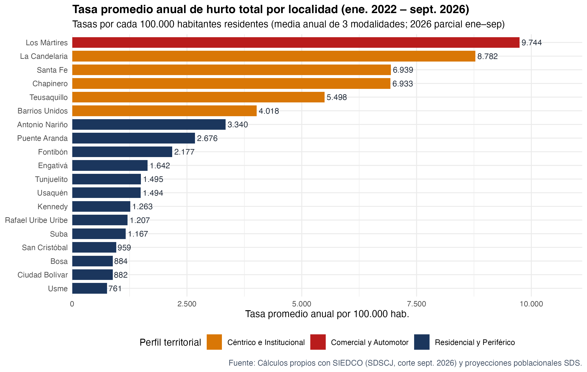
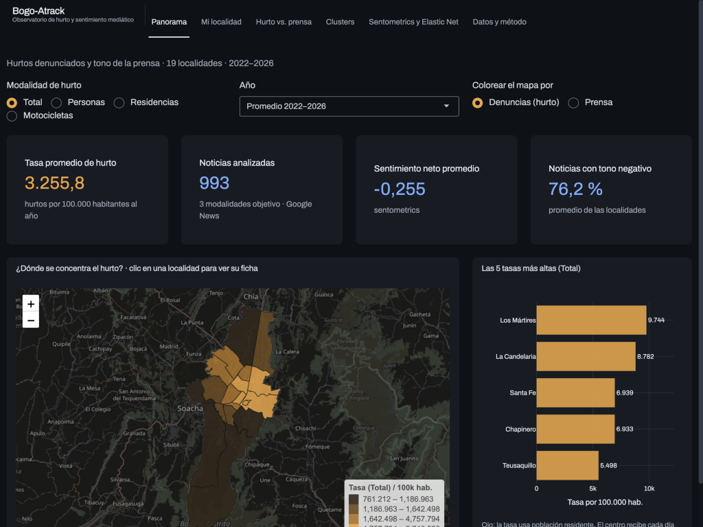
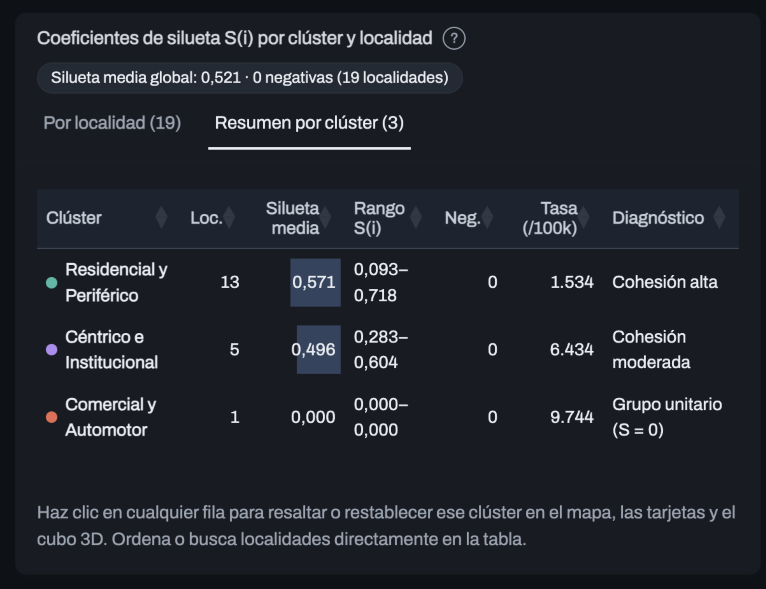
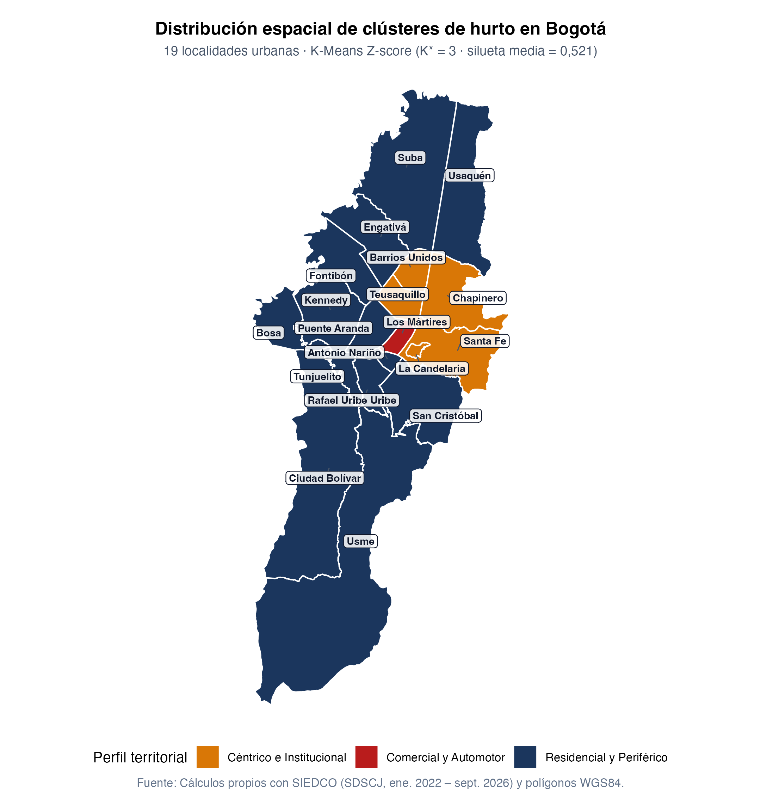
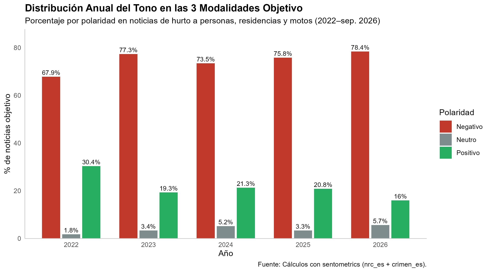

```{r}
#| label: setup-datos-finales
options(scipen = 999)
library(dplyr)
library(tidyr)
library(ggplot2)
library(ggrepel)
library(arrow)
library(readr)
library(scales)
library(knitr)

d  <- readRDS(here::here("data", "processed", "datos_consolidados_shiny.rds"))
cl <- read_parquet(here::here("data", "processed", "clusters_localidades_kmeans.parquet"))
n  <- read_parquet(here::here("data", "processed", "03_noticias", "noticias_procesadas.parquet"))
pa <- read_parquet(here::here("data", "processed", "panel_consolidado_localidad_anual.parquet"))

met <- d$attributions$metricas_modelo

etiqueta_mes_es <- function(x) {
  meses <- c("ene", "feb", "mar", "abr", "may", "jun", "jul", "ago", "sep", "oct", "nov", "dic")
  paste(meses[as.integer(format(x, "%m"))], format(x, "%Y"))
}
```

# Introducción: Pregunta Problema, Hipótesis y Motivación Económica

**Pregunta de investigación, delimitación temporal e hipótesis.** ¿Cómo se relacionan los registros oficiales de hurto (personas, residencias y motocicletas) con el volumen y el tono de las noticias de inseguridad en las 19 localidades urbanas de Bogotá entre enero de 2022 y septiembre de 2026 (`57` meses)? Dado que 2026 corresponde a un corte parcial de nueve meses, controlamos la comparabilidad temporal estimando el modelo dinámico en frecuencia mensual homogénea y replicando los cruces espaciales sobre los cuatro años completos (`2022–2025`). Evaluamos la hipótesis descriptiva de que las localidades con mayores tasas registradas atraen mayor cobertura per cápita y polaridad más adversa, aunque con brechas espaciales hacia corredores comerciales céntricos y periferias de alta población. El alcance evalúa la correspondencia informativa entre estadísticas oficiales y contenido periodístico, sin asumir causalidad sobre la reputación barrial ni sustituir encuestas de victimización.

**Relevancia económica y respaldo en literatura.** En el entorno urbano existe una asimetría de información persistente: hogares, trabajadores y comercios rara vez consultan bases administrativas policiales para estimar su riesgo diario, y forman expectativas a partir de las señales abiertas de la prensa local. La literatura económica identifica tres canales mediante los cuales una brecha entre delito registrado y cobertura mediática afecta decisiones y bienestar. Primero, la **formación de expectativas y los costos privados de protección**: Mastrorocco y Minale (2018) muestran mediante un experimento natural que una mayor exposición a cobertura mediática de crimen eleva la preocupación por inseguridad y altera preferencias ciudadanas aun con criminalidad constante; en el comercio local, esa señal induce gastos privados en vigilancia y recorte de horarios. Segundo, el **valor del suelo y las desamenidades urbanas**: Gibbons (2004) estima que los delitos patrimoniales y las señales visibles de desorden se capitalizan como desamenidad en los precios de vivienda y la inversión barrial. Tercero, la **asignación de bienes públicos de seguridad**: estudios para Bogotá del CEDE y CAF (Mejía, Ortega y Ortiz, 2015; Blattman, Green, Ortega y Tobón, 2021) documentan una alta concentración espacial del delito y restricciones sobre la asignación de patrullaje; contrastar registros oficiales frente a notoriedad mediática aporta evidencia para distinguir entre riesgo denunciado y presión informativa. Siguiendo a Restrepo y Moreno (2007), priorizamos hurtos patrimoniales cotidianos sobre homicidios porque explican con mayor fuerza el temor ciudadano en Bogotá.

# Datos, Procesamiento y Análisis Exploratorio (EDA)

Integramos tres fuentes públicas enlazadas mediante `codigo_localidad` y fecha (`2022-01` a `2026-09`), excluyendo la localidad rural de Sumapaz (`20`) y los registros sin localización (`99`):

- **Registros oficiales SIEDCO (SDSCJ):** el archivo `SIEDCO.csv` contiene `376.185` filas agrupadas por mes, hecho, localidad y atributos administrativos; al filtrar las tres modalidades objetivo y sumar la variable `CANTIDAD` se consolidan `684.007` hechos denunciados (`627.299` hurto a personas, `32.408` a residencias y `24.300` de motocicletas) en un panel balanceado de `1.083` registros (`19` localidades $\times$ `57` meses).
- **Proyecciones demográficas (SDS) y cartografía WGS84:** permiten normalizar denuncias y noticias por cada `100.000` habitantes residentes. En el panel anual (`n = 95`), el corte parcial de 2026 promedia `2.210,5` hurtos totales por 100k habitantes frente a `3.517,1` en los cuatro años completos (`2022–2025`, `n = 76`), por lo que toda comparación interanual separa ambos horizontes.
- **Prensa digital (Google News RSS):** se descargaron artículos mediante consultas booleanas por localidad con filtros anti-homonimia (*Santa Fe* fútbol, *Bosa* Italia, *San Cristóbal* Venezuela, *Antonio Nariño* universidad). Tras limpiar HTML y validar hitos barriales (`confianza_geografica = "Alta"` en `532` de `3.916` notas y en `131` de las `993` objetivo), aplicamos una **deduplicación dual** por enlace canónico y titular normalizado que asigna cada artículo a una única localidad (`0` enlaces o titulares repetidos entre localidades), evitando el doble conteo en notas multi-territoriales. Clasificamos las `3.916` notas bajo la taxonomía oficial SDSCJ y restringimos `sentometrics` al subconjunto comparable de `993` noticias objetivo (`736` personas, `141` residencias y `116` motocicletas).

```{=latex}
\Needspace{11\baselineskip}
```

```{r}
#| label: tbl-eda-resumen
#| tbl-pos: "H"
#| tbl-cap: "Estadísticas descriptivas del panel anual (n = 95 localidad-año, ene. 2022 – sept. 2026)"
res_eda <- tibble(
  Variable = c(
    "Tasa anual hurto a personas (/100k hab.)",
    "Tasa anual hurto a residencias (/100k hab.)",
    "Tasa anual hurto de motos (/100k hab.)",
    "Tasa anual combinada (3 mod., 2022–sep. 2026)",
    "Tasa anual combinada (años completos 2022–2025)",
    "Noticias objetivo (/100k hab., anual)",
    "Sentimiento neto promedio (panel n = 95)"
  ),
  Media = c(
    mean(pa$tasa_hurto_personas), mean(pa$tasa_hurto_residencias),
    mean(pa$tasa_hurto_motos), mean(pa$tasa_hurto_total),
    mean(pa$tasa_hurto_total[pa$año <= 2025]),
    mean(pa$noticias_conteo / pa$poblacion * 1e5), mean(pa$sentimiento_promedio)
  ),
  Mediana = c(
    median(pa$tasa_hurto_personas), median(pa$tasa_hurto_residencias),
    median(pa$tasa_hurto_motos), median(pa$tasa_hurto_total),
    median(pa$tasa_hurto_total[pa$año <= 2025]),
    median(pa$noticias_conteo / pa$poblacion * 1e5), median(pa$sentimiento_promedio)
  ),
  DesvEst = c(
    sd(pa$tasa_hurto_personas), sd(pa$tasa_hurto_residencias),
    sd(pa$tasa_hurto_motos), sd(pa$tasa_hurto_total),
    sd(pa$tasa_hurto_total[pa$año <= 2025]),
    sd(pa$noticias_conteo / pa$poblacion * 1e5), sd(pa$sentimiento_promedio)
  ),
  Min = c(
    min(pa$tasa_hurto_personas), min(pa$tasa_hurto_residencias),
    min(pa$tasa_hurto_motos), min(pa$tasa_hurto_total),
    min(pa$tasa_hurto_total[pa$año <= 2025]),
    min(pa$noticias_conteo / pa$poblacion * 1e5), min(pa$sentimiento_promedio)
  ),
  Max = c(
    max(pa$tasa_hurto_personas), max(pa$tasa_hurto_residencias),
    max(pa$tasa_hurto_motos), max(pa$tasa_hurto_total),
    max(pa$tasa_hurto_total[pa$año <= 2025]),
    max(pa$noticias_conteo / pa$poblacion * 1e5), max(pa$sentimiento_promedio)
  )
) |>
  mutate(across(-Variable, ~ case_when(
    grepl("Sentimiento", Variable) ~ format(round(.x, 3), decimal.mark = ",", big.mark = ".", nsmall = 3),
    grepl("Noticias", Variable)    ~ format(round(.x, 2), decimal.mark = ",", big.mark = ".", nsmall = 2),
    TRUE                           ~ format(round(.x, 1), decimal.mark = ",", big.mark = ".", nsmall = 1)
  )))

kable(res_eda, col.names = c("Indicador", "Media", "Mediana", "Desv. Est.", "Mínimo", "Máximo"),
      align = c("l", "r", "r", "r", "r", "r"))
```

La @tbl-eda-resumen muestra la dispersión territorial de las denuncias y aclara la unidad de lectura del tono mediático: el sentimiento neto promedia `-0,255` en el panel localidad-año (`n = 95`, `76,2 %` negativas), `-0,263` sobre los `993` documentos individuales (`75,3 %` negativas, entre `67,9 %` en 2022 y `78,4 %` en 2026) y `-0,268` como media simple de las 19 localidades (@tbl-anexo-modalidades). En la @fig-ranking-tasas, Los Mártires (`9.744` anuales/100k) y La Candelaria (`8.782`) superan en más de diez veces a Usme (`761`). Esta brecha refleja tres mecanismos concurrentes: (1) el **denominador residente** frente a la población flotante diaria del centro ampliado; (2) el **subregistro diferencial de denuncias**, pues menores tasas en periferias pueden obedecer también a barreras de denuncia o desconfianza institucional; y (3) la **concentración intralocal** de delitos en corredores específicos.

{#fig-ranking-tasas width=68%}

# Metodología y Límites de Medición

## Segmentación territorial ($K$-Means) y validación de siluetas $S(i)$

Agrupamos las `19` localidades según sus tasas anuales promedio en las tres modalidades (excluyendo la tasa total para evitar colinealidad). Elegimos promedios anuales en lugar de las `1.083` filas mensuales por tres motivos: (1) el clúster actúa como covariable territorial estable en `sentometrics`, mientras que en frecuencia mensual `10` de `19` localidades cambian de grupo entre meses (`20` meses en cero motocicletas y `4` en cero residencias); (2) coincide con la periodicidad anual de SDS y produce la misma partición `13 / 5 / 1` excluyendo 2026 o 2022; y (3) bajo `Z-score`, promediar los `57` meses entrega correlaciones de `1,0000`, la misma silueta (`0,5211`) y el mismo agrupamiento ($\text{ARI} = 1{,}0000$).

Evaluamos cinco recetas en `{recipes}` (@tbl-anexo-escalamientos): `Min-Max [0, 1]` (`0,5614`) y `PCA 2D` (`0,5539`, `96,89 %` de varianza) arrojan siluetas mayores porque se miden en su propia matriz de distancias, pero asignan exactamente los mismos `19` territorios ($\text{ARI} = 1{,}0000$, cero negativas). Retenemos `Z-score` porque preserva unidades en desviaciones estándar sin anclarse a extremos muestrales ni omitir `PC3` (`3,11 %`), superando a `Robusto` (`0,4562`, `1` negativa) y `Log(1 + x) + Z-score` (`0,4442`, $\text{ARI} = 0{,}3380$), y coincidiendo con `AGNES Ward.D2` ($\text{ARI} = 1{,}0000$). Con $K^* = 3$ resultan tres perfiles sin siluetas negativas (@tbl-anexo-siluetas): *Residencial y Periférico* (`13` localidades, silueta media `0,571`, rango `0,093–0,718`), *Céntrico e Institucional* (`5`: La Candelaria, Chapinero, Santa Fe, Teusaquillo y Barrios Unidos; media `0,496`, rango `0,283–0,604`) y *Comercial y Automotor* (`1`: Los Mártires; grupo unitario con $S = 0{,}000$).

## Minería de texto (`sentometrics`) y regresión Elastic Net

Sobre las `993` noticias objetivo creamos `sento_corpus()` con seis covariables binarias sin guiones (`3` clústeres `c_*` y `3` modalidades `tema_*`). Estimamos la polaridad documental con `how = "proportionalPol"` combinando `nrc_es`, el léxico local `crimen_es` (`105` términos en español con tildes y eñes como *fleteo*, *cosquilleo*, *halado*, *víctima*, *desarticulación* y *megatoma*) y `30` reglas contextuales `valenceIn` ($t \in \{1, 2, 3, 4\}$); su ordenamiento concuerda con `TF-IDF` ($r = 0{,}7285$). Para evitar sobreajuste, redujimos `364` series iniciales a $M = 36$ series mensuales (`2` léxicos $\times$ `6` covariables $\times$ `3` memorias de `lag = 6`: `linear`, `exponential0.5`, `beta22`), por debajo de las $N = 51$ observaciones mensuales efectivas. Calibramos Elastic Net (`sento_model`) por criterio BIC para predecir la tasa mensual real distrital de SIEDCO a horizonte $h = 1$, complementado con validación iterativa fuera de muestra (`do.iter = TRUE`, `nSample = 30`, `21` pronósticos OOS) frente a un *benchmark* `AR(1)`.

## Concentración intralocal y subregistro en los registros oficiales

La evidencia para Bogotá demuestra que el delito se concentra en pocos segmentos viales: Mejía, Ortega y Ortiz (2015) encuentran que entre el `2,5 %` y el `4,6 %` de las cuadras concentran el `50 %` del delito urbano, y Blattman et al. (2021) evalúan intervenciones focalizadas sobre `1.919` segmentos críticos. Las noticias de Google News carecen de coordenadas de manzana y titulan por localidad o sector amplio; así, incidentes focalizados en pocas cuadras se agregan bajo el nombre completo de la localidad. Por eso la localidad es la unidad empírica apropiada para medir correspondencia informativa. Frente al **subregistro de denuncias** (miedo, costos de trámite o normalización), nuestra estrategia contrasta deliberadamente modalidades con incentivos de denuncia opuestos: **hurto a personas** (alto subregistro) frente a **hurto de motocicletas** (subregistro mínimo, pues la denuncia ante Policía/Fiscalía es requisito para activar pólizas y deslindar responsabilidad civil y penal). Comprobar que las brechas territoriales persisten en motocicletas confirma que la cobertura responde también a criterios de notoriedad y escala poblacional.

# Resultados, Storytelling y Conexión Económica

```{r}
#| label: fig-enet-fit
#| fig-cap: "Ajuste mensual del modelo Elastic Net (h = 1) frente a la tasa mensual real distrital de SIEDCO (ene. 2022 – sept. 2026)"
#| fig-height: 2.05
#| fig-width: 7.4
aj <- d$attributions$ajuste_temporal |>
  mutate(date = as.Date(date)) |>
  select(date, `Observada (SIEDCO real)` = observado, `Predicha (Elastic Net h = 1)` = predicho) |>
  pivot_longer(-date, names_to = "Serie", values_to = "Tasa")

ggplot(aj, aes(x = date, y = Tasa, color = Serie, linetype = Serie)) +
  geom_line(linewidth = 0.85) +
  scale_color_manual(values = c("Observada (SIEDCO real)" = "#D97706", "Predicha (Elastic Net h = 1)" = "#2563EB")) +
  scale_linetype_manual(values = c("Observada (SIEDCO real)" = "solid", "Predicha (Elastic Net h = 1)" = "dashed")) +
  scale_x_date(date_breaks = "6 months", labels = etiqueta_mes_es) +
  labs(
    title = "Ajuste predictivo mensual de sento_model frente a SIEDCO real",
    subtitle = sprintf("alfa* = %s · lambda* = %s (BIC) · %d/%d activas · R² in-sample = %s %% · OOS: %s vs %s AR(1) (-%s %%)",
                       format(met$alpha_optimo, decimal.mark = ","),
                       format(round(met$lambda_optimo, 4), decimal.mark = ","),
                       met$n_activos, met$n_predictores,
                       format(round(met$r2_in_sample * 100, 2), decimal.mark = ","),
                       format(round(met$rmse_oos_en, 2), decimal.mark = ","),
                       format(round(met$rmse_oos_ar1, 2), decimal.mark = ","),
                       format(round(met$reduccion_rmse_vs_ar1, 1), decimal.mark = ",")),
    x = "Mes objetivo de pronóstico (t + 1)", y = "Tasa mensual / 100k hab.",
    color = NULL, linetype = NULL,
    caption = "Fuente: sentometrics (993 noticias objetivo, lag = 6 meses) frente a SIEDCO mensual (SDSCJ)."
  ) +
  theme_minimal(base_size = 8.4) +
  theme(legend.position = "bottom", plot.title = element_text(face = "bold", size = 9.5),
        plot.subtitle = element_text(size = 7.7, color = "#475569"),
        plot.caption = element_text(size = 7.4, color = "#64748B"))
```

Cuatro hallazgos responden la pregunta problema. **Primero** (@fig-enet-fit), el modelo Elastic Net ($\alpha^* = 0{,}8$, $\lambda^* = 0{,}3341$) retiene `21` de `36` series y reproduce dentro de muestra el **`84,55 %`** de la varianza mensual observada ($\text{RMSE} = 11{,}57$); en validación fuera de muestra con ventana expansiva (`do.iter = TRUE`), reduce el error en **`29,9 %`** frente a un *benchmark* `AR(1)` ($\text{RMSE}_{\text{OOS}} = 24{,}35$ frente a $34{,}71$), liderado por `nrc_es--tema_hurto_personas--exponential0.5` (`+83,4`), `crimen_es--tema_hurto_personas--linear` (`+78,5`) y `nrc_es--c_residencial--linear` (`-88,2`). **Segundo** (@fig-desajuste), al comparar tasas por `100.000` habitantes existe una asociación espacial estrecha entre denuncias y noticias ($r = +0{,}845$, $\rho = +0{,}821$ en las tres modalidades; $r = +0{,}854$ en personas), pero en **volumen absoluto** de artículos la correlación cambia de signo ($r = -0{,}148$ en las `993` notas y $r = -0{,}421$ en las `3.916` totales), porque localidades populosas como Bosa (`90` notas), Suba (`79`) y Engativá (`78`) acumulan más notas brutas que La Candelaria (`21`). El chequeo sobre años completos (`2022–2025`) confirma el mismo patrón ($r = +0{,}809$ en tasas frente a $r = -0{,}067$ en conteo bruto).

```{r}
#| label: fig-desajuste
#| fig-cap: "Correlación positiva en tasas por habitante (A) frente a desacople en conteos brutos de prensa (B)"
#| fig-height: 2.30
#| fig-width: 7.4
n3 <- n |> filter(es_objetivo_3mod) |> count(localidad, name = "notas_3mod")
df_des <- cl |>
  left_join(n3, by = "localidad") |>
  mutate(notas_3mod = replace_na(notas_3mod, 0L), tasa_noti = (notas_3mod / poblacion_prom) * 1e5 / 5)

df_long <- bind_rows(
  df_des |> transmute(localidad, cluster_nombre, tasa_total_prom,
                      panel = sprintf("A. Tasa noticias / 100k hab. (r = %s)", format(round(cor(df_des$tasa_total_prom, df_des$tasa_noti), 3), decimal.mark = ",")),
                      y_val = tasa_noti),
  df_des |> transmute(localidad, cluster_nombre, tasa_total_prom,
                      panel = sprintf("B. Conteo bruto de noticias (r = %s)", format(round(cor(df_des$tasa_total_prom, df_des$notas_3mod), 3), decimal.mark = ",")),
                      y_val = notas_3mod)
)
pal_cl <- c("Céntrico e Institucional" = "#D97706", "Comercial y Automotor" = "#B91C1C", "Residencial y Periférico" = "#1B365D")
dest <- c("Los Mártires", "La Candelaria", "Santa Fe", "Chapinero", "Teusaquillo", "Suba", "Bosa", "Kennedy")

ggplot(df_long, aes(x = tasa_total_prom, y = y_val)) +
  geom_smooth(aes(linetype = "Ajuste lineal (OLS)"), method = "lm", se = FALSE, color = "#64748B", linewidth = 0.7) +
  geom_point(aes(color = cluster_nombre), size = 2.1, alpha = 0.92) +
  geom_text_repel(data = df_long |> filter(localidad %in% dest), aes(label = localidad, color = cluster_nombre),
                  size = 2.25, fontface = "bold", box.padding = 0.48, point.padding = 0.44,
                  force = 5.0, max.overlaps = Inf, seed = 2026, show.legend = FALSE) +
  facet_wrap(~panel, scales = "free_y") +
  scale_color_manual(values = pal_cl, name = "Clúster:") +
  scale_linetype_manual(values = c("Ajuste lineal (OLS)" = "dotted"), name = NULL) +
  scale_x_continuous(labels = comma_format(big.mark = ".", decimal.mark = ","),
                     expand = expansion(mult = c(0.06, 0.14))) +
  labs(x = "Tasa anual promedio de hurto total (/100k hab.)", y = "Cobertura en prensa",
       caption = "Fuente: SIEDCO (SDSCJ), SDS y Google News filtrado a las 3 modalidades (ene. 2022 - sept. 2026). Chequeo 2022-2025: r = +0,809 (A) vs. -0,067 (B).") +
  guides(color = guide_legend(order = 1), linetype = guide_legend(order = 2)) +
  theme_minimal(base_size = 8.2) +
  theme(legend.position = "bottom", panel.spacing = unit(1.0, "lines"),
        plot.margin = margin(3, 18, 3, 4),
        plot.caption = element_text(size = 7.3, color = "#64748B"),
        strip.text = element_text(face = "bold", size = 8.6, color = "#1B365D"))
```

**Tercero**, el hurto de motocicletas exhibe la concordancia ordinal más débil ($\rho = 0{,}374$): cinco localidades periféricas (Kennedy, Ciudad Bolívar, Engativá, Bosa y Suba) concentran el `58,5 %` de las `24.300` denuncias (`14.215` casos), asociadas a la alta tenencia residencial (`~90 %` de viajes en moto en estratos 1 a 3 según SDM y ProBogotá, 2023) y al *halado* en vía pública, pero reciben baja cobertura per cápita frente a Los Mártires o Antonio Nariño. Como este delito tiene subregistro mínimo, la brecha confirma asimetría de visibilidad mediática. **Cuarto**, el sentimiento neto en hurto a personas correlaciona positivamente con la tasa ($r = +0{,}398$): Teusaquillo (`-0,402`, `90,3 %` negativas) y Tunjuelito (`-0,397`, `89,5 %` negativas) acumulan reportes de robos sin balance operativo, mientras en el centro y Suba (`-0,186`) las notas de capturas moderan el promedio.

**Síntesis e implicaciones económicas.** El volumen de prensa acompaña la geografía del delito al normalizar por población ($r = +0{,}845$), pero se desacopla en volumen absoluto ($r = -0{,}148$) y no vuelve estadísticamente más negativo el sentimiento entre localidades ($r = +0{,}334$, $p = 0{,}163$); es decir, la divergencia mediática opera por visibilidad selectiva y peso demográfico más que por endurecimiento del tono. Económicamente, esta evidencia muestra tres consecuencias prácticas: los agentes que leen titulares sin ajustar por población sobreestiman la exposición relativa en periferias masivas y subestiman focos en corredores comerciales; en motocicletas, el bajo peso mediático en periferias invisibiliza una pérdida patrimonial concentrada en estratos 1 a 3; y las decisiones de asignación policial y prevención requieren combinar registros administrativos y métricas de cobertura en lugar de guiarse solo por agenda noticiosa.

# Resultados en `Bogo-Atrack` (Shiny), Retroalimentación y Referencias

El flujo íntegro se reproduce desde una sesión limpia ejecutando `scripts/master.R` con rutas relativas `{here}`, consolidando `data/processed/sentometrics_pipeline.rds` y `data/processed/datos_consolidados_shiny.rds` (`0,87 MB`). Sobre este paquete, `app/app.R` despliega **Bogo-Atrack** en seis pestañas sincronizadas (*Panorama*, *Mi localidad*, *Hurto vs. prensa*, *Clusters* 3D + siluetas, *Sentometrics y Elastic Net*, y *Datos y método*), usando ámbar para denuncias SIEDCO y azul para prensa. La aplicación permite: (1) alternar mapa y `Top 5` entre denuncias y prensa por año y modalidad; (2) explorar los `4` cuadrantes dinámicos $(\bar{X}, \bar{Y})$; (3) rotar el cubo tridimensional $K$-Means (`Z-score` y tasas) sincronizado bidireccionalmente con la **tabla interactiva de siluetas $S(i)$** (`Por localidad (19)` y `Resumen por clúster (3)`); y (4) auditar el ajuste *in-sample* y OOS (`-29,9 %` frente a AR(1)) junto con las atribuciones mensuales. La @fig-shiny-doc muestra dos vistas reales del aplicativo (tablas de respaldo en @tbl-anexo-modalidades a @tbl-anexo-escalamientos).

::: {#fig-shiny-doc layout="[[48, -4, 48]]"}
{#fig-shiny-pan width=100%}

{#fig-shiny-sil width=100%}

Resultados visuales de la aplicación Shiny `Bogo-Atrack` (`app/app.R`): vistas de `Panorama` (`-0,255` / `76,2 %`) y validación interactiva de siluetas $S(i)$ en `Clusters`.
:::

```{r}
#| label: tbl-feedback
#| tbl-pos: "H"
#| tbl-cap: "Trazabilidad de los 6 ítems de retroalimentación de Entrega 1 incorporados al trabajo final"
kable(
  tibble(
    `Ítem de retroalimentación (Entrega 1)` = c(
      "1. Pregunta: corte 2026 y relevancia económica",
      "2. Motivación: coherencia y literatura económica",
      "3. Datos: cruce, depuración y notas multi-localidad",
      "4. Metodología: hotspots, subregistro y Shiny",
      "5. EDA: consistencia numérica, autocontención e idioma",
      "6. Storytelling: prudencia causal y cierre económico"
    ),
    `Corrección verificable incorporada en el documento final y Bogo-Atrack` = c(
      "Corte ene. 2022 – sept. 2026 explícito, control 2022–2025 (r = +0,809) y asimetría informativa.",
      "Pregunta-hipótesis-motivación alineadas con Mastrorocco & Minale (2018), Gibbons (2004) y Restrepo & Moreno (2007).",
      "Aclaración SIEDCO (376.185 filas -> 684.007 hechos), hitos barriales y deduplicación dual (0 duplicados).",
      "Subsección CEDE/CESED (Mejía et al., 2015; Blattman et al., 2021), validación OOS (-29,9 % vs. AR(1)) y capturas Shiny.",
      "Cifras unificadas por unidad (-0,255 panel / -0,263 corpus), meses en español, leyenda OLS y rótulos Tabla/Figura.",
      "Sin estigmatización causal; bajas tasas leídas con flotante + subregistro + hotspots; cierre conectado a los 3 canales."
    )
  )
)
```

**Referencias.** Ardia, D., Bluteau, K., Borms, S., & Boudt, K. (2021). *The R Package sentometrics to Compute, Aggregate and Predict with Textual Sentiment*. Journal of Statistical Software, 99(2), 1–40. · Blattman, C., Green, D. P., Ortega, D., & Tobón, S. (2021). *Place-Based Interventions at Scale: The Direct and Spillover Effects of Policing and City Services on Crime*. Journal of the European Economic Association, 19(4), 2022–2051. · Gibbons, S. (2004). *The Costs of Urban Property Crime*. The Economic Journal, 114(499), F441–F463. · Mastrorocco, N., & Minale, L. (2018). *News Media and Crime Perceptions: Evidence from a Natural Experiment*. Journal of Public Economics, 165, 230–255. · Mejía, D., Ortega, D., & Ortiz, K. (2015). *Un análisis de la criminalidad urbana en Colombia*. CAF / CEDE Universidad de los Andes. · Mohammad, S. M., & Turney, P. D. (2013). *Crowdsourcing a Word-Emotion Association Lexicon*. Computational Intelligence, 29(3), 436–465. · ProBogotá Región & SDM (2023). *Encuesta de Movilidad de Bogotá-Región 2023*. · Restrepo, E. M., & Moreno, A. J. (2007). *Bogotá: ¿más crimen?, ¿más miedo?* Desarrollo y Sociedad, (59), 165–214. · SDSCJ (2026) & SDS (2026). *SIEDCO y Proyecciones Demográficas de Bogotá 2005–2035*.

\newpage

# Anexos (Tablas y Figuras Complementarias — Fuera del límite de 5 páginas) {.unnumbered}

```{r}
#| label: tbl-anexo-modalidades
#| tbl-pos: "H"
#| tbl-cap: "Resumen estadístico y correlación espacial por modalidad entre SIEDCO y prensa (n = 19 localidades, ene. 2022 – sept. 2026)"
cnt_m <- function(dn) n |> filter(delito_sdscj == dn) |> group_by(localidad) |> summarise(nn = n(), sn = mean(sentimiento_score), .groups = "drop")
t3 <- n |> filter(es_objetivo_3mod) |> group_by(localidad) |> summarise(nn = n(), sn = mean(sentimiento_score), .groups = "drop")
ac <- n |> group_by(localidad) |> summarise(nn = n(), sn = mean(sentimiento_score), .groups = "drop")
b_del <- cl |> select(localidad, tp = tasa_personas_prom, tr = tasa_resid_prom, tm = tasa_motos_prom, tt = tasa_total_prom, pob = poblacion_prom)
mk <- function(df, rc, lbl) {
  x <- b_del |> left_join(df, by = "localidad") |> mutate(nn = replace_na(nn, 0L), rn = nn / pob * 1e5 / 5)
  tibble(
    Modalidad = lbl, Notas = sum(x$nn),
    `Del./100k` = round(mean(x[[rc]]), 1), `Not./100k` = round(mean(x$rn), 2),
    `Sent. med.` = round(mean(x$sn, na.rm = TRUE), 3),
    `r (tasa)` = round(cor(x[[rc]], x$rn), 3),
    `rho (tasa)` = round(cor(x[[rc]], x$rn, method = "spearman"), 3),
    `r (conteo)` = round(cor(x[[rc]], x$nn), 3),
    `r (sent.)` = round(cor(x[[rc]], x$sn, use = "complete.obs"), 3)
  )
}
kable(
  bind_rows(
    mk(cnt_m("Hurto a personas"), "tp", "Hurto personas"),
    mk(cnt_m("Hurto a residencias"), "tr", "Hurto residencias"),
    mk(cnt_m("Hurto de motocicletas"), "tm", "Hurto motos"),
    mk(t3, "tt", "Total (3 mod.)"),
    mk(ac, "tt", "Ref.: corpus total")
  ),
  format.args = list(big.mark = ".", decimal.mark = ",")
)
```

```{r}
#| label: tbl-anexo-siluetas
#| tbl-pos: "H"
#| tbl-cap: "Resumen de coeficientes de silueta S(i) por clúster territorial (K-Means Z-score, K* = 3; media global = 0,521)"
sil_res <- cl |>
  group_by(cluster_nombre) |>
  summarise(
    Localidades = n(),
    `Silueta media` = round(mean(silueta_localidad), 3),
    `Mín. S(i)` = round(min(silueta_localidad), 3),
    `Máx. S(i)` = round(max(silueta_localidad), 3),
    Negativas = sum(silueta_localidad < 0),
    `Tasa media (/100k)` = round(mean(tasa_total_prom), 0),
    .groups = "drop"
  ) |>
  arrange(desc(`Silueta media`)) |>
  mutate(Diagnóstico = case_when(
    Localidades == 1L ~ "Grupo unitario (S=0)",
    `Silueta media` >= 0.50 ~ "Cohesión alta",
    TRUE ~ "Cohesión moderada"
  ))

kable(
  sil_res,
  col.names = c("Clúster", "Loc.", "Silueta media", "Mín. S(i)", "Máx. S(i)", "Neg.", "Tasa (/100k)", "Diagnóstico"),
  format.args = list(big.mark = ".", decimal.mark = ",")
)
```

```{r}
#| label: tbl-anexo-escalamientos
#| tbl-pos: "H"
#| tbl-cap: "Sensibilidad de K-Means (K* = 3) a cinco recetas de preprocesamiento ({recipes}) y PCA 2D"
sens <- read_csv(here::here("output", "tables", "tabla_sensibilidad_escalamientos_pca.csv"), show_col_types = FALSE)
kable(
  sens,
  digits = 4,
  format.args = list(big.mark = ".", decimal.mark = ","),
  col.names = c("Espacio", "Silueta", "Neg.", "WSS", "ARI base", "PC1", "PC2", "Acum. 2D")
)
```

::: {#fig-anexo-mapas layout="[[46, -4, 50]]"}
{#fig-anexo-mapa width=94%}

{#fig-anexo-tono width=100%}

Figuras complementarias de cartografía territorial y estabilidad anual de polaridad mediática (ene. 2022 – sept. 2026).
:::
