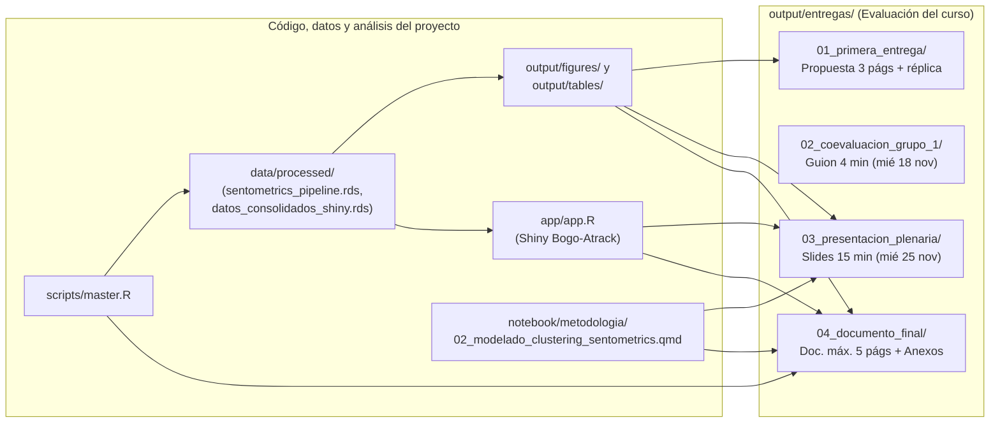

# Entregas y Checklist del Trabajo Final — Grupo 3

Esta carpeta concentra los entregables académicos de **Bogo-Atrack** (*Hurtos y Sentimiento Mediático en Bogotá, 2022–2026*), **Grupo 3** del curso *Taller de Programación Aplicada a R* (Maestría en Economía Aplicada — MECA, Universidad de los Andes).

* **Integrantes (Grupo 3):** Carvajal Cruz, Juan Esteban (`202614312`) · Echeverry Castaño, Gabriel Arturo (`201016705`) · Echeverry De Mendoza, Juan José (`202616233`) · López Valderrama, Sergio Alejandro (`202111932`) · Palma Rojas, Miguelangel (`202621481`) · Ramírez Contreras, Olga Lucía (`202624900`).
* **Profesor complementario asignado:** Camilo Ramírez · **Profesor magistral:** Santiago Neira.
* **Pareja de co-evaluación cruzada:** **Grupo 1** (*Becerra Andrade, Martha Alexandra; Farfán López, Duván Javier; Patiño Mendoza, Daniela Lucía; Quintero Salinas, Camilo Antonio; Rodríguez Luna, Esteban; Sánchez Parra, Diego* · Prof. Sergio Vásquez).
* **Enunciados y rúbricas oficiales:** [`docs/enunciados/README.md`](../../docs/enunciados/README.md).

---

## Arquitectura y flujo hacia `output/entregas/`

---

## Estructura de subcarpetas

| Subcarpeta | Etapa / Hito | Archivos actuales |
| :--- | :--- | :--- |
| [**`01_primera_entrega/`**](01_primera_entrega/) | **Semana 11 (24 oct · 10 %)** | `01_entrega_1_propuesta_eda.qmd`/`.html`/`.pdf`, `01_propuesta_retroalimentada_evaluador.pdf` y `01_respuestas_evaluador_entrega_1.qmd`/`.pdf`. |
| [**`02_coevaluacion_grupo_1/`**](02_coevaluacion_grupo_1/) | **Sesión 1 (mié 18 nov, 6:25 p. m.)** | [`guia_coevaluacion_grupo_1.md`](02_coevaluacion_grupo_1/guia_coevaluacion_grupo_1.md) y [`plantilla_coevaluacion_grupo_1.docx`](02_coevaluacion_grupo_1/plantilla_coevaluacion_grupo_1.docx). |
| [**`03_presentacion_plenaria/`**](03_presentacion_plenaria/) | **Sesión 2 (mié 25 nov, 6:25 p. m.)** | [`plantilla_presentacion_grupo_3.pptx`](03_presentacion_plenaria/plantilla_presentacion_grupo_3.pptx) (base 10 diapositivas + notas con reparto de 15 min). |
| [**`04_documento_final/`**](04_documento_final/) | **Semana 16 (Documento + Script + Shiny)** | [`plantilla_documento_final.qmd`](04_documento_final/plantilla_documento_final.qmd), [`plantilla_documento_final.pdf`](04_documento_final/plantilla_documento_final.pdf) y [`plantilla_documento_final.docx`](04_documento_final/plantilla_documento_final.docx). |

---

## Checklist maestro: qué entregar, cuándo, en qué formato y cómo

### 1. Primera Entrega — Propuesta y EDA *(completada)*

- [x] **Qué entregar:** documento de máximo **3 páginas** (Pregunta $\le 150$ pal., Motivación $\le 150$, Datos $\le 150$, Metodología $\le 150$, EDA y storytelling $\le 700$ con $\ge 2$ gráficos autocontenidos).
- [x] **Dónde y cómo:** radicado en Bloque Neón (`01_entrega_1_propuesta_eda.pdf`).
- [x] **Retroalimentación archivada:** copia anotada en [`01_propuesta_retroalimentada_evaluador.pdf`](01_primera_entrega/01_propuesta_retroalimentada_evaluador.pdf) y réplica formal en [`01_respuestas_evaluador_entrega_1.pdf`](01_primera_entrega/01_respuestas_evaluador_entrega_1.pdf).

### 2. Co-evaluación al Grupo 1 *(Sesión 1: miércoles 18 de noviembre de 2026, 6:25 p. m. – 6:50 p. m.)*

- [ ] **Asistencia obligatoria de los 6 integrantes desde las 6:00 p. m.:** el equipo pedagógico escoge arbitrariamente a **2 expositores** del Grupo 3 al terminar la charla del Grupo 1. **Si falta uno de los dos seleccionados, todo el Grupo 3 obtiene 0.0 en co-evaluación.**
- [ ] **Qué entregar (oral en 4 minutos):** retroalimentación siguiendo [`plantilla_coevaluacion_grupo_1.docx`](02_coevaluacion_grupo_1/plantilla_coevaluacion_grupo_1.docx) o [`guia_coevaluacion_grupo_1.md`](02_coevaluacion_grupo_1/guia_coevaluacion_grupo_1.md):
  1. **Resumen (25 % · `0:00–0:50`):** pregunta, datos, método, hallazgo central y relevancia del trabajo del Grupo 1.
  2. **Comentarios positivos (25 % · `0:50–1:45`):** al menos **2 aspectos concretos** con justificación de por qué aportan valor.
  3. **Oportunidades de mejora (30 % · `1:45–3:35`):** al menos **2 mejoras concretas y viables** fundamentadas metodológica o empíricamente.
  4. **Pertinencia, respeto y tiempo (20 % · `3:35–4:00`):** tono constructivo sin exceder los **4 minutos**.

### 3. Envío previo y Presentación Plenaria del Grupo 3 *(Sesión 2: miércoles 25 de noviembre de 2026, 6:25 p. m. – 6:50 p. m.)*

- [ ] **Envío obligatorio 24 horas antes (fecha límite: martes 24 de noviembre a las 7:30 p. m.):**
  * **A quién enviar:** al equipo pedagógico (**Camilo Ramírez** y equipo docente / **Santiago Neira**) y a **todos los integrantes del Grupo 1** (Martha Alexandra Becerra, Duván Javier Farfán, Daniela Lucía Patiño, Camilo Antonio Quintero, Esteban Rodríguez y Diego Sánchez).
  * **Consecuencia por retraso:** no enviar 24 h antes conlleva una **penalización del 30 %** en la nota de presentación y co-evaluación.
- [ ] **Formato y contenido de diapositivas:** completar [`plantilla_presentacion_grupo_3.pptx`](03_presentacion_plenaria/plantilla_presentacion_grupo_3.pptx) (exportable también a PDF de respaldo) cubriendo las 7 secciones exigidas:
  1. Diapositiva estratégica de resumen al inicio.
  2. Pregunta problema e hipótesis.
  3. Motivación económica y social (**15 %**).
  4. Datos, fuentes y variables (**10 %**).
  5. Estadísticas descriptivas autocontenidas (**15 %** — insertar figuras de `output/figures/` con título, ejes, unidades y fuente).
  6. Análisis con datos y *storytelling* (**20 %**).
  7. Metodología avanzada justificada (**30 %** — K-Means con tasas anuales + `Z-score`, `sentometrics` con `993` noticias y `36` series en Elastic Net) y demostración breve de `Bogo-Atrack`.
- [ ] **Regla de exposición y comunicación (10 % · máximo 15 minutos):**
  * **Los 6 integrantes deben exponer** alguna sección o hallazgo (**quien no presente recibe 0.0 individual**).
  * **Cámara:** se recomienda encender la cámara durante toda la intervención.
  * **Reparto sugerido (`2,5 min` por persona):**
    1. *Miguelangel Palma (`0:00–2:30`):* resumen ejecutivo, pregunta problema, hipótesis y los 3 canales económicos.
    2. *Gabriel Arturo Echeverry (`2:30–5:00`):* fuentes (`SIEDCO`, `SDS`, `Google News`), depuración y filtro a `993` notas.
    3. *Juan Esteban Carvajal (`5:00–7:30`):* estadísticas descriptivas, efecto denominador por población flotante y volumen frente a tasa.
    4. *Sergio Alejandro López (`7:30–10:00`):* $K$-Means sobre tasas anuales y `Z-score` ($K^*=3$) + construcción de corpus y `36` series en `sentometrics`.
    5. *Olga Lucía Ramírez (`10:00–12:30`):* Elastic Net ($R^2 = 88{,}99\,\%$), hallazgos por modalidad, motos en periferia y tono mediático.
    6. *Juan José Echeverry (`12:30–15:00`):* recorrido breve por `Bogo-Atrack` (`app/app.R`), síntesis de respuestas a la retroalimentación y cierre.

### 4. Documento Final + Script Replicable + Shiny App *(Semana 16 — Entrega escrita por Bloque Neón)*

- [ ] **Documento escrito (máximo 5 páginas de cuerpo principal sin contar Anexos):** completar [`plantilla_documento_final.qmd`](04_documento_final/plantilla_documento_final.qmd) (para compilar a PDF vía Quarto) o [`plantilla_documento_final.docx`](04_documento_final/plantilla_documento_final.docx) (si se edita en Word). Debe incluir exactamente:
  1. **Introducción** (pregunta, hipótesis y motivación económica — **15 %**).
  2. **Datos** (fuentes, procesamiento, justificación y EDA autocontenido — **10 % + 15 %**).
  3. **Metodología** (K-Means + `sentometrics` + Elastic Net con justificación de elecciones y alternativas — **20 %**).
  4. **Resultados y Análisis de Resultados** (hallazgos y *storytelling* coherente — **15 %**).
  5. **Referencias, Script y Reproducibilidad** (**10 %**).
  6. **Anexos** (figuras y tablas de `output/` fuera del conteo de 5 páginas).
- [ ] **Incorporación explícita de retroalimentación (Criterio 7 — 15 %):** incluir un apartado visible que muestre qué cambió tras los **4 comentarios de Entrega 1** y tras las observaciones recibidas en plenaria (**Grupo 1**, **Camilo Ramírez** y **Santiago Neira**).
- [ ] **Script replicable y comentado:** verificar desde una sesión limpia de R que `scripts/master.R` ejecuta toda la secuencia sin errores ni rutas absolutas y produce `data/processed/sentometrics_pipeline.rds` y `data/processed/datos_consolidados_shiny.rds`.
- [ ] **Aplicación Shiny ejecutable (`Bogo-Atrack`):** comprobar que `shiny::runApp(here::here("app"))` abre las 6 pestañas sin errores y resume de forma autocontenida los resultados del proyecto.

---

## Nota sobre diferencias entre los documentos oficiales

| Aspecto | Enunciado General (`02_entrega_final_y_presentacion/`) | Instructivo de Plenarias (`03_asignaciones_y_coevaluacion/`) | Regla operativa para el Grupo 3 |
| :--- | :--- | :--- | :--- |
| **Duración de charla** | 20 min exposición + 5 min co-evaluación | **15 min** exposición + 4 min co-eval. + 6 min docentes (`25 min` total) | Preparar charla para **15 min exactos** (criterio estricto en rúbrica). |
| **Fecha de plenaria** | Semana 16 (referencia 17 nov) | Sesión 1: **18 nov** · Sesión 2: **25 nov** | Co-evaluar al Grupo 1 el **18 nov (6:25 p. m.)** y exponer el **25 nov (6:25 p. m.)**. |
| **Envío previo** | 24 horas antes | **Martes correspondiente a las 7:30 p. m.** | Enviar `.pptx` a más tardar **martes 24 nov, 7:30 p. m.** (evita multa del 30 %). |
| **Ponderación presentación** | 15 % presentación + 15 % documento final | Cita 10 % en texto de recomendación general | Verificar en Bloque Neón el peso final; la fórmula interna de la presentación es `0.15 N1 + 0.10 N2 + 0.15 N3 + 0.20 N4 + 0.30 N5 + 0.10 N6`. |
