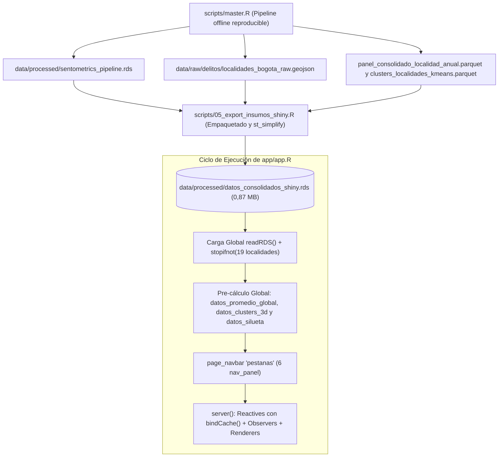
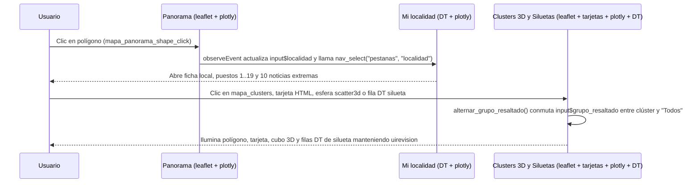

# Arquitectura de `Bogo-Atrack` (`app/app.R`)

## Resumen General (`Overview`)

`Bogo-Atrack` (*Observatorio de hurto y sentimiento mediático*) es una aplicación web interactiva construida en R Shiny con `{bslib}` (Bootstrap 5, tema oscuro `#0E1116`), `{leaflet}`, `{plotly}` y `{DT}`. Su propósito es permitir que evaluadores y usuarios exploren sin latencia el contraste entre denuncias policiales oficiales (**SIEDCO / SDSCJ**, en ámbar `#F0A43A`) y cobertura de prensa (**`sentometrics`**, en azul `#79AEFF`) en las `19` localidades urbanas de Bogotá entre enero de `2022` y septiembre de `2026`.

La característica arquitectónica central es el **desacoplamiento total entre cómputo pesado y visualización reactiva**: la aplicación no ejecuta web scraping, no calcula matrices de léxicos y no estima modelos Elastic Net ni clustering al abrirse. En su lugar, carga una única vez al arrancar el archivo empaquetado `data/processed/datos_consolidados_shiny.rds` (`0,87 MB`), pre-computa vistas constantes en memoria global y almacena consultas repetidas mediante `bindCache()`.

---

## Diagrama de Arquitectura y Flujo de Datos

### Flujo de Sincronización Interactiva entre Vistas

---

## Componentes Principales

### 1. Empaquetado Offline (`scripts/05_export_insumos_shiny.R`)

- **Propósito:** Reunir en un único bundle liviano los paneles procesados, la cartografía simplificada y los resultados S3 de `sentometrics`, evitando que la sesión Shiny lea archivos Parquet crudos o GeoJSON de alta resolución.
- **Transformaciones clave:** Simplifica las geometrías con `sf::st_simplify()` manteniendo la topología en CRS `WGS84` (`4326`), recalcula resúmenes longitudinales mediante `sentometrics::corpus_summarize()`, y serializa la lista `bundle_shiny` en `data/processed/datos_consolidados_shiny.rds`.

### 2. Capa Global Pre-computada (`app/app.R`)

- **Propósito:** Desempaquetar `datos_app` una sola vez al iniciar el proceso de R y materializar estructuras inmutables compartidas entre pestañas y sesiones.
- **Objetos y funciones clave:**
  - `resumir_panel()`: consolida tasas promedio (`2022–2026`) o filtra por año, y cuando `modalidad != "tasa_hurto_total"` recalcula en vivo `noticias_conteo`, `sentimiento_promedio` y `prop_negativas` desde `tabla_noticias` para empatar el numerador mediático con la modalidad delictiva activa.
  - `datos_promedio_global`: invoca `resumir_panel("todos", "tasa_hurto_total")` al arranque para abastecer rankings fijos, clústeres y tarjetas base.
  - `preparar_datos_clusters_3d()`: pre-calcula coordenadas reales y estandarizadas (`scale()`), centroides $\mu_k$ y segmentos radiales con separadores `NA_real_` para que el cubo `scatter3d` dibuje `3` trazas por clúster (`puntos`, `segmentos`, `centroides`) en milisegundos.
  - `clasificar_silueta()`, `etiqueta_cluster_badge_html()`, `preparar_tablas_silueta()` y `datos_silueta`: calculan una sola vez al arranque las tablas ordenadas `por_localidad` (`19` filas) y `por_cluster` (`3` filas), los diagnósticos uniformes (`"Grupo unitario (S = 0)"` para `Los Mártires`), los indicadores HTML escapados y los resúmenes globales (`0,521` media global, `0` siluetas negativas).
  - `paleta_cuartiles()`: genera cortes por cuartiles (`colorBin()`) con respaldo uniforme cuando el subgrupo tiene rango nulo.
  - `estilo_plotly()`, `tarjeta_cifra()` y `agregar_mapa_base()`: encapsulan la identidad oscura (`#0E1116` / `#171B22`) y aplican teselas gratuitas de OpenStreetMap con filtro CSS invertido (sin necesidad de llave API).

### 3. Interfaz y Grafo Reactivo por Pestaña (`page_navbar(id = "pestanas")`)

| Pestaña (`value`) | Entradas (`input$*`) | Reactivos / Observadores | Salidas (`output$*`) |
| :--- | :--- | :--- | :--- |
| **`panorama`** | `modalidad`, `anio`, `capa_mapa`, `medida`, `mapa_panorama_shape_click` | `datos_panorama()` (con `bindCache()`), `capa_panorama()`, `observeEvent()` de salto a `localidad` | `kpi_*`, `titulo_*`, `nota_top5_panorama`, `mapa_panorama`, `grafico_top5` |
| **`localidad`** | `localidad`, `modalidad_loc` | Helpers internos `puesto()` y `valor_loc()` sobre `datos_promedio_global` | `ficha_titulo`, `loc_*`, `grafico_evolucion`, `grafico_tono`, `tabla_noticias_loc` |
| **`prensa`** | `anio_prensa`, `modalidad_prensa`, `plotly_click` (`source = "dispersion"`) | `datos_prensa()` (con `bindCache()`), `localidad_prensa` (`reactiveVal("Teusaquillo")`) | `grafico_dispersion`, `explicacion_lineas_corte`, `ficha_prensa` |
| **`clusters`** | `grupo_resaltado`, `mapa_clusters_shape_click`, `clic_tarjeta_cluster`, `plotly_click` (`clusters_3d`), `tabla_silueta_loc_rows_selected`, `tabla_silueta_resumen_rows_selected`, `mostrar_nombres_3d`, `escala_z_3d` | `alternar_grupo_resaltado()` y `observeEvent()` bidireccionales que alternan `grupo_resaltado` | `mapa_clusters`, `tarjetas_clusters`, `grafico_clusters_3d` (con `bindCache()` y `uirevision`), `card_siluetas_clusters` (`badge_silueta_activa` en caché, `tabla_silueta_loc` y `tabla_silueta_resumen` vía `construir_dt_silueta()`) |
| **`sentometrics`** | `grupo_serie_sento`, `features_sento_sel`, `lexico_sento`, `tiempo_sento`, `ver_picos_sento`, `dim_attr_sento`, `escala_attr_sento` | UI dinámica `selector_features_sento`, filtrado directo sobre `measures_long` y `attr_long_*` | `kpi_*_modelo`, `grafico_series_sento`, `grafico_atribuciones_sento`, `grafico_ajuste_sento`, `grafico_coefs_sento` |
| **`metodo`** | Sin filtros dinámicos | Construcción tabular de auditoría | `tabla_contrato_rds` (resume `sentometrics_pipeline.rds` y `datos_consolidados_shiny.rds`) |

---

## Flujo Reactivo Crítico (`Hurto vs. prensa` y Sincronización `Top 5`)

1. **Coherencia cromática mapa–ranking en `Panorama`:** tanto `mapa_panorama` como `grafico_top5` consumen exactamente la misma función `cfg$paleta` devuelta por `capa_panorama()`. Al cambiar `capa_mapa` entre `"hurto"` y `"prensa"`, ambos gráficos cambian juntos entre la escala ámbar y la escala azul, garantizando además que las barras negativas o positivas ordenen bien los márgenes mediante relleno asimétrico (`izq_pad`, `der_pad`).
2. **Cuadrantes dinámicos en `Hurto vs. prensa`:** `grafico_dispersion` y `explicacion_lineas_corte` trazan los ejes de corte $(\bar{X}, \bar{Y})$ como el promedio simple distrital recalculado sobre `datos_prensa()` según `anio_prensa` y `modalidad_prensa`, ubicando a cada localidad en uno de cuatro cuadrantes y actualizando `ficha_prensa` al hacer clic en cualquier burbuja.
3. **Preservación de rotación 3D en `Clusters`:** `grafico_clusters_3d` define `uirevision = if (usar_z) "zscore" else "tasas"`, lo que permite resaltar clústeres o activar nombres sin reiniciar el ángulo de cámara rotado por el usuario (solo reinicia ejes al alternar entre tasas reales y $Z$-scores).

---

## Configuración y Convenciones de Entorno

- **Tema visual:** `tema_dos_lecturas` (`bslib::bs_theme(version = 5) |> bslib::bs_add_rules(...)`) define fuentes Google (`Archivo` y `IBM Plex Mono`), fondo `#0E1116`, tarjetas `#171B22`, bordes `#2A303A` y estilos oscuros específicos para `{DT}` y `.nav-underline` (`#1D2430` en cabeceras, `#232A35` en hover, `#1E2530` en filas activas).
- **Control numérico y conflictos:** `options(scipen = 999)` desactiva notación científica; `{conflicted}` fija prioridad explícita para `dplyr::filter`, `dplyr::lag`, `dplyr::select` y `plotly::layout`.
- **Rutas y ejecución:** usa exclusivamente `here::here()` relativo a `Repo_Entrega_Final_Taller_R.Rproj` y se lanza con `shiny::runApp(here::here("app"))`. No requiere variables de entorno ni claves externas.

---

## Índice de Referencias Estables de Código

| Componente | Archivo relativo | Símbolos clave |
| :--- | :--- | :--- |
| Empaquetador del bundle | `scripts/05_export_insumos_shiny.R` | `bundle_shiny`, `sf::st_simplify()`, `corpus_summarize()`, `saveRDS()` |
| Catálogo y pre-cálculo global | `app/app.R` | `resumir_panel()`, `preparar_datos_clusters_3d()`, `paleta_cuartiles()`, `datos_promedio_global`, `datos_clusters_3d` |
| Estilo UI y tema `{bslib}` | `app/app.R`, `app/www/custom.css` | `tema_dos_lecturas`, `bs_add_rules()`, `estilo_plotly()`, `tarjeta_cifra()`, `agregar_mapa_base()`, `page_navbar` |
| Navegación `Panorama` ↔ `Localidad` | `app/app.R` | `datos_panorama()`, `capa_panorama()`, `mapa_panorama_shape_click`, `grafico_top5`, `ficha_titulo` |
| Cuadrantes `Hurto vs. prensa` | `app/app.R` | `datos_prensa()`, `localidad_prensa`, `grafico_dispersion`, `explicacion_lineas_corte`, `ficha_prensa` |
| Interacción bidireccional `Clusters 3D` y siluetas | `app/app.R` | `clasificar_silueta()`, `etiqueta_cluster_badge_html()`, `preparar_tablas_silueta()`, `datos_silueta`, `alternar_grupo_resaltado()`, `construir_dt_silueta()`, `mapa_clusters`, `tarjetas_clusters`, `grafico_clusters_3d`, `clic_tarjeta_cluster`, `badge_silueta_activa`, `tabla_silueta_loc`, `tabla_silueta_resumen`, `tabla_silueta_loc_rows_selected`, `tabla_silueta_resumen_rows_selected` |
| Explorador `Sentometrics` y contrato | `app/app.R` | `selector_features_sento`, `grafico_series_sento`, `grafico_atribuciones_sento`, `tabla_contrato_rds` |

---

## Glosario Técnico

| Término | Definición en el contexto de `Bogo-Atrack` |
| :--- | :--- |
| **Bundle `.rds`** | Lista serializada `datos_consolidados_shiny.rds` que concentra tablas, geometrías `sf` y resultados S3 para arranque inmediato de `app/app.R`. |
| **Dos lecturas** | Regla visual del tablero que asocia **ámbar (`#F0A43A`)** a registros oficiales de SIEDCO y **azul (`#79AEFF`)** a métricas mediáticas de `sentometrics`. |
| **`bindCache()`** | Mecanismo de Shiny que memoriza salidas y reactivos según combinaciones de `input$` (`anio`, `modalidad`, `escala_z_3d`) evitando recálculos redundantes. |
| **`uirevision`** | Propiedad de diseño de `{plotly}` usada en `grafico_clusters_3d` para conservar la rotación de cámara mientras cambian colores u opacidad de clústeres. |
| **Corte $(\bar{X}, \bar{Y})$** | Promedio simple distrital entre las 19 localidades para tasa de hurto y porcentaje negativo, usado como referencia dinámica de los cuatro cuadrantes. |
