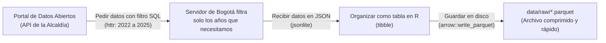

# Descarga de datos abiertos de Bogotá

En esta carpeta descargamos las bases oficiales de la Alcaldía de Bogotá que usamos en el proyecto: delitos denunciados, proyecciones de población y los mapas de las localidades.

---

## 1. Enlaces a las tablas en el portal web

Si quieres ver o consultar las tablas directamente en la página web de la Alcaldía (portal de Datos Abiertos Bogotá), aquí tienes los enlaces directos a cada conjunto de datos:

| Conjunto de Datos | Entidad que lo publica | Enlace a la página web de la tabla | Qué contiene |
| :--- | :--- | :---: | :--- |
| **Delitos de Alto Impacto** | Secretaría de Seguridad (SDSCJ / SIEDCO) | [**Ir a la tabla en Datos Abiertos**](https://datosabiertos.bogota.gov.co/dataset/delito-de-alto-impacto-bogota-d-c) | Denuncias de hurtos a personas, casas y motocicletas por fecha, localidad y coordenadas. |
| **Pirámide Poblacional** | Secretaría de Salud (SDS) | [**Ir a la tabla en Datos Abiertos**](https://datosabiertos.bogota.gov.co/dataset/piramide-poblacional-bogota-d-c) | Habitantes proyectados por localidad y año (2005–2035). Lo usamos como denominador para calcular las tasas por cada 100.000 habitantes. |
| **Límites de Localidades** | Secretaría de Planeación (SDP) | [**Ir al mapa en Datos Abiertos**](https://datosabiertos.bogota.gov.co/dataset/localidad-bogota-d-c) | Mapas oficiales con los polígonos de las localidades de Bogotá en GeoJSON. |

---

## 2. Cómo funciona la descarga

El script [`datos_abiertos_bogota.R`](file:///Users/juanjoseecheverry/Library/Mobile%20Documents/com~apple~CloudDocs/Universidad/Maestria%20%28MECA%29/Primer%20semestre/Taller%20R/Repo_Entrega_Final_Taller_R/scripts/01_ingesta/01_datos_abiertos/datos_abiertos_bogota.R) hace la descarga de forma automatizada:



### Consultas directas con SQL (SoQL)
En vez de descargar bases gigantescas con 10 o 15 años de información vieja, le pedimos a la API de la Alcaldía que filtre directamente desde sus servidores solo los años que nos interesan:
* Filtro de años: `anio >= '2022' AND anio <= '2025'`.
* Esto ahorra tiempo de descarga y no satura la memoria del computador.

### Guardado en formato Parquet
Guardamos los datos en archivos `.parquet` dentro de `data/raw/`:
* Carga hasta 10 veces más rápido que un archivo `.csv`.
* Ocupa mucho menos espacio en disco.
* Mantiene los tipos de datos intactos (no desconfigura fechas ni códigos de localidad).

### Plan de respaldo
Si la API de la Alcaldía está caída o lenta, el script se da cuenta y descarga directamente el archivo CSV plano publicado en la página oficial para que el trabajo no se frene.

---

## 3. Cómo correr el script

Desde la consola de RStudio en la raíz del proyecto:

```r
source(here::here("scripts", "01_ingesta", "01_datos_abiertos", "datos_abiertos_bogota.R"))
```

### Archivos que genera en `data/raw/`:
* `delitos_alto_impacto_raw.parquet`: hurtos registrados entre 2022 y 2025.
* `poblacion_localidades_raw.parquet`: proyección de habitantes por localidad.
* `localidades_bogota_raw.geojson`: polígonos de las localidades para los mapas de la aplicación Shiny.
