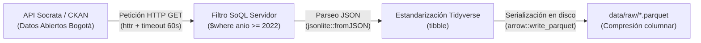

# Ingesta de Datos Abiertos de Bogotá (API Socrata / SoQL)

Esta subcarpeta contiene los scripts y la metodología técnica para la descarga automatizada de los microdatos oficiales del Distrito Capital utilizados como insumo fundamental del proyecto de investigación.

---

## 1. Enlaces Directos a las Tablas y Conjuntos de Datos

Para consultar o auditar los datos directamente en el portal web de la Alcaldía Mayor de Bogotá (Datos Abiertos Bogotá), acceda a las siguientes páginas oficiales de cada recurso:

| Conjunto de Datos | Entidad Responsable | Enlace Directo a la Tabla en el Portal Web | Descripción del Recurso |
| :--- | :--- | :---: | :--- |
| **Delitos de Alto Impacto** | Secretaría Distrital de Seguridad, Convivencia y Justicia (SDSCJ / SIEDCO) | [**Ver tabla en Datos Abiertos Bogotá**](https://datosabiertos.bogota.gov.co/dataset/delito-de-alto-impacto-bogota-d-c) | Registros de delitos de alto impacto desagregados por modalidad (hurto a personas, residencias, motocicletas), fecha, localidad y coordenadas. |
| **Pirámide Poblacional** | Secretaría Distrital de Salud (SDS) | [**Ver tabla en Datos Abiertos Bogotá**](https://datosabiertos.bogota.gov.co/dataset/piramide-poblacional-bogota-d-c) | Proyecciones demográficas oficiales de población por localidad, grupo de edad y año (2005–2035). Base para calcular las tasas por 100.000 habitantes. |
| **Límites de Localidades** | Secretaría Distrital de Planeación (SDP) | [**Ver mapa en Datos Abiertos Bogotá**](https://datosabiertos.bogota.gov.co/dataset/localidad-bogota-d-c) | Cartografía vectorial oficial (polígonos de las 19 localidades urbanas y rural) en formatos GeoJSON y Shapefile. |

> **Nota:** La plataforma distrital está soportada sobre arquitectura abierta CKAN / Socrata: [Portal de Datos Abiertos de Bogotá](https://datosabiertos.bogota.gov.co/).

---

## 2. Metodología de Ingesta y Optimización SoQL

La descarga se ejecuta mediante el script [`datos_abiertos_bogota.R`](file:///Users/juanjoseecheverry/Library/Mobile%20Documents/com~apple~CloudDocs/Universidad/Maestria%20%28MECA%29/Primer%20semestre/Taller%20R/Repo_Entrega_Final_Taller_R/scripts/01_ingesta/01_datos_abiertos/datos_abiertos_bogota.R), el cual aplica las siguientes etapas metodológicas:



### 2.1 Filtrado del Lado del Servidor (SoQL)
En lugar de descargar toda la serie histórica (lo que transferiría millones de filas innecesarias), el script utiliza el lenguaje de consulta **SoQL** (*Socrata Open Data API Query Language*, estándar ANSI SQL):
* **Cláusula `$where`:** `anio >= '2022' AND anio <= '2025'` para delimitar directamente la descarga al periodo de estudio.
* **Cláusula `$limit`:** Lotes configurables de hasta $100.000$ registros por petición para asegurar lecturas completas y sin pérdida de observaciones.

### 2.2 Persistencia Eficiente en Apache Parquet
Todos los microdatos crudos procesados se guardan de inmediato en `data/raw/` en formato **Apache Parquet (`.parquet`)**:
* **Lectura ultrarrápida:** Hasta 10x más veloz que leer archivos `.csv` en R.
* **Tipado estricto:** Preserva los tipos de columnas (fechas, códigos numéricos de localidad, conteos) evitando conversiones erróneas de texto.
* **Alta compresión:** Reduce el uso de almacenamiento en disco en más del 80%.

### 2.3 Resiliencia y Fallback Automático
Si la API pública experimenta congestión o cambios de endpoint, el script implementa un mecanismo de captura de errores (`tryCatch`) que conmuta de forma transparente a la descarga directa del archivo CSV plano publicado en el portal distrital, garantizando que el pipeline nunca se interrumpa.

---

## 3. Instrucciones de Ejecución

Para descargar y actualizar los datos abiertos:
```r
source(here::here("scripts", "01_ingesta", "01_datos_abiertos", "datos_abiertos_bogota.R"))
```

### Artefactos Generados en `data/raw/`:
* `delitos_alto_impacto_raw.parquet`: Registros de delitos 2022–2025.
* `poblacion_localidades_raw.parquet`: Proyecciones poblacionales por localidad y año.
* `localidades_bogota_raw.geojson`: Geometría espacial para cartografía y mapas Shiny.
