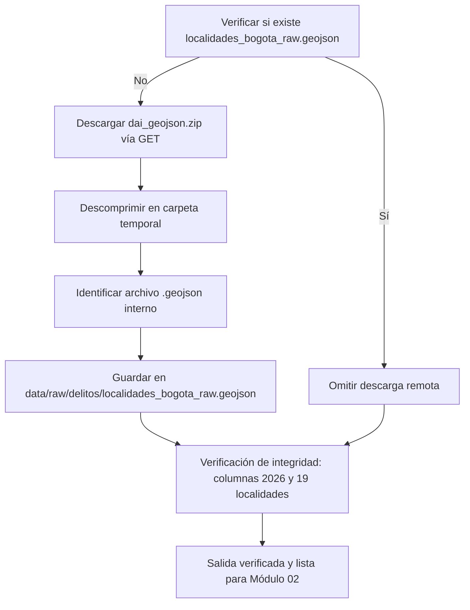

# Ingesta de Delitos de Alto Impacto y Cartografía Distrital (SDSCJ)

Este submódulo gestiona la descarga y extracción reproducible de la capa espacial y estadística oficial de **Delitos de Alto Impacto (DAI)** publicada por la Secretaría Distrital de Seguridad, Convivencia y Justicia (SDSCJ) en articulación con el Sistema de Información Estadístico, Delincuencial, Contravencional y Operativo (SIEDCO) de la Policía Nacional.

---

## 1. Ficha Técnica del Conjunto de Datos

* **Entidad Emisora:** Secretaría Distrital de Seguridad, Convivencia y Justicia (SDSCJ) / Policía Nacional (SIEDCO).
* **Portal Oficial:** [Datos Abiertos Bogotá — Delito de Alto Impacto](https://datosabiertos.bogota.gov.co/dataset/delito-de-alto-impacto-bogota-d-c).
* **Recurso de Origen:** Paquete comprimido `dai_geojson.zip` con geometrías y tablas agregadas.
* **Archivo de Salida:** [`data/raw/delitos/localidades_bogota_raw.geojson`](file:///data/raw/delitos/localidades_bogota_raw.geojson).
* **Sistema de Coordenadas:** WGS 84 (`EPSG:4326`), compatible directamente con `{sf}` y mapas interactivos `{leaflet}`.
* **Corte Temporal Oficial:** Enero de 2018 a Septiembre de 2026 (Atributo de metadato: `CMMES: Ene-Sep (2018vs2026)`).

---

## 2. Cobertura Espacial y Unidades Territoriales

El archivo vectorial contiene **21 geometrías poligonales** que corresponden a:
1. **19 Localidades Urbanas:** Usaquén (01), Chapinero (02), Santa Fe (03), San Cristóbal (04), Usme (05), Tunjuelito (06), Bosa (07), Kennedy (08), Fontibón (09), Engativá (10), Suba (11), Barrios Unidos (12), Teusaquillo (13), Los Mártires (14), Antonio Nariño (15), Puente Aranda (16), La Candelaria (17), Rafael Uribe Uribe (18) y Ciudad Bolívar (19).
2. **1 Localidad Rural Excluida:** Sumapaz (20) — excluida formalmente del análisis de seguridad urbana por baja densidad y tipología rural.
3. **1 Categoría Sin Asignación:** Código 99 ("Sin Localización") — delitos registrados en el Distrito sin precisión geográfica comprobada.

---

## 3. Diccionario de Variables Delictivas Oficiales

Cada entidad espacial cuenta con 137 atributos que registran conteos delictivos anuales y acumulados para las **12 familias oficiales de Delitos de Alto Impacto (DAI)**. La nomenclatura de variables utiliza un prefijo temático de delito seguido del año y el sufijo `CONT` (conteo):

| Prefijo | Modalidad Delictiva Oficial | Variable 2022 | Variable 2026 (Ene–Sep) |
| :--- | :--- | :---: | :---: |
| **`CMHP`** | **Hurto a Personas (Eje central del estudio)** | `CMHP22CONT` | `CMHP26CONT` |
| `CMHC` | Hurto a Comercio | `CMHC22CONT` | `CMHC26CONT` |
| `CMHR` | Hurto a Residencias | `CMHR22CONT` | `CMHR26CONT` |
| `CMHA` | Hurto a Automotores | `CMHA22CONT` | `CMHA26CONT` |
| `CMHM` | Hurto a Motocicletas | `CMHM22CONT` | `CMHM26CONT` |
| `CMH` | Homicidios Comunes | `CMH22CONT` | `CMH26CONT` |
| `CMHF` | Homicidios en Riña / Otras Circunstancias | `CMHF22CONT` | `CMHF26CONT` |
| `CMLP` | Lesiones Personales | `CMLP22CONT` | `CMLP26CONT` |
| `CME` | Extorsión | `CME22CONT` | `CME26CONT` |
| `CMS` | Secuestro | `CMS22CONT` | `CMS26CONT` |
| `CMDS` | Delitos Sexuales | `CMDS22CONT` | `CMDS26CONT` |
| `CMVI` | Violencia Intrafamiliar | `CMVI22CONT` | `CMVI26CONT` |

---

## 4. Lógica de Ejecución del Script

El script [`descarga_delitos_sdscj.R`](file:///scripts/01_ingesta/01_delitos/descarga_delitos_sdscj.R) opera de la siguiente manera:



### Ejecución Directa:
```r
source(here::here("scripts", "01_ingesta", "01_delitos", "descarga_delitos_sdscj.R"))
```
