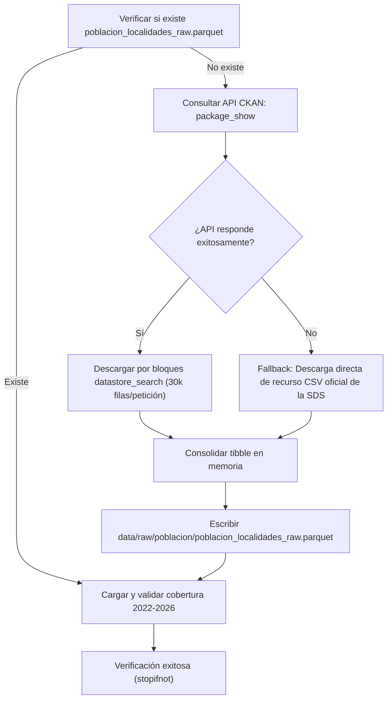

# Ingesta de Proyecciones de Población por Localidad (SDS)

Este submódulo gestiona la descarga reproducible de las proyecciones demográficas distritales publicadas por la Secretaría Distrital de Salud (SDS) a través del portal de Datos Abiertos de Bogotá. Constituye el insumo base para calcular los denominadores demográficos en las tasas de criminalidad por cada 100.000 habitantes.

---

## 1. Ficha Técnica del Conjunto de Datos

* **Entidad Emisora:** Secretaría Distrital de Salud (SDS).
* **Portal Oficial:** [Datos Abiertos Bogotá — Pirámide Poblacional](https://datosabiertos.bogota.gov.co/dataset/piramide-poblacional-bogota-d-c).
* **Mecanismo de Consulta:** API CKAN (`package_show` y `datastore_search`) con paginación por bloques de 30.000 registros y enlace de respaldo (*fallback*) directo en CSV.
* **Archivo de Salida:** [`data/raw/poblacion/poblacion_localidades_raw.parquet`](file:///data/raw/poblacion/poblacion_localidades_raw.parquet).
* **Formato de Almacenamiento:** Apache Parquet (compresión Snappy, tipado estricto y lectura optimizada).
* **Cobertura Temporal:** 2005 a 2035 (proyecciones oficiales ininterrumpidas, cubriendo con exactitud el periodo de análisis 2022–2026).
* **Volumen:** 131.502 registros tabulares.

---

## 2. Estructura y Esquema de Columnas

El archivo crudo almacena la pirámide poblacional proyectada con la siguiente granularidad demográfica:

| Columna | Tipo de Dato | Descripción y Valores |
| :--- | :---: | :--- |
| `ANO` | `numeric` | Año calendario de la proyección (2005 a 2035). |
| `CODIGO_LOCALIDAD` | `numeric` / `character` | Código numérico oficial (1 a 19 para localidades urbanas; 20 para Sumapaz; 0 para consolidado distrital). |
| `NOMBRE_LOCALIDAD` | `character` | Nombre de la localidad en mayúsculas sin normalizar. |
| `SEXO` | `character` | Categoría biológica (`Hombres`, `Mujeres`). |
| `EDAD` | `numeric` | Edad simple en años cumplidos (0 a 100+). |
| `CURSODEVIDA` | `character` | Ciclo vital estandarizado (`Primera infancia`, `Infancia`, `Adolescencia`, `Juventud`, `Adultez`, `Persona Mayor`). |
| `GRUPOEDAD` | `character` | Agrupación quinquenal de edad (ej. `00 a 04`, `05 a 09`, `80 y más`). |
| `POBLACION` | `numeric` | Conteo de personas proyectadas para la combinación localidad-año-sexo-edad. |

---

## 3. Rol Metodológico en el Proyecto

En la etapa de limpieza ([`02_limpieza_indicadores.R`](file:///scripts/02_limpieza_indicadores.R)), estos datos se filtran para excluir el total distrital (`CODIGO_LOCALIDAD != 0`), se agrupan por localidad y año ($2022 \le t \le 2026$), y se suman para obtener la población total anual por localidad ($\text{Pob}_{i,t}$), empleada en la tasa delictiva:

$$\text{Tasa de Hurto}_{i,t} = \left( \frac{\text{Conteo Hurtos}_{i,t}}{\text{Población Proyectada}_{i,t}} \right) \times 100.000$$

---

## 4. Lógica de Ejecución y Resiliencia

El script [`descarga_poblacion_sds.R`](file:///scripts/01_ingesta/02_poblacion/descarga_poblacion_sds.R) implementa un flujo con doble capa de redundancia:



### Ejecución Directa:
```r
source(here::here("scripts", "01_ingesta", "02_poblacion", "descarga_poblacion_sds.R"))
```
