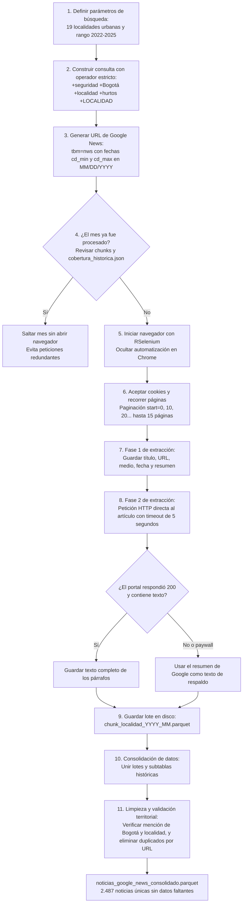

# Scraping y consolidación de noticias en Google News

Este directorio contiene el código para descargar, validar y consolidar noticias de prensa sobre seguridad y hurtos en las 19 localidades urbanas de Bogotá durante el periodo 2022 a 2025.

---

## 1. Por qué consultar la interfaz web (SERP) y no solo el feed RSS

Los canales RSS públicos de Google News ofrecen una ventana corta de noticias recientes, habitualmente entre 30 y 60 días hacia atrás. Como este proyecto necesita una serie histórica continua de cuatro años (2022 a 2025), consultamos directamente el buscador de Google News con los parámetros de búsqueda avanzada:

* `tbm=nws`: indica a Google que filtre únicamente resultados catalogados como noticias.
* `tbs=cdr:1,cd_min:{inicio},cd_max:{fin}`: define una ventana temporal cerrada usando fechas en formato estadounidense (`MM/DD/YYYY`).
* `start={n}`: permite avanzar de 10 en 10 resultados a lo largo de las páginas de cada consulta.

---

## 2. Flujo general del proceso



---

## 3. Reglas técnicas del scraping

### Búsqueda booleana estricta con el operador `+`
Google Search aplica por defecto expansiones semánticas, reemplaza palabras por sinónimos y descarta términos cuando encuentra pocos resultados. Eso desvía las búsquedas hacia otras ciudades o hacia delitos distintos a hurtos.

Para forzar una intersección lógica obligatoria (AND estricto):
* Anteponemos el signo `+` a cada término general: `+seguridad +Bogotá +localidad +hurtos`.
* Descomponemos el nombre de la localidad anteponiendo `+` a cada una de sus palabras (por ejemplo, `+ANTONIO +NARIÑO`, `+BARRIOS +UNIDOS`, `+CIUDAD +BOLÍVAR`).
* De esta forma, Google entrega únicamente noticias que contienen de manera obligatoria la ciudad, la temática de hurto y el nombre exacto de la localidad. La localidad rural de Sumapaz se excluye del análisis.

### División temporal en bloques mensuales
Google trunca los resultados de búsqueda a un máximo cercano a 300 resultados (unas 30 páginas) por consulta. Si se pidiera el periodo 2022 a 2025 en una sola búsqueda, el motor omitiría la gran mayoría de noticias intermedias.

* El script fragmenta los cuatro años en bloques mensuales exactos (48 meses por localidad).
* Las fechas límite se convierten al formato `MM/DD/YYYY` exigido por los parámetros `cd_min` y `cd_max`.

### Registro de avance y guardado incremental en disco
Los procesos largos de descarga web pueden fallar por microcortes de red, cambios de IP o cierres de sesión:
* Cada mes extraído de una localidad se guarda inmediatamente en disco como un archivo independiente en formato Parquet: `data/raw/noticias/chunk_{localidad}_{YYYY_MM}.parquet`.
* Al ejecutar el script, la función revisa si el archivo ya existe o si el mes ya está registrado en `cobertura_historica.json`. Si el mes ya se procesó, continúa de inmediato al siguiente sin enviar ninguna petición a Google.
* Si el proceso se detiene en cualquier punto, puede reanudarse sin repetir trabajo.

### Ocultamiento de automatización y tiempos de espera
* Se inicia Chrome con la bandera `--disable-blink-features=AutomationControlled` para evitar que el navegador reporte que está bajo control de Selenium.
* El código busca y presiona de forma automática los botones de aceptación de cookies (`#L2AGLb` o etiquetas que incluyan "Acepto").
* Entre páginas se aplican pausas aleatorias de 2 a 4 segundos generadas con `runif()`.
* Si Google despliega un desafío interactivo (detección de términos como `unusual traffic` o `recaptcha`), el script lanza una advertencia en la consola y espera 30 segundos para permitir su solución manual antes de reintentar.

### Extracción en dos fases con respaldo de texto
1. Fase 1 (resultados de búsqueda): se leen los elementos del resultado en Google: título, medio de prensa, enlace, fecha y el resumen visible de la noticia.
2. Fase 2 (portal externo): se intenta descargar el texto completo de los párrafos (`<p>`) haciendo una solicitud HTTP directa con `httr::GET` y un tiempo de espera máximo de 5 segundos.
3. Respaldo por fallas: si el medio exige suscripción, devuelve un error HTTP (como 403 o 404) o tarda más de 5 segundos en responder, se conserva el resumen de Google como texto del artículo. Ninguna noticia se descarta por problemas del portal de origen y el texto resultante siempre queda listo para el análisis con `sentometrics`.

### Limpieza territorial y desduplicación
Al consolidar las subtablas:
* Se normalizan los textos a formato ASCII sin tildes mediante `stringi::stri_trans_general(., "Latin-ASCII")` para evitar inconsistencias de codificación.
* Se verifica que la palabra "Bogotá" aparezca en el título, en el resumen o en el cuerpo.
* Se extrae el nombre de la localidad desde la consulta original y se confirma su presencia en el texto.
* Se ordenan los registros priorizando aquellos donde la localidad aparece en el título o en el resumen, y se eliminan filas duplicadas que compartan la misma URL (`enlace`).

---

## 4. Archivos generados

```text
data/raw/noticias/
├── historico_por_localidad/                  # 19 subtablas brutas individuales (4.276 registros)
│   ├── antonio_narino.parquet (.rds)
│   ├── barrios_unidos.parquet (.rds)
│   ├── bosa.parquet (.rds)
│   ├── ... (19 localidades urbanas)
│   └── usme.parquet (.rds)
├── cobertura_historica.json                  # Registro de meses ya procesados por localidad
└── chunk_*.parquet                           # Lotes mensuales nuevos del scraper incremental

data/raw/
├── noticias_google_news_consolidado.parquet  # Base final validada (2.487 noticias únicas)
└── noticias_google_news_consolidado.rds      # Respaldo en formato RDS de R
```

---

## 5. Instrucciones de uso

### Consolidar las subtablas históricas (2022-01 a 2025-09)
Para generar la base consolidada validada de 2.487 noticias y el archivo de metadatos de cobertura:

```r
source(here::here("scripts", "01_ingesta", "02_scraping_noticias", "00_consolidar_subtablas_historicas.R"))
```

### Ejecutar el scraper incremental para meses nuevos o faltantes
Para descargar periodos complementarios (como el trimestre octubre a diciembre de 2025 o meses de 2026):

```r
source(here::here("scripts", "01_ingesta", "02_scraping_noticias", "scraping_google_news.R"))

# Iniciar la descarga respetando los meses ya cubiertos
ejecutar_scraping_localidades()

# Integrar los nuevos lotes a la base consolidada
noticias_actualizadas <- consolidar_noticias_scraping()
```

---

> ⬅️ Volver a la [guía de scripts](file:///Users/juanjoseecheverry/Library/Mobile%20Documents/com~apple~CloudDocs/Universidad/Maestria%20%28MECA%29/Primer%20semestre/Taller%20R/Repo_Entrega_Final_Taller_R/scripts/README.md) | Volver al [README principal](file:///Users/juanjoseecheverry/Library/Mobile%20Documents/com~apple~CloudDocs/Universidad/Maestria%20%28MECA%29/Primer%20semestre/Taller%20R/Repo_Entrega_Final_Taller_R/README.md)
