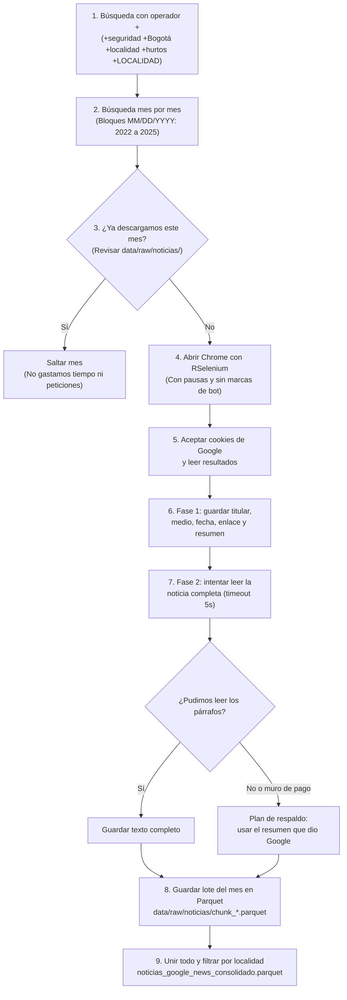

# Cómo extraemos las noticias de Google News

En esta carpeta está el código para descargar las noticias de seguridad en las 19 localidades urbanas de Bogotá entre 2022 y 2025. 

El método viene de la experiencia del repositorio *Perception-and-legitimacy*, pero le metimos varias mejoras para que el proceso no se caiga a mitad de camino y no tengamos que volver a empezar si se interrumpe la conexión.

---

## 1. ¿Por qué buscar en la web de Google Noticias y no solo en el feed RSS?

El feed RSS de Google News solo guarda noticias de las últimas semanas (generalmente 30 a 60 días). Como nuestro análisis abarca 4 años completos (**desde enero de 2022 hasta diciembre de 2025**), necesitamos buscar directamente en el portal web de Google Noticias (`tbm=nws`) usando el filtro de fechas personalizadas.

---

## 2. Diagrama del flujo de scraping



---

## 3. Los 6 trucos para que el scraping funcione bien

### 1. El truco del operador `+` (búsqueda estricta)
Google suele cambiar palabras por sinónimos o mostrar noticias de otras ciudades. Si buscamos simplemente `hurto Kennedy`, a veces aparecen noticias de robos en Medellín o noticias políticas de la localidad. 

Para obligar a Google a que la noticia hable exactamente de seguridad en esa localidad de Bogotá, le ponemos un `+` a cada palabra obligatoria:
* Base de búsqueda: `+seguridad +Bogotá +localidad +hurtos`
* Localidad con más de una palabra: se separa con un `+` en cada término (por ejemplo: `+ANTONIO +NARIÑO`, `+BARRIOS +UNIDOS`, `+CIUDAD +BOLÍVAR`).
* Esto fuerza a Google a un **AND estricto**: solo devuelve páginas que contengan todas esas palabras. Excluimos la localidad rural de Sumapaz.

### 2. Buscar mes por mes (chunking temporal)
Si le pides a Google cuatro años de golpe, solo te deja ver las primeras 30 páginas (unas 300 noticias) y oculta el resto. Al dividir los 4 años en **bloques mensuales** (enero 2022, febrero 2022, etc.), logramos extraer muchas más noticias y no dejamos huecos en la serie. Además, convertimos las fechas al formato que Google exige: `MM/DD/YYYY`.

### 3. Guardar por pedazos (checkpointing para no perder avance)
Hacer scraping sobre miles de consultas toma varias horas. Si se cae el internet o salta un bloqueo en el mes 20, no queremos perder lo que ya descargamos.
* Cada mes de cada localidad se guarda de inmediato en disco:
  ```text
  data/raw/noticias/chunk_{localidad}_{YYYY_MM}.parquet
  ```
* Cuando vuelves a correr el script, este primero revisa si el archivo de ese mes ya existe. Si ya está listo, se lo salta y continúa con el siguiente. Así puedes parar y continuar el proceso cuando quieras.

### 4. Evitar que nos bloqueen (Selenium)
* Le quitamos a Chrome las etiquetas automáticas de navegador controlado (`--disable-blink-features=AutomationControlled`).
* Acepta automáticamente la ventana de cookies de Google para que no tape los resultados.
* Mete pausas aleatorias de 2 a 4 segundos entre consultas para no saturar al buscador.
* Si Google pide resolver un CAPTCHA, el script te avisa con un mensaje y pausa 30 segundos para que lo resuelvas a mano en el navegador.

### 5. Descarga en dos fases y plan de respaldo (fallback)
1. **Fase 1:** Guardamos de una vez el titular, la fecha, el enlace y el resumen que Google muestra en la página de resultados.
2. **Fase 2:** Intentamos entrar al enlace de la noticia para leer los párrafos completos (`<p>`) con un tiempo límite corto de 5 segundos.
3. **Plan de respaldo:** Muchos periódicos tienen muro de pago (paywall) o bloquean accesos automáticos. Si la página no abre o pide suscripción, el script no bota la noticia: guarda el resumen que nos dio Google. Así nos aseguramos de que cada noticia siempre tenga texto para el análisis de sentimiento.

### 6. Filtro final de localidad
Cuando termina de descargar todos los meses, el script une todos los pedazos, quita noticias repetidas y comprueba que el nombre de la localidad realmente aparezca en el texto. El resultado consolidado se guarda en `data/raw/noticias_google_news_consolidado.parquet`.

---

## 4. Cómo correr el script

Abre RStudio y corre estos comandos en la consola:

```r
# 1. Cargar las funciones de scraping
source(here::here("scripts", "01_ingesta", "02_scraping_noticias", "scraping_google_news.R"))

# 2. Iniciar la descarga por meses y localidades (avanza con checkpoints)
ejecutar_scraping_localidades()

# 3. Consolidar todos los lotes en un solo archivo Parquet
noticias_df <- consolidar_noticias_scraping()
```
