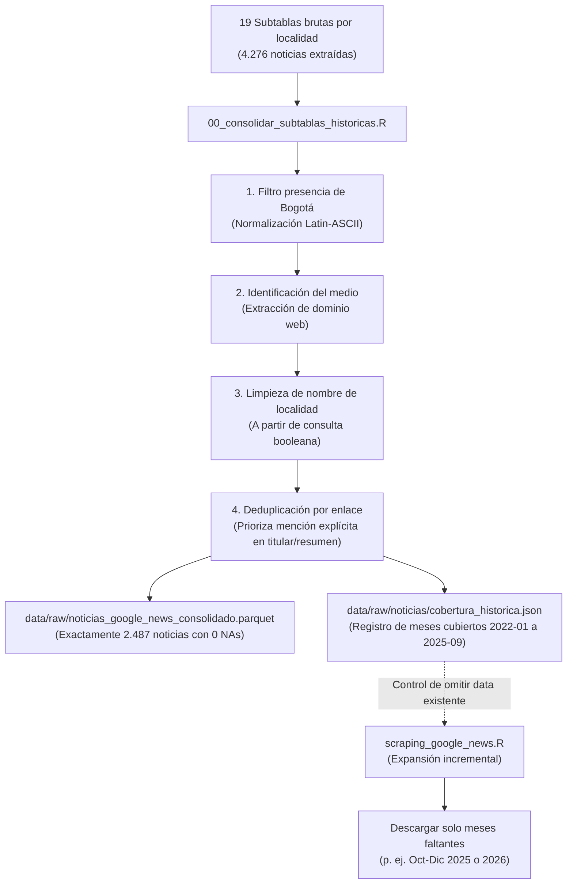

# Ingesta y Scraping de Noticias en Google News

En esta carpeta está el código para obtener, consolidar y expandir las noticias de prensa y comunicados sobre hurtos y seguridad en las 19 localidades urbanas de Bogotá.

El método proviene del repositorio previo *Perception-and-legitimacy*, pero se rediseñó para garantizar **trazabilidad completa**, **conservación de subtablas por localidad** y un mecanismo de **scraping incremental** que no repite datos existentes.

---

## 1. Estructura de Datos y Trazabilidad

Para que cualquier persona pueda auditar cómo se construyó la base final, conservamos tanto las subtablas brutas de cada localidad como el archivo unificado:

```text
data/raw/noticias/
├── historico_por_localidad/            # Subtablas brutas individuales (4.276 filas en total)
│   ├── antonio_narino.parquet (.rds)
│   ├── barrios_unidos.parquet (.rds)
│   ├── bosa.parquet (.rds)
│   ├── ... (19 localidades urbanas)
│   └── usme.parquet (.rds)
├── cobertura_historica.json            # Metadatos de meses y fechas ya cubiertos por localidad
└── chunk_*.parquet                     # Lotes temporales adicionales de scraping incremental

data/raw/
├── noticias_google_news_consolidado.parquet   # Base final validada (2.487 noticias únicas)
└── noticias_google_news_consolidado.rds       # Respaldo en formato nativo de R
```

---

## 2. Flujo de Trabajo Metodológico



---

## 3. Scripts Disponibles

### `00_consolidar_subtablas_historicas.R`
* **¿Qué hace?** Lee las carpetas originales de las 19 localidades, guarda cada subtabla en `historico_por_localidad/` (formato Parquet y RDS), ejecuta la consolidación y validación territorial, exporta `noticias_google_news_consolidado.parquet` y crea el archivo `cobertura_historica.json`.
* **Garantía:** Reproduce con precisión matemática las 2.487 filas del estudio original sin pérdida de información.
* **Ejecución:**
  ```r
  source(here::here("scripts", "01_ingesta", "02_scraping_noticias", "00_consolidar_subtablas_historicas.R"))
  ```

### `scraping_google_news.R`
* **¿Qué hace?** Automatiza Google Noticias mediante `RSelenium` para descargar periodos nuevos o faltantes mes por mes.
* **Control incremental inteligente:** Antes de lanzar una petición a Google, revisa `cobertura_historica.json` y los chunks guardados en `data/raw/noticias/`. Si el mes de esa localidad ya existe, lo omite automáticamente, ahorrando tiempo y evitando bloqueos de IP.
* **Búsqueda booleana estricta:** Aplica el operador `+` en cada palabra obligatoria (`+seguridad +Bogotá +localidad +hurtos +KENNEDY`), forzando a Google a un AND estricto.
* **Ejecución:**
  ```r
  source(here::here("scripts", "01_ingesta", "02_scraping_noticias", "scraping_google_news.R"))
  ejecutar_scraping_localidades()
  ```

---

## 4. Cobertura Histórica y Expansión Futura

* **Periodo cubierto en subtablas:** Enero de 2022 a Septiembre de 2025 (45 meses).
* **Periodo pendiente por scrapear:** Octubre a Diciembre de 2025 (3 meses para completar el cuatrienio).
* Al ejecutar `scraping_google_news.R`, el script identificará de inmediato que los primeros 45 meses ya están cubiertos y únicamente descargará los 3 meses restantes, integrándolos a la base consolidada sin tocar los datos previos.
