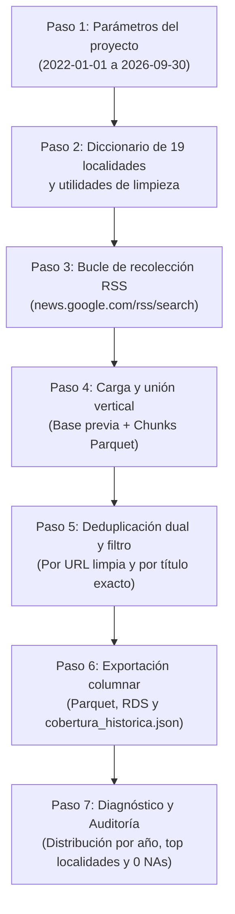

# Ingesta y Scraping de Noticias en Google News

En esta carpeta está el código para obtener, consolidar y expandir las noticias de prensa y comunicados sobre hurtos y seguridad en las 19 localidades urbanas de Bogotá.

El método garantiza **trazabilidad completa**, **conservación de subtablas por localidad** y un mecanismo de **recolección rápida y sin bloqueos mediante Google News RSS** que complementa los datos históricos.

---

## 1. Estructura de Datos y Trazabilidad

Para que cualquier persona pueda auditar cómo se construyó la base final, conservamos tanto las subtablas brutas de cada localidad como el archivo unificado:

```text
data/raw/
└── noticias/
    ├── noticias_google_news_consolidado.parquet   # Base final validada y enriquecida (3.928 noticias únicas)
    └── noticias_google_news_consolidado.rds       # Respaldo en formato nativo de R
```

---

## 2. Flujo de Trabajo Metodológico y Procedural

El script `scraping_google_news.R` opera con un **flujo lineal secuencial (Paso 1 a Paso 7)**, sin complejas funciones envolventes anidadas, permitiendo su ejecución de arriba hacia abajo o paso a paso con `Ctrl + Enter` en RStudio:



---

## 3. Script Principal

### `scraping_google_news.R`
* **¿Qué hace?** Automatiza de manera integral y autónoma la recolección, consolidación histórica, deduplicación, enriquecimiento analítico (medios, geografía, delitos oficiales de alto impacto) y exportación del corpus para las 19 localidades urbanas mediante un flujo lineal procedimental y el **motor oficial Google News RSS**.
* **Ventajas clave:**
  * Script único, autónomo y reproducible sin dependencias externas ni rutas locales personales.
  * Flujo procedimental paso a paso: fácil de leer, depurar y evaluar sin capas de funciones abstractas.
  * No requiere navegador web ni drivers de Selenium.
  * No genera bloqueos por IP ni reCAPTCHAs.
  * Captura fecha real exacta de publicación (`pubDate`), medio de comunicación (`source`), titular y enlace limpio.
  * Incorpora la nomenclatura oficial de **Delitos de Alto Impacto (SCJ / SIEDCO)** para empalme directo con estadísticas policiales.
* **Ejecución:**
  ```r
  source(here::here("scripts", "01_ingesta", "02_scraping_noticias", "scraping_google_news.R"))
  ```

---

## 4. Cobertura Histórica y Expansión Futura

* **Periodo cubierto en subtablas históricas:** Enero de 2022 a Septiembre de 2025 (2.533 noticias previas).
* **Expansión con Google News RSS:** 1.395 artículos adicionales deduplicados cubriendo hasta septiembre de 2026.
* **Total consolidado actual:** **3.928 noticias únicas** cubriendo desde `2022-01-01` hasta `2026-09-30` con 0 valores nulos en campos esenciales.
