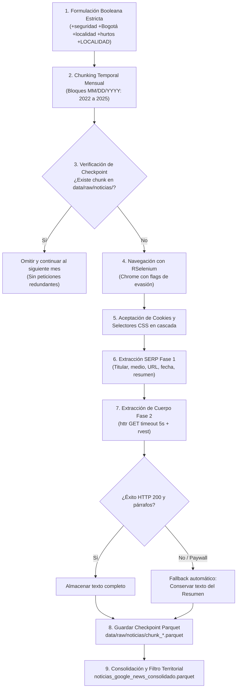

# Metodología de Web Scraping Robusto de Noticias (Google News)

Esta subcarpeta contiene la implementación del pipeline de recolección automatizada del corpus de prensa para las 19 localidades urbanas de Bogotá durante el periodo **2022–2025**, evolucionado a partir de la metodología de investigación desarrollada en *Perception-and-legitimacy*.

---

## 1. Fundamentación Técnica: ¿Por qué Google News SERP y no solo RSS?

Las fuentes públicas RSS de Google News ofrecen únicamente una ventana temporal reciente (habitualmente entre 30 y 60 días hacia atrás). Dado que este proyecto requiere reconstruir una serie longitudinal de 4 años calendario completos (**01/01/2022 al 31/12/2025**), es indispensable consultar el motor histórico de Google News (*Search Engine Results Page* - SERP) bajo el parámetro especializado `tbm=nws` y el rango de fechas personalizado `tbs=cdr:1,cd_min:...,cd_max:...`.

---

## 2. Diagrama de la Metodología de Scraping



---

## 3. Pilares Metodológicos en Detalle

### 3.1 Consultas Booleanas con Operador Estricto (`+`)
Google News aplica por defecto expansiones semánticas y sinónimos automáticos, lo que suele desviar los resultados hacia otras ciudades (ej. Medellín, Cali) o hacia delitos diferentes a hurtos. Para forzar un **AND Booleano estricto**:
* Se antepone el operador `+` a cada término temático: `+seguridad +Bogotá +localidad +hurtos`.
* Se aplica una función que descompone el nombre de cada localidad y antepone `+` a cada una de sus palabras (ej. `+ANTONIO +NARIÑO`, `+BARRIOS +UNIDOS`, `+CIUDAD +BOLÍVAR`).
* **Resultado:** Google restringe obligatoriamente los resultados a artículos que contengan explícitamente todas las palabras clave y el nombre territorial de la localidad. Se excluye la localidad rural de Sumapaz.

### 3.2 Partición Temporal Mensual (*Date Chunking*)
Google Search impone un límite de truncamiento de ~300 resultados (30 páginas de 10 noticias) por consulta si se solicita un rango muy amplio. Si se consultara de golpe el periodo 2022–2025, se perdería más del 80% del archivo de noticias.  
* **Solución:** El script divide el intervalo en **bloques mensuales exactos** (48 meses por localidad = 912 ventanas de consulta).
* **Formato de fecha:** Google requiere el formato estadounidense `MM/DD/YYYY` en el parámetro `cd_min` y `cd_max`.

### 3.3 Checkpointing Incremental en Disco (Persistencia a Prueba de Fallos)
Los procesos de web scraping sobre miles de consultas están expuestos a cortes de red, bloqueos temporales de IP o reinicios del sistema:
* Cada mes procesado para una localidad se guarda inmediatamente en disco como un archivo particionado Apache Parquet:
  ```text
  data/raw/noticias/chunk_{localidad}_{YYYY_MM}.parquet
  ```
* Al arrancar o relanzar el script, este comprueba primero `if (file.exists(archivo_chunk)) next`. Si el archivo ya existe, **lo salta de inmediato sin abrir la página ni consumir peticiones**.
* Esto permite interrumpir el proceso en cualquier momento y reanudarlo exactamente donde quedó, sin duplicar peticiones ni perder el trabajo realizado.

### 3.4 Antidetección y Gestión de Bloqueos (Selenium)
* **Banderas de evasión:** Se inicializa Chrome con `--disable-blink-features=AutomationControlled` para evitar que Google detecte el flag de WebDriver automatizado.
* **Consentimiento de Cookies:** Hace clic programático automático sobre `button#L2AGLb` o botones con etiqueta "Acepto" para desbloquear la vista SERP.
* **Pausas aleatorias:** Tiempos de espera variables (`runif(1, 2.0, 4.0)` segundos) que simulan la interacción humana.
* **Control de CAPTCHA:** Si el HTML contiene patrones como `unusual traffic` o `recaptcha`, emite una alerta acústica/mensaje, realiza una pausa de 30 segundos para permitir la resolución manual en el navegador y retoma la navegación automáticamente.

### 3.5 Extracción de Texto en Dos Fases con Fallback
1. **Fase 1 (Metadatos y Resumen):** Se capturan título, enlace, medio de comunicación, fecha visible y el snippet de resumen disponible directamente en la SERP de Google News.
2. **Fase 2 (Cuerpo del Artículo):** Para cada enlace obtenido, se realiza una petición HTTP (`httr::GET`) con cabecera de navegador y un timeout estricto de **5 segundos** para leer los párrafos (`<p>`).
3. **Mecanismo de Fallback:** Si el portal externo tiene muro de pago (*paywall*), requiere suscripción, devuelve error 403/404 o tarda más de 5 segundos, el script asigna automáticamente el **`resumen`** de Google News como cuerpo de la noticia. De esta manera, **ninguna noticia se descarta** y el módulo de `sentometrics` siempre cuenta con texto analizable.

### 3.6 Validación Territorial Estricta y Desduplicación
Al finalizar los checkpoints, la función de consolidación:
* Une todos los micro-archivos `.parquet`.
* Elimina noticias duplicadas mediante la URL (`enlace`).
* Realiza un filtrado mediante expresiones regulares asegurando que el nombre de la localidad esté efectivamente mencionado en el titular, resumen o cuerpo.
* Guarda el resultado en `data/raw/noticias_google_news_consolidado.parquet`.

---

## 4. Instrucciones de Uso

Abra RStudio en la raíz del proyecto y ejecute:

```r
# 1. Cargar el script de scraping
source(here::here("scripts", "01_ingesta", "02_scraping_noticias", "scraping_google_news.R"))

# 2. Iniciar la recolección automática por meses y localidades
ejecutar_scraping_localidades()

# 3. Consolidar los chunks de data/raw/noticias/ en una única base validada
noticias_df <- consolidar_noticias_scraping()
```
