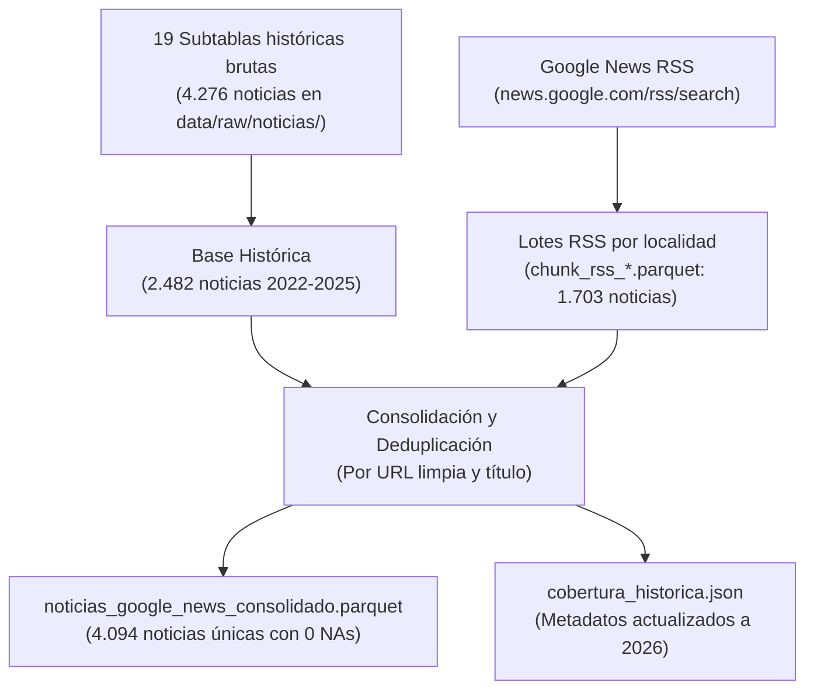

# Ingesta y Scraping de Noticias en Google News

En esta carpeta está el código para obtener, consolidar y expandir las noticias de prensa y comunicados sobre hurtos y seguridad en las 19 localidades urbanas de Bogotá.

El método garantiza **trazabilidad completa**, **conservación de subtablas por localidad** y un mecanismo de **recolección rápida y sin bloqueos mediante Google News RSS** que complementa los datos históricos.

---

## 1. Estructura de Datos y Trazabilidad

Para que cualquier persona pueda auditar cómo se construyó la base final, conservamos tanto las subtablas brutas de cada localidad como el archivo unificado:

```text
data/raw/noticias/
├── historico_por_localidad/            # Subtablas brutas individuales (4.276 filas en total)
│   ├── antonio_narino.parquet (.rds)
│   ├── barrios_unidos.parquet (.rds)
│   ├── bosa.parquet (.rds)
│   ├── ... (19 localidades urbanas)
│   └── usme.parquet (.rds)
├── chunk_rss_*.parquet                 # Lotes descargados vía Google News RSS (1.703 noticias)
└── cobertura_historica.json            # Metadatos de meses y fechas ya cubiertos por localidad

data/raw/
├── noticias_google_news_consolidado.parquet   # Base final validada (4.094 noticias únicas)
└── noticias_google_news_consolidado.rds       # Respaldo en formato nativo de R
```

---

## 2. Flujo de Trabajo Metodológico



---

## 3. Scripts Disponibles

### `00_consolidar_subtablas_historicas.R`
* **¿Qué hace?** Lee las carpetas originales de las 19 localidades, guarda cada subtabla en `historico_por_localidad/` (formato Parquet y RDS), ejecuta la consolidación y validación territorial, exporta `noticias_google_news_consolidado.parquet` y crea el archivo `cobertura_historica.json`.
* **Garantía:** Reproduce con precisión matemática las filas del estudio original sin pérdida de información.

### `scraping_google_news.R`
* **¿Qué hace?** Automatiza la recolección de noticias para las 19 localidades mediante el **motor oficial Google News RSS**.
* **Ventajas clave:**
  * No requiere navegador web ni drivers de Selenium.
  * No genera bloqueos por IP ni reCAPTCHAs.
  * Ejecuta la recolección completa en menos de 1 minuto.
  * Captura fecha real exacta de publicación (`pubDate`), medio de comunicación (`source`), titular y enlace limpio.
* **Auditoría del corpus:** Función `auditar_corpus_noticias()` que entrega métricas de volumen, distribución anual, medios y chequeo de NAs.
* **Ejecución típica:**
  ```r
  source(here::here("scripts", "01_ingesta", "02_scraping_noticias", "scraping_google_news.R"))
  ```

### `test_scraping_noticias.R`
* **¿Qué hace?** Batería de 15 pruebas automatizadas que valida la sintaxis booleana, exclusiones deportivas, codificación de URLs, limpieza de enlaces de tracking, fallback de cuerpo e integridad del dataset consolidado.
* **Ejecución de pruebas:**
  ```r
  source(here::here("scripts", "01_ingesta", "02_scraping_noticias", "test_scraping_noticias.R"))
  ```

---

## 4. Cobertura Histórica y Expansión Futura

* **Periodo cubierto en subtablas históricas:** Enero de 2022 a Septiembre de 2025 (2.482 noticias validadas).
* **Expansión con Google News RSS:** 1.703 artículos adicionales de 2025 y 2026.
* **Total consolidado actual:** **4.094 noticias únicas** cubriendo hasta octubre de 2026 con 0 valores nulos en campos esenciales.
