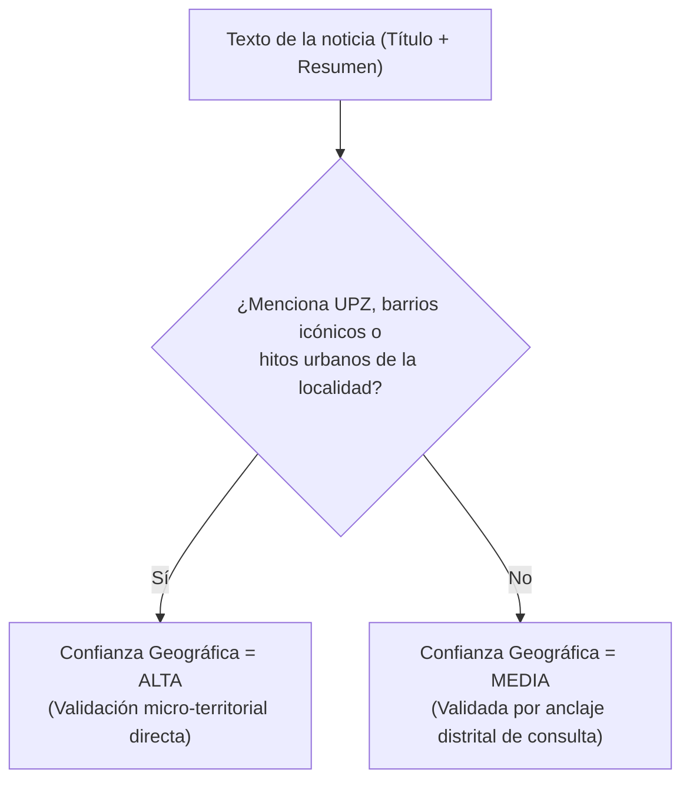

# Ingesta y Scraping de Noticias en Google News

Esta carpeta contiene la documentación técnica y el código procedimental para la captura, depuración, resolución de ambigüedades territoriales y enriquecimiento analítico del corpus de noticias sobre criminalidad en las 19 localidades urbanas de Bogotá D.C.

El pipeline opera mediante el motor oficial de **Google News RSS**, garantizando trazabilidad completa, ausencia de bloqueos por IP y una discriminación geográfica estricta para evitar falsos positivos y homonimias.

---

## 1. Parámetros del Motor de Scraping (Google News RSS)

A diferencia del raspado HTML convencional mediante emuladores o navegadores automatizados (Selenium/Puppeteer), el pipeline utiliza el protocolo estructurado RSS de Google News. Esto permite consultas rápidas, reproducibles y sin interrupciones por CAPTCHAs.

### Estructura de la URL y Parámetros
El punto de acceso HTTP para cada consulta se estructura así:

$$\text{URL} = \texttt{https://news.google.com/rss/search?q=} + \text{URLencode}(\text{Cadena\_Búsqueda}) + \texttt{\&hl=es-419\&gl=CO\&ceid=CO:es-419}$$

| Parámetro | Valor | Justificación Técnica y Control Metodológico |
| :--- | :--- | :--- |
| `q` | *(String codificado en UTF-8)* | Consulta booleana que combina anclajes territoriales, términos delictivos y filtros de exclusión negativos. |
| `hl` | `es-419` | Fija el idioma de la respuesta en **español latinoamericano**, asegurando coincidencia léxica en terminología judicial y periodística regional. |
| `gl` | `CO` | Restringe la geolocalización del motor a **Colombia**, priorizando la indexación de medios informativos nacionales, regionales y locales. |
| `ceid` | `CO:es-419` | Identificador de edición territorial (*Country Edition Identifier*): vincula la búsqueda al catálogo periodístico de Colombia en español. |

### Control de Tasa de Peticiones (*Politeness Delay*)
Para preservar la estabilidad de la conexión y respetar las políticas de uso de los servidores, el bucle de recolección incluye una pausa obligatoria de 1,0 segundo (`Sys.sleep(1.0)`) entre solicitudes sucesivas. En cada llamada se parsea el árbol XML extrayendo los campos:
* Titular (`<title>`)
* Enlace original (`<link>`)
* Fecha de publicación (`<pubDate>`)
* Medio editorial de origen (`<source>`)
* Resumen editorial o snippet (`<description>`)

---

## 2. Construcción de Consultas Booleanas y Anclaje Territorial

Para garantizar que cada noticia recolectada pertenezca a una localidad específica de Bogotá y describa hechos delictivos o de seguridad ciudadana, cada consulta se construye mediante la fórmula procedimental:

```text
Cadena_Búsqueda = [Términos Delictivos] + "Bogota" + "[Nombre Localidad]" + [Filtro Exclusiones] + "-horoscopo -tarot"
```

### 2.1 Anclaje Temático: Diccionario de Delitos de Alto Impacto
El componente delictivo utiliza una disyunción booleana (`OR`) que cubre tanto la tipología penal formal como el lenguaje común de la crónica roja en Bogotá:

```text
terminos_delitos = "(hurto OR robo OR atraco OR asalto OR fleteo OR sicariato OR homicidio OR extorsion OR delincuencia OR inseguridad)"
```

### 2.2 Anclaje Distrital Estricto: `"Bogota"` Obligatorio
Toda consulta incluye explícitamente el término `Bogota`. Este operador garantiza que el motor de búsqueda indexe artículos donde la ciudad sea el eje contextual del reporte, descartando noticias de otras ciudades que utilicen nombres coincidentes.

### 2.3 Anclaje Local Exacto: Entrecomillado de Territorio
El nombre de la localidad se introduce con comillas dobles (por ejemplo, `"Santa Fe"`, `"La Candelaria"`, `"San Cristóbal"`). En la sintaxis de Google News, las comillas fuerzan la coincidencia de la frase exacta continua (*exact phrase match*), impidiendo que se recuperen textos donde las palabras aparezcan dispersas o desconectadas.

---

## 3. Manejo de Homonimias y Prevención de Falsos Positivos

El principal reto técnico en la minería de prensa de Bogotá consiste en que varias localidades comparten su denominación con clubes de fútbol, municipios de otros departamentos, estados de otros países o instituciones educativas. Si no se filtran, estas homonimias contaminan la base con noticias irrelevantes.

Para neutralizar estas coincidencias, el script aplica una **estrategia de exclusión negativa en dos capas**:

### Capa 1: Filtros de Exclusión Booleana en la Consulta (`filtro_exclusiones`)

| Localidad | Fuente de Ambigüedad / Falso Positivo | Operadores de Exclusión Negativa (`-`) |
| :--- | :--- | :--- |
| **Santa Fe** | **Club de Fútbol Independiente Santa Fe:** noticias deportivas sobre partidos, hinchadas, torneos o el estadio Nemesio Camacho El Campín.<br>**Municipios externos:** Santa Fe de Antioquia y Santa Fe de Ralito (Córdoba). | `-futbol -liga -campin -dimayor -cardenal -partido -estadio -gol -independiente -antioquia -ralito` |
| **San Cristóbal** | **Geografía internacional:** Ciudad de San Cristóbal (Estado Táchira, Venezuela) y San Cristóbal de las Casas (Chiapas, México).<br>**Municipios nacionales:** San Cristóbal (Bolívar). | `-venezuela -tachira -mexico -chiapas -bolivar` |
| **La Candelaria** | **Comuna 10 (La Candelaria) de Medellín:** noticias policiales del centro de Medellín.<br>**Municipios externos:** Candelaria (Valle del Cauca) y Candelaria (Atlántico). | `-medellin -valle -antioquia -atlantico` |
| **Ciudad Bolívar** | **Geografía internacional:** Ciudad Bolívar (capital del Estado Bolívar, Venezuela, sobre el río Orinoco).<br>**Municipio nacional:** Ciudad Bolívar (Suroeste antioqueño). | `-venezuela -antioquia -orinoco` |
| **Antonio Nariño** | **Entidad educativa:** Noticias académicas, convocatorias de matrícula y acreditaciones de la Universidad Antonio Nariño (UAN). | `-universidad -uan -pregrado -matricula -facultad` |
| **Rafael Uribe Uribe** | **Entidades de salud y barrios en otras ciudades:** Clínica o barrios homónimos en Cali (Valle del Cauca). | `-cali` |
| **Bosa** | **Geografía internacional:** Municipio costero de Bosa en la provincia de Oristán (Cerdeña, Italia). | `-italia -cerdeña` |
| **Transversal** | **Contenido no informativo / ruido:** Horóscopos, lecturas de tarot o notas de entretenimiento que usen palabras clave. | `-horoscopo -tarot` |

### Capa 2: Filtro de Validación Pos-Scraping en Titulares
Adicionalmente a los operadores de búsqueda, se ejecuta una regla de auditoría sobre el titular (`titulo`):
1. **Regla de exclusión deportiva en Santa Fe:** Si la localidad asignada es `Santa Fe` y el titular contiene expresiones como *partido santa fe*, *santa fe vs*, *el campín*, *liga betplay*, *copa betplay* o *fútbol colombiano*, el registro se descarta automáticamente.
2. **Regla de exclusión de otras ciudades:** Si el titular sitúa expresamente el hecho en otra urbe (*"en Medellín"*, *"en Cali"*, *"en Barranquilla"*, *"en Bucaramanga"*, *"en Cartagena"*, *"en Cúcuta"*, *"en Pereira"*, *"en Manizales"*, *"en Ibagué"*, *"en Santa Marta"*, *"en Villavicencio"* o *"en Venezuela"*) y **no** menciona la palabra *Bogotá*, el artículo se elimina de forma preventiva.

---

## 4. Auditoría de Confianza Geográfica (`confianza_geografica`)

Para medir el nivel de certeza espacial con el que una noticia describe una localidad específica, el pipeline asigna una etiqueta categórica de dos niveles (`Alta` vs. `Media`):



### Diccionario de Patrones Micro-Territoriales
* **Usaquén:** Cedritos, Santa Bárbara, San Cristóbal Norte, Torca, Unicentro.
* **Chapinero:** Chicó, Rosales, El Retiro, Lago, Marly, Antiguo Country.
* **Santa Fe:** La Macarena, Las Aguas, Germania, Las Nieves, San Victorino, La Perseverancia.
* **San Cristóbal:** 20 de Julio, La Victoria, Libertadores, Quindío.
* **Usme:** Yomasa, Alfonso López, Danubio, Monteblanco.
* **Tunjuelito:** Venecia, San Carlos, Tunal, El Tunal, San Benito.
* **Bosa:** Brasil, Carbonell, Porvenir, San Bernardino, La Libertad.
* **Kennedy:** Patio Bonito, Castilla, Tintal, El Tintal, Corabastos, Mandalay, Carvajal, Timiza.
* **Fontibón:** Modelia, Salitre, Capellanía, Zona Franca, San Pablo.
* **Engativá:** Minuto de Dios, Boyacá Real, Álamos, Quirigua, Garcés Navas.
* **Suba:** Rincón, Niza, Colina Campestre, Tibabuyes, Prado Veraniego, Pontevedra, La Campiña.
* **Barrios Unidos:** 7 de Agosto, Polo Club, 12 de Octubre, Rincón del Salitre, La Castellana.
* **Teusaquillo:** Palermo, Galerías, Salitre Greco, Parkway, Ciudad Salitre, La Soledad.
* **Los Mártires:** Santa Isabel, Ricaurte, Eduardo Santos, La Sabana, Voto Nacional.
* **Antonio Nariño:** Restrepo, Santander, Policarpa, Ciudad Berna.
* **Puente Aranda:** Ciudad Montes, Salazar Gómez, Gorgonzola, Cundinamarca.
* **La Candelaria:** Centro Histórico, Plaza de Bolívar, Belén.
* **Rafael Uribe Uribe:** Olaya, Quiroga, San José, Diana Turbay, Marruecos.
* **Ciudad Bolívar:** Meissen, Sierra Morena, Arborizadora, Lucero, San Francisco, Jerusalén.

---

## 5. Estrategia de Deduplicación Dual

Los portales de noticias suelen publicar el mismo cable informativo a través de múltiples canales, redirecciones con parámetros de mercadeo (`utm_source`, `utm_medium`, `fbclid`) o sindicaciones de agencias de prensa.

Para evitar que una misma noticia se contabilice varias veces distorsionando el volumen delictivo, se aplica una deduplicación en dos fases:
1. **Limpieza y deduplicación por URL canónica:** Se eliminan todas las cadenas de seguimiento tras el signo `?` y se ejecuta `distinct(enlace, .keep_all = TRUE)`.
2. **Deduplicación por titular exacto:** Se eliminan las notas replicadas que compartan exactamente el mismo texto de titular (`distinct(titulo, .keep_all = TRUE)`).

---

## 6. Enriquecimiento Analítico y Nomenclatura Oficial

Cada artículo procesado se clasifica en dos dimensiones estructurales para su posterior modelado econométrico:

### 6.1 Tipología del Medio de Comunicación (`tipo_medio`)
* **Institucional:** Alcaldía Mayor, Secretaría de Seguridad, Policía Nacional, Fiscalía General, Concejo de Bogotá.
* **Prensa Tradicional:** El Tiempo, El Espectador, Revista Semana, Portafolio, El País, El Nuevo Siglo, La República.
* **Televisión y Radio:** Citytv, Noticias Caracol, Noticias RCN, Blu Radio, W Radio, La FM, Canal Capital, Red+ Noticias.
* **Nativo Digital:** Infobae, Pulzo, Las2Orillas, KienyKe, Minuto30, Valora Analitik.
* **Prensa Local y Comunitaria:** Suba Alternativa, Periódico Barrios de Bogotá, medios barriales y ADN.
* **Prensa Digital General:** Otros portales informativos web.

### 6.2 Homologación a Delitos de Alto Impacto (`delito_alto_impacto`)
Siguiendo las definiciones de la **Secretaría Distrital de Seguridad, Convivencia y Justicia (SDSCJ)** y el sistema **SIEDCO** de la Policía Nacional, el texto se clasifica en una de 15 tipologías:
1. Homicidio
2. Delitos sexuales y violencia intrafamiliar
3. Extorsión
4. Hurto de celulares
5. Hurto de bicicletas
6. Hurto de motocicletas
7. Hurto de automotores y autopartes
8. Hurto a personas
9. Hurto a comercio
10. Hurto a residencias
11. Lesiones personales
12. Tráfico local de estupefacientes (microtráfico)
13. Operatividad y capturas policiales
14. Política de seguridad y prevención
15. Hurto / Delincuencia común no diferenciada

---

## 7. Ejecución y Salidas

Para reproducir la recolección completa desde una sesión limpia:

```r
source(here::here("scripts", "01_ingesta", "02_scraping_noticias", "scraping_google_news.R"))
```

* **Salida columnar optimizada:** `data/raw/noticias/noticias_google_news_consolidado.parquet`
* **Salida nativa R:** `data/raw/noticias/noticias_google_news_consolidado.rds`
* **Cobertura temporal:** Enero de 2022 a Septiembre de 2026.
* **Total observaciones auditadas:** 3.928 registros con 0 valores nulos en variables de control.
