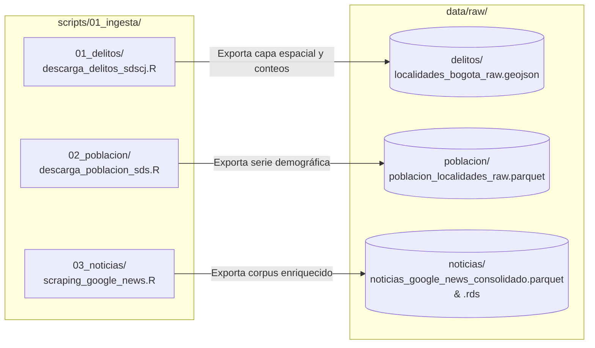

# Módulo 01: Ingesta de Datos y Descarga de Fuentes Externas

Esta carpeta concentra de manera exclusiva y estructurada **todo el código responsable de la descarga, extracción y recolección de datos externos** para el proyecto *Hurtos y Sentimiento Mediático en Bogotá (2022–2026)*.

---

## 1. Principio Fundamental de Arquitectura

> [!IMPORTANT]
> **Aislamiento Estricto de Descargas:** Ningún script por fuera de `scripts/01_ingesta/` tiene permitido realizar peticiones de red, llamadas a APIs externas o descargas de archivos (`download.file`, `GET`, etc.). Todos los módulos posteriores (`02_limpieza_indicadores.R`, `02_limpieza_texto_noticias.R`, `03_analisis_sentometrics.R`, etc.) consumen exclusivamente los datos ya materializados localmente en `data/raw/`.

---

## 2. Organización Modular y Mapeo con `data/raw/`

El módulo está subdividido en tres carpetas temáticas independientes. Cada carpeta contiene su propio script de descarga y exporta su resultado a una subcarpeta coincidente dentro de `data/raw/`:

```text
scripts/01_ingesta/
├── README.md                      # Esta guía general de arquitectura
├── 01_delitos/                    # Ingesta de criminalidad y cartografía distrital
│   ├── descarga_delitos_sdscj.R   # Script de descarga y extracción oficial
│   └── README.md                  # Ficha técnica y variables de Delitos SDSCJ
├── 02_poblacion/                  # Ingesta de proyecciones demográficas
│   ├── descarga_poblacion_sds.R   # Script de consulta API CKAN / fallback CSV
│   └── README.md                  # Ficha técnica y estructura poblacional SDS
└── 03_noticias/                   # Ingesta y scraping de prensa digital
    ├── scraping_google_news.R     # Script único de recolección RSS y consolidación
    └── README.md                  # Protocolo de búsqueda booleana y filtros
```

### Correspondencia 1 a 1 de Almacenamiento:



---

## 3. Resumen de Fuentes e Insumos Producidos

| Submódulo | Fuente Oficial / Motor | Archivo de Salida en `data/raw/` | Formato | Cobertura Temporal |
| :--- | :--- | :--- | :---: | :---: |
| [**`01_delitos/`**](file:///scripts/01_ingesta/01_delitos/README.md) | Secretaría de Seguridad (SDSCJ / SIEDCO) | `delitos/localidades_bogota_raw.geojson` | GeoJSON vectorial | 2018–2026 (Corte a Septiembre) |
| [**`02_poblacion/`**](file:///scripts/01_ingesta/02_poblacion/README.md) | Secretaría de Salud (SDS) | `poblacion/poblacion_localidades_raw.parquet` | Apache Parquet | 2005–2035 (Proyecciones oficiales) |
| [**`03_noticias/`**](file:///scripts/01_ingesta/03_noticias/README.md) | Google News RSS (Prensa Nacional/Local) | `noticias/noticias_google_news_consolidado.parquet` | Apache Parquet / RDS | 2022-01-01 a 2026-09-30 (3.916 noticias) |

---

## 4. Modos de Ejecución

Los scripts pueden ejecutarse de manera individual e independiente según la necesidad de actualización, o de forma orquestada a través del pipeline general:

### Ejecución por Fuente
Desde la consola de RStudio en la raíz del proyecto:
```r
# 1. Descargar delitos y mapa oficial
source(here::here("scripts", "01_ingesta", "01_delitos", "descarga_delitos_sdscj.R"))

# 2. Descargar población proyectada
source(here::here("scripts", "01_ingesta", "02_poblacion", "descarga_poblacion_sds.R"))

# 3. Consolidar noticias de prensa
source(here::here("scripts", "01_ingesta", "03_noticias", "scraping_google_news.R"))
```

---

## 5. Idempotencia y Resiliencia

1. **Idempotencia:** Si los archivos en `data/raw/` ya existen y superan los chequeos de integridad, los scripts de ingesta omiten la descarga remota redundante, ahorrando ancho de banda y evitando sobrecarga en los servidores del Distrito.
2. **Mecanismos de Respaldo (*Fallback*):** Tanto en delitos como en población se implementan rutas de descarga alternativas ante eventuales caídas de la API CKAN o del portal de Datos Abiertos de Bogotá.
