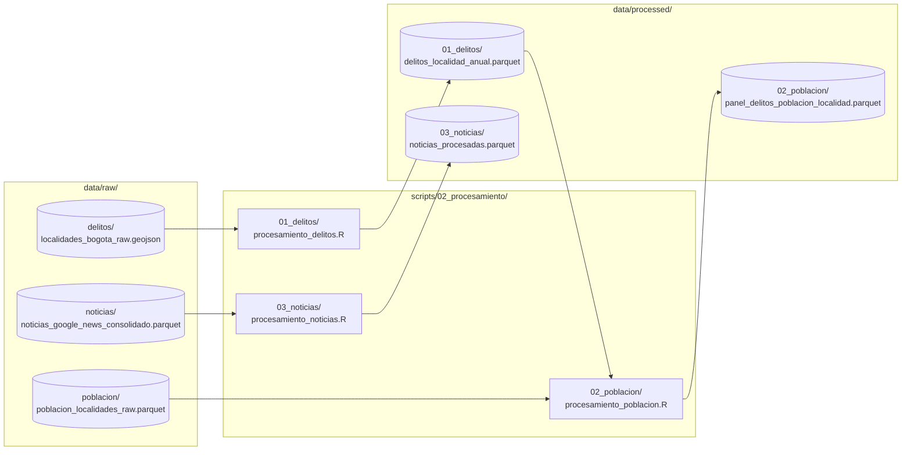

# Módulo 02: Procesamiento y Transformación de Datos

Esta carpeta concentra **todos los scripts responsables de transformar la información cruda (`data/raw/`) en conjuntos procesados y normalizados (`data/processed/`)** para el proyecto *Hurtos y Sentimiento Mediático en Bogotá (2022–2026)*.

---

## 1. Principio Fundamental de Arquitectura

> [!IMPORTANT]
> **Consumo Exclusivo de Data Raw:** Ningún script de `02_procesamiento/` realiza descargas desde internet. Todos leen los insumos almacenados en `data/raw/`, aplican transformaciones vectorizadas y almacenan las tablas normalizadas en `data/processed/` bajo formato columnar optimizado (Apache Parquet).

---

## 2. Estructura Simétrica con `01_ingesta/` y `data/processed/`

Al igual que el módulo de ingesta, `02_procesamiento/` se divide en tres subcarpetas temáticas que procesan sus respectivas fuentes, cada una gobernada por **un único script definitivo** que exporta **exactamente un archivo**:

```text
scripts/02_procesamiento/
├── README.md                      # Esta guía general de procesamiento
├── 01_delitos/                    # Procesamiento de la capa delictiva SDSCJ
│   ├── procesamiento_delitos.R    # Transforma delitos raw en panel anual 2022-2026
│   └── README.md                  # Ficha de variables delictivas procesadas
├── 02_poblacion/                  # Procesamiento demográfico y cálculo de tasas
│   ├── procesamiento_poblacion.R  # Agrega habitantes SDS y calcula tasas por 100k hab
│   └── README.md                  # Ficha de indicadores demográficos y tasas
└── 03_noticias/                   # Procesamiento NLP y catálogo DAI (SDSCJ)
    ├── procesamiento_noticias.R   # Limpieza NLP + Reclasificación en 11 DAI oficiales
    └── README.md                  # Protocolo de filtrado, diccionarios y auditoría
```

### Mapeo de Flujo: De `data/raw/` a `data/processed/`



---

## 3. Resumen de Entradas y Salidas

| Submódulo | Script | Entrada Cruda (`data/raw/`) | Salida Procesada (`data/processed/`) |
| :--- | :--- | :--- | :--- |
| **`01_delitos/`** | `procesamiento_delitos.R` | `delitos/localidades_bogota_raw.geojson` | `01_delitos/delitos_localidad_anual.parquet` |
| **`02_poblacion/`** | `procesamiento_poblacion.R` | `poblacion/poblacion_localidades_raw.parquet` | `02_poblacion/panel_delitos_poblacion_localidad.parquet` |
| **`03_noticias/`** | `procesamiento_noticias.R` | `noticias/noticias_google_news_consolidado.parquet` | `03_noticias/noticias_procesadas.parquet` |

---

## 4. Ejecución del Módulo

Para procesar todos los datos secuencialmente:

```r
# 1. Delitos oficiales
source(here::here("scripts", "02_procesamiento", "01_delitos", "procesamiento_delitos.R"))

# 2. Población y tasas
source(here::here("scripts", "02_procesamiento", "02_poblacion", "procesamiento_poblacion.R"))

# 3. Limpieza NLP y clasificación DAI de noticias
source(here::here("scripts", "02_procesamiento", "03_noticias", "procesamiento_noticias.R"))
```
