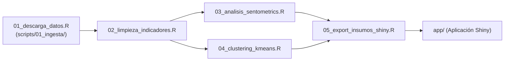

# Scripts y pipeline de procesamiento en R

En esta carpeta está el código en R que hace todo el trabajo técnico: descargar los datos, limpiarlos, calcular las tasas de hurto, medir el sentimiento de las noticias con `sentometrics`, agrupar las localidades con $K$-means y preparar los datos para la aplicación interactiva de Shiny.

---

## 1. Cómo corre el pipeline

Para ejecutar todo el flujo de principio a fin de forma automática:
```r
source(here::here("scripts", "master.R"))
```

### Orden de ejecución de los scripts:



1. **[`master.R`](file:///Users/juanjoseecheverry/Library/Mobile%20Documents/com~apple~CloudDocs/Universidad/Maestria%20%28MECA%29/Primer%20semestre/Taller%20R/Repo_Entrega_Final_Taller_R/scripts/master.R):** El script orquestador. Carga las librerías, fija la semilla de reproducibilidad, define las rutas con `{here}` y llama cada módulo en orden comprobando que los archivos generados queden bien guardados.
2. **[`01_descarga_datos.R`](file:///Users/juanjoseecheverry/Library/Mobile%20Documents/com~apple~CloudDocs/Universidad/Maestria%20%28MECA%29/Primer%20semestre/Taller%20R/Repo_Entrega_Final_Taller_R/scripts/01_descarga_datos.R):** Coordina los dos tipos de descargas que tenemos en `scripts/01_ingesta/`.
3. **[`scripts/01_ingesta/`](file:///Users/juanjoseecheverry/Library/Mobile%20Documents/com~apple~CloudDocs/Universidad/Maestria%20%28MECA%29/Primer%20semestre/Taller%20R/Repo_Entrega_Final_Taller_R/scripts/01_ingesta):**
   * [**`01_datos_abiertos/`**](file:///Users/juanjoseecheverry/Library/Mobile%20Documents/com~apple~CloudDocs/Universidad/Maestria%20%28MECA%29/Primer%20semestre/Taller%20R/Repo_Entrega_Final_Taller_R/scripts/01_ingesta/01_datos_abiertos): Descarga datos de la Alcaldía (delitos, población y mapas) usando la API Socrata con filtros SQL, guardando todo en formato Parquet.
   * [**`02_scraping_noticias/`**](file:///Users/juanjoseecheverry/Library/Mobile%20Documents/com~apple~CloudDocs/Universidad/Maestria%20%28MECA%29/Primer%20semestre/Taller%20R/Repo_Entrega_Final_Taller_R/scripts/01_ingesta/02_scraping_noticias): Descarga noticias de Google News con Selenium mes a mes, guardando por pedazos para no perder avance si se interrumpe la conexión.
4. **[`02_limpieza_indicadores.R`](file:///Users/juanjoseecheverry/Library/Mobile%20Documents/com~apple~CloudDocs/Universidad/Maestria%20%28MECA%29/Primer%20semestre/Taller%20R/Repo_Entrega_Final_Taller_R/scripts/02_limpieza_indicadores.R):** Unifica los nombres de las 19 localidades urbanas, cruza con la población y calcula las tasas de hurto (personas, casas y motos) por cada 100.000 habitantes.
5. **[`03_analisis_sentometrics.R`](file:///Users/juanjoseecheverry/Library/Mobile%20Documents/com~apple~CloudDocs/Universidad/Maestria%20%28MECA%29/Primer%20semestre/Taller%20R/Repo_Entrega_Final_Taller_R/scripts/03_analisis_sentometrics.R):** Construye el corpus de noticias, aplica el diccionario de polaridad NRC en español y calcula el sentimiento promedio de las noticias por localidad y año.
6. **[`04_clustering_kmeans.R`](file:///Users/juanjoseecheverry/Library/Mobile%20Documents/com~apple~CloudDocs/Universidad/Maestria%20%28MECA%29/Primer%20semestre/Taller%20R/Repo_Entrega_Final_Taller_R/scripts/04_clustering_kmeans.R):** Estandariza las tasas de delito, encuentra el número adecuado de grupos con el método de la silueta y agrupa las localidades con perfiles similares de inseguridad.
7. **[`05_export_insumos_shiny.R`](file:///Users/juanjoseecheverry/Library/Mobile%20Documents/com~apple~CloudDocs/Universidad/Maestria%20%28MECA%29/Primer%20semestre/Taller%20R/Repo_Entrega_Final_Taller_R/scripts/05_export_insumos_shiny.R):** Junta las tasas, el sentimiento, los clústeres y los mapas en un solo archivo optimizado (`data/processed/datos_consolidados_shiny.rds`) para que la app de Shiny cargue de inmediato.

---

## 2. Reglas de estilo para el equipo
Antes de modificar o agregar scripts a esta carpeta, revisa [**`docs/estandares_programacion.md`**](file:///Users/juanjoseecheverry/Library/Mobile%20Documents/com~apple~CloudDocs/Universidad/Maestria%20%28MECA%29/Primer%20semestre/Taller%20R/Repo_Entrega_Final_Taller_R/docs/estandares_programacion.md):
* Secciones organizadas con `# 1. ----` para que aparezcan en el Document Outline de RStudio (`Cmd + Shift + O`).
* Cero `setwd()` y cero rutas absolutas tipo `/Users/...`: usamos siempre `here::here()`.
* Usar los verbos de `dplyr` y el pipe nativo `|>`.
