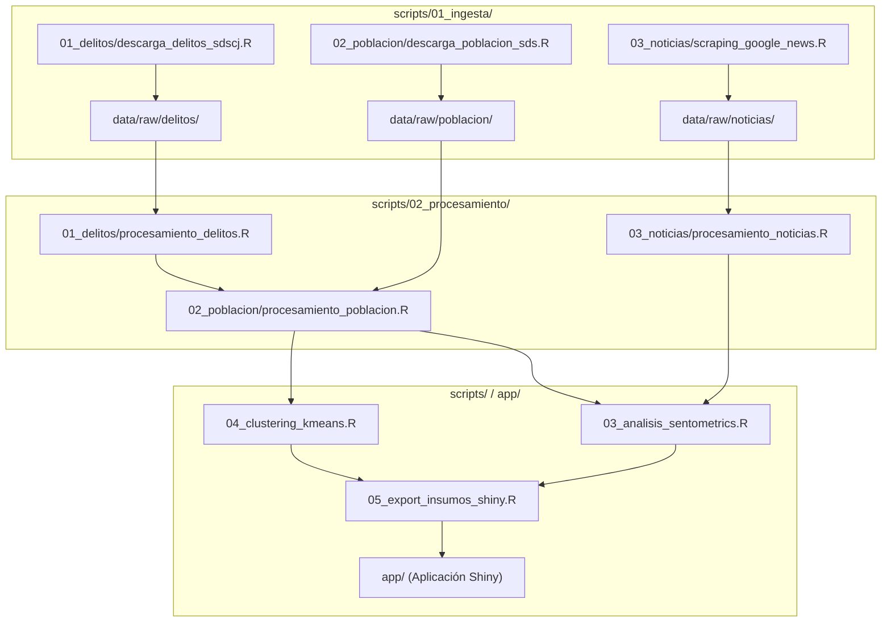

# Scripts y Pipeline de Procesamiento en R

En esta carpeta se encuentra el código en R estructurado para la ejecución técnica del proyecto: descarga e ingesta modular de datos abiertos y noticias, depuración léxica y de indicadores, análisis de sentimiento con `sentometrics`, clustering con $K$-means y preparación de insumos para la aplicación Shiny.

---

## 1. Flujo Secuencial de Ejecución

Cada módulo está diseñado para ejecutarse de manera autónoma y secuencial según la etapa del flujo analítico:

### Orden de Ejecución:

1. **Ingesta de Fuentes Externas ([`scripts/01_ingesta/`](01_ingesta/README.md)):**
   * [`01_delitos/descarga_delitos_sdscj.R`](01_ingesta/01_delitos/descarga_delitos_sdscj.R): Ingesta de la capa cartográfica y delictiva oficial SDSCJ (`data/raw/delitos/localidades_bogota_raw.geojson`).
   * [`02_poblacion/descarga_poblacion_sds.R`](01_ingesta/02_poblacion/descarga_poblacion_sds.R): Ingesta de proyecciones demográficas de la Secretaría Distrital de Salud (`data/raw/poblacion/poblacion_localidades_raw.parquet`).
   * [`03_noticias/scraping_google_news.R`](01_ingesta/03_noticias/scraping_google_news.R): Ingesta y consolidación de prensa digital vía Google News RSS (`data/raw/noticias/noticias_google_news_consolidado.parquet`).

2. **Procesamiento y Transformación ([`scripts/02_procesamiento/`](02_procesamiento/README.md)):**
   * [`01_delitos/procesamiento_delitos.R`](02_procesamiento/01_delitos/procesamiento_delitos.R): Estructuración del panel mensual de delitos SIEDCO 2022–sep. 2026 (`data/processed/01_delitos/delitos_localidad_mensual.parquet`, `1.083` filas).
   * [`02_poblacion/procesamiento_poblacion.R`](02_procesamiento/02_poblacion/procesamiento_poblacion.R): Agregación demográfica y cálculo de tasas mensuales por 100k hab (`data/processed/02_poblacion/panel_delitos_poblacion_mensual.parquet`).
   * [`03_noticias/procesamiento_noticias.R`](02_procesamiento/03_noticias/procesamiento_noticias.R): Limpieza NLP del cuerpo editorial y clasificación jerárquica SDSCJ sobre el corpus completo (`data/processed/03_noticias/noticias_procesadas.parquet`, `3.916` notas).

3. **Agrupamiento Territorial ($K$-Means) y Sensibilidad Tidymodels:**
   * [`04_clustering_kmeans.R`](04_clustering_kmeans.R): Anualiza las tasas mensuales de SIEDCO, estandariza en $Z$-scores, evalúa silueta e inercia ($K = 2 \dots 6$), clasifica las 19 localidades en $K^* = 3$ perfiles (*Residencial y Periférico* `13`, *Céntrico e Institucional* `5`, *Comercial y Automotor* `1`: Los Mártires), ejecuta análisis de sensibilidad con `{tidymodels}`/`{recipes}` (Min-Max, Robusto, Log+Z, PCA 2D) y modelos alternativos (PAM Euclidiana/Manhattan, AGNES Ward.D2, GMM) exportando `clusters_localidades_kmeans.parquet` y cuatro tablas CSV en `output/tables/`.

4. **Pipeline Completo de Sentimiento (`sentometrics` — Corpus objetivo y diseño de `36` series):**
   * [`03_analisis_sentometrics.R`](03_analisis_sentometrics.R): Filtra el corpus a las **`993` noticias objetivo** de las 3 modalidades SIEDCO (*Hurto a personas*, *Hurto a residencias* y *Hurto de motocicletas*), construye `sento_corpus` con `6` covariables binarias sin guiones (`c_centro`, `c_comercial`, `c_residencial`, `tema_hurto_personas`, `tema_hurto_residencias`, `tema_hurto_motos`), integra los léxicos `nrc_es` y `crimen_es` con modificadores de valencia, calcula puntajes documentales (`how = "proportionalPol"`), extrae noticias extremas (`peakdocs()`), construye las **`36` series mensuales** (`2 × 6 × 3`, esquemas `linear`, `exponential0.5`, `beta22` con `lag = 6`), calcula el índice global y `peakdates()`, estima Elastic Net (`BIC`, `h = 1`) contra la tasa mensual real observada en `SIEDCO.csv`, consolida todo en un único archivo `data/processed/sentometrics_pipeline.rds` y actualiza `panel_consolidado_localidad_anual.parquet`.

5. **Estadísticos Descriptivos del Corpus (`T-08`):**
   * [`06_descriptivos_corpus.R`](06_descriptivos_corpus.R): Lee `sentometrics_pipeline.rds` y `noticias_procesadas.parquet`, genera las figuras `figura3` a `figura9` en `output/figures/` (con facetas legibles de las `6` covariables objetivo en `figura9`) y exporta `output/tables/tabla_descriptivos_corpus.csv`.

6. **Exportación de Insumos para Shiny y Orquestación:**
   * [`05_export_insumos_shiny.R`](05_export_insumos_shiny.R): Empaqueta indicadores, clústeres, los objetos `sentometrics` y las geometrías poligonales (`EPSG:4326`) en `data/processed/datos_consolidados_shiny.rds`.
   * [`master.R`](master.R): Script maestro que ejecuta en orden secuencial todos los módulos anteriores desde una sesión limpia.

---

## 2. Reglas de Estilo del Proyecto
* Secciones organizadas con encabezados comentados de nivel `# 1. ----` legibles por el Document Outline de RStudio.
* Uso estricto de rutas relativas con `here::here()`: prohibido el uso de `setwd()`.
* Sintaxis idiomática tidyverse (`dplyr`, `tidyr`, `stringr`) y operador nativo de tubería (`|>`).
