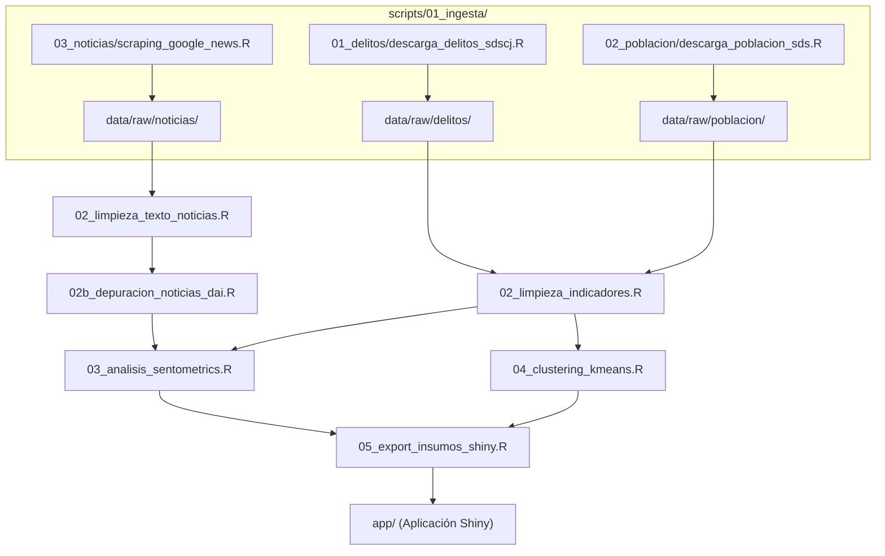

# Scripts y Pipeline de Procesamiento en R

En esta carpeta se encuentra el código en R estructurado para la ejecución técnica del proyecto: descarga e ingesta modular de datos abiertos y noticias, depuración léxica y de indicadores, análisis de sentimiento con `sentometrics`, clustering con $K$-means y preparación de insumos para la aplicación Shiny.

---

## 1. Flujo Secuencial del Pipeline

Para ejecutar todo el flujo de principio a fin de manera reproducible:

```r
source(here::here("scripts", "master.R"))
```

### Arquitectura de Scripts:



### Detalle de Módulos:

1. **[`master.R`](file:///g:/My%20Drive/Github/Repo_Entrega_Final_Taller_R/scripts/master.R):** Script orquestador general del repositorio. Inicializa dependencias, resuelve conflictos de funciones con `{conflicted}`, fija la semilla pseudoaleatoria y corre los módulos secuencialmente auditando la existencia de los artefactos.
2. **[`scripts/01_ingesta/`](file:///g:/My%20Drive/Github/Repo_Entrega_Final_Taller_R/scripts/01_ingesta):** Contiene de forma exclusiva todos los scripts de descarga de información externa, organizados en subcarpetas temáticas:
   * **`01_delitos/`:** Ingesta de la capa cartográfica y delictiva oficial SDSCJ (`localidades_bogota_raw.geojson`).
   * **`02_poblacion/`:** Ingesta de proyecciones demográficas de la Secretaría Distrital de Salud (`poblacion_localidades_raw.parquet`).
   * **`03_noticias/`:** Scraping y consolidación de prensa digital vía Google News RSS (`noticias_google_news_consolidado.parquet`).
3. **[`02_limpieza_indicadores.R`](file:///g:/My%20Drive/Github/Repo_Entrega_Final_Taller_R/scripts/02_limpieza_indicadores.R):** Lee los datos crudos locales de `data/raw/delitos/` y `data/raw/poblacion/` (sin descargas directas), unifica las 19 localidades urbanas y computa las tasas delictivas anuales por 100.000 habitantes (2022–2026).
4. **[`02_limpieza_texto_noticias.R`](file:///g:/My%20Drive/Github/Repo_Entrega_Final_Taller_R/scripts/02_limpieza_texto_noticias.R) y [`02b_depuracion_noticias_dai.R`](file:///g:/My%20Drive/Github/Repo_Entrega_Final_Taller_R/scripts/02b_depuracion_noticias_dai.R):** Limpieza, normalización y depuración temático-espacial del corpus periodístico según los 11 Delitos de Alto Impacto.
5. **[`03_analisis_sentometrics.R`](file:///g:/My%20Drive/Github/Repo_Entrega_Final_Taller_R/scripts/03_analisis_sentometrics.R):** Construye el corpus de noticias, aplica el diccionario léxico de valencia NRC en español y calcula el sentimiento promedio anual por localidad.
6. **[`04_clustering_kmeans.R`](file:///g:/My%20Drive/Github/Repo_Entrega_Final_Taller_R/scripts/04_clustering_kmeans.R):** Estandariza tasas, evalúa métricas de silueta y agrupa localidades con perfiles similares de inseguridad ($K^* = 3$).
7. **[`05_export_insumos_shiny.R`](file:///g:/My%20Drive/Github/Repo_Entrega_Final_Taller_R/scripts/05_export_insumos_shiny.R):** Empaqueta indicadores, clusters, sentimiento y geometrías poligonales simplificadas en un archivo binario consolidado para la aplicación interactiva.

---

## 2. Reglas de Estilo del Proyecto
* Secciones organizadas con encabezados comentados de nivel `# 1. ----` legibles por el Document Outline de RStudio.
* Uso estricto de rutas relativas con `here::here()`: prohibido el uso de `setwd()`.
* Sintaxis idiomática tidyverse (`dplyr`, `tidyr`, `stringr`) y operador nativo de tubería (`|>`).
