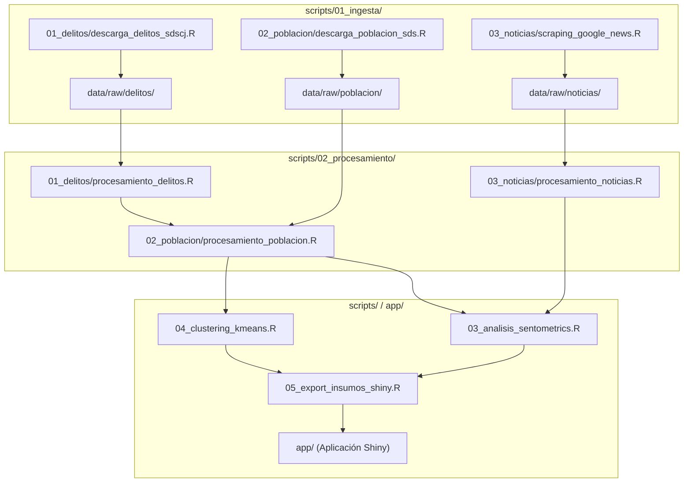

# Scripts y Pipeline de Procesamiento en R

En esta carpeta se encuentra el código en R estructurado para la ejecución técnica del proyecto: descarga e ingesta modular de datos abiertos y noticias, depuración léxica y de indicadores, análisis de sentimiento con `sentometrics`, clustering con $K$-means y preparación de insumos para la aplicación Shiny.

---

## 1. Flujo Secuencial de Ejecución

Cada módulo está diseñado para ejecutarse de manera autónoma y secuencial según la etapa del flujo analítico:

### Orden de Ejecución:

1. **Ingesta de Fuentes Externas ([`scripts/01_ingesta/`](file:///scripts/01_ingesta/)):**
   * [`01_delitos/descarga_delitos_sdscj.R`](file:///scripts/01_ingesta/01_delitos/descarga_delitos_sdscj.R): Ingesta de la capa cartográfica y delictiva oficial SDSCJ (`data/raw/delitos/localidades_bogota_raw.geojson`).
   * [`02_poblacion/descarga_poblacion_sds.R`](file:///scripts/01_ingesta/02_poblacion/descarga_poblacion_sds.R): Ingesta de proyecciones demográficas de la Secretaría Distrital de Salud (`data/raw/poblacion/poblacion_localidades_raw.parquet`).
   * [`03_noticias/scraping_google_news.R`](file:///scripts/01_ingesta/03_noticias/scraping_google_news.R): Ingesta y consolidación de prensa digital vía Google News RSS (`data/raw/noticias/noticias_google_news_consolidado.parquet`).

2. **Procesamiento y Transformación ([`scripts/02_procesamiento/`](file:///scripts/02_procesamiento/)):**
   * [`01_delitos/procesamiento_delitos.R`](file:///scripts/02_procesamiento/01_delitos/procesamiento_delitos.R): Estructuración del panel de delitos 2022–2026 (`data/processed/01_delitos/delitos_localidad_anual.parquet`).
   * [`02_poblacion/procesamiento_poblacion.R`](file:///scripts/02_procesamiento/02_poblacion/procesamiento_poblacion.R): Agregación demográfica y cálculo de tasas por 100k hab (`data/processed/02_poblacion/panel_delitos_poblacion_localidad.parquet`).
   * [`03_noticias/procesamiento_noticias.R`](file:///scripts/02_procesamiento/03_noticias/procesamiento_noticias.R): Limpieza NLP del cuerpo editorial y clasificación en 11 DAI oficiales SDSCJ (`data/processed/03_noticias/noticias_procesadas.parquet`).

3. **Análisis Cuantitativo de Sentimiento:**
   * [`03_analisis_sentometrics.R`](file:///scripts/03_analisis_sentometrics.R): Aplica el diccionario léxico de valencia NRC en español, calcula la polaridad neta proporcional por documento y fusiona las métricas con el panel delictivo oficial.

4. **Clustering Territorial ($K$-Means):**
   * [`04_clustering_kmeans.R`](file:///scripts/04_clustering_kmeans.R): Estandariza tasas, evalúa métricas de silueta y agrupa localidades con perfiles similares de inseguridad ($K^* = 3$).

5. **Exportación de Insumos para Shiny:**
   * [`05_export_insumos_shiny.R`](file:///scripts/05_export_insumos_shiny.R): Empaqueta indicadores, clusters, sentimiento y geometrías poligonales simplificadas en un archivo binario consolidado (`data/processed/datos_consolidados_shiny.rds`) para la aplicación interactiva.

---

## 2. Reglas de Estilo del Proyecto
* Secciones organizadas con encabezados comentados de nivel `# 1. ----` legibles por el Document Outline de RStudio.
* Uso estricto de rutas relativas con `here::here()`: prohibido el uso de `setwd()`.
* Sintaxis idiomática tidyverse (`dplyr`, `tidyr`, `stringr`) y operador nativo de tubería (`|>`).
