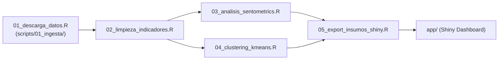

# Pipeline de Procesamiento y Scripts en R

Esta carpeta alberga el pipeline modular de scripts del proyecto, estructurado para garantizar que cualquier persona pueda reproducir el análisis completo desde una sesión limpia de R.

---

## 1. Orden de Ejecución del Pipeline

Para ejecutar todo el flujo de inicio a fin de forma automatizada:
```r
source(here::here("scripts", "master.R"))
```

### Módulos del Pipeline:



1. **[`master.R`](file:///Users/juanjoseecheverry/Library/Mobile%20Documents/com~apple~CloudDocs/Universidad/Maestria%20%28MECA%29/Primer%20semestre/Taller%20R/Repo_Entrega_Final_Taller_R/scripts/master.R):** Script orquestador general. Inicializa librerías, resuelve conflictos con `{conflicted}`, fija semillas y rutas relativas con `{here}`, y ejecuta los módulos secuencialmente auditando la existencia de los artefactos resultantes.
2. **[`01_descarga_datos.R`](file:///Users/juanjoseecheverry/Library/Mobile%20Documents/com~apple~CloudDocs/Universidad/Maestria%20%28MECA%29/Primer%20semestre/Taller%20R/Repo_Entrega_Final_Taller_R/scripts/01_descarga_datos.R):** Orquestador del módulo de ingesta que coordina las descargas de `scripts/01_ingesta/`.
3. **[`scripts/01_ingesta/`](file:///Users/juanjoseecheverry/Library/Mobile%20Documents/com~apple~CloudDocs/Universidad/Maestria%20%28MECA%29/Primer%20semestre/Taller%20R/Repo_Entrega_Final_Taller_R/scripts/01_ingesta):**
   * [**`datos_abiertos_bogota.R`**](file:///Users/juanjoseecheverry/Library/Mobile%20Documents/com~apple~CloudDocs/Universidad/Maestria%20%28MECA%29/Primer%20semestre/Taller%20R/Repo_Entrega_Final_Taller_R/scripts/01_ingesta/datos_abiertos_bogota.R): Consultas SoQL a Socrata vía `httr` y `jsonlite` para Delitos de Alto Impacto (2022–2025), Población y Cartografía oficial de localidades. Guarda en `data/raw/*.parquet`.
   * [**`scraping_google_news.R`**](file:///Users/juanjoseecheverry/Library/Mobile%20Documents/com~apple~CloudDocs/Universidad/Maestria%20%28MECA%29/Primer%20semestre/Taller%20R/Repo_Entrega_Final_Taller_R/scripts/01_ingesta/scraping_google_news.R): Scraping robusto con `RSelenium` usando consultas booleanas (`+palabras`), navegación mensual `MM/DD/YYYY`, *checkpointing* incremental en `data/raw/noticias/*.parquet`, extracción de cuerpo en dos fases con fallback al resumen y validación territorial.
4. **[`02_limpieza_indicadores.R`](file:///Users/juanjoseecheverry/Library/Mobile%20Documents/com~apple~CloudDocs/Universidad/Maestria%20%28MECA%29/Primer%20semestre/Taller%20R/Repo_Entrega_Final_Taller_R/scripts/02_limpieza_indicadores.R):** Normalización de nombres de las 19 localidades urbanas, cruce con proyecciones poblacionales y cálculo de tasas de hurto a personas, residencias y motos por cada 100.000 habitantes.
5. **[`03_analisis_sentometrics.R`](file:///Users/juanjoseecheverry/Library/Mobile%20Documents/com~apple~CloudDocs/Universidad/Maestria%20%28MECA%29/Primer%20semestre/Taller%20R/Repo_Entrega_Final_Taller_R/scripts/03_analisis_sentometrics.R):** Creación del corpus fechado (`sento_corpus`), aplicación del léxico NRC en español para polaridad y cómputo de métricas por Localidad × Año.
6. **[`04_clustering_kmeans.R`](file:///Users/juanjoseecheverry/Library/Mobile%20Documents/com~apple~CloudDocs/Universidad/Maestria%20%28MECA%29/Primer%20semestre/Taller%20R/Repo_Entrega_Final_Taller_R/scripts/04_clustering_kmeans.R):** Estandarización de tasas, selección de $K$ óptimo mediante método de la silueta y asignación de perfiles de inseguridad.
7. **[`05_export_insumos_shiny.R`](file:///Users/juanjoseecheverry/Library/Mobile%20Documents/com~apple~CloudDocs/Universidad/Maestria%20%28MECA%29/Primer%20semestre/Taller%20R/Repo_Entrega_Final_Taller_R/scripts/05_export_insumos_shiny.R):** Enlace de bases limpias, integración con geometrías y exportación del objeto optimizado `data/processed/datos_consolidados_shiny.rds`.

---

## 2. Reglas de Estilo para Nuevos Scripts
Todo código añadido a esta carpeta debe cumplir con [**`docs/estandares_programacion.md`**](file:///Users/juanjoseecheverry/Library/Mobile%20Documents/com~apple~CloudDocs/Universidad/Maestria%20%28MECA%29/Primer%20semestre/Taller%20R/Repo_Entrega_Final_Taller_R/docs/estandares_programacion.md):
* Encabezados jerárquicos `# 1. ----` y `## 1.1 ----` legibles desde el Outline de RStudio (`Cmd + Shift + O`).
* Sin `setwd()` ni rutas absolutas: todas las rutas usan `here::here()`.
* Uso explícito de verbos de `dplyr` y pipe nativo `|>`.
